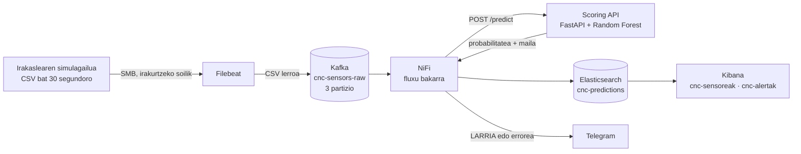

# CNC Guard — CNC makinen mantentze prediktiboa

**AABD Espezializazioa · Erronka 1 · Uni Eibar-Ermua · 5. taldea · 2026-2027**

ARAKAIN Makineriak 50 CNC makina ditu Bilbon, eta makina bat geldirik egoteak **1.200 € balio du orduko**. Orain arte makina hautsi, gelditu eta konpondu egiten zen (mantentze korrektiboa). **CNC Guard-ek hutsegiteak gertatu aurretik abisatzen du**: makinen sentsore-datuak denbora errealean jasotzen ditu, Random Forest eredu batek irakurketa bakoitzaren hutsegite-probabilitatea kalkulatzen du, eta arriskua handia denean alerta bat sortzen da Kibanan eta Telegram-en.


### Emaitzak begi-kolpe batean

| | Notebook-a (validation, 1.600 irakurketa) | Ekoizpenean (simulagailua, 7.550 irakurketa) |
|---|---|---|
| Garaiz detektatutako hutsegiteak (**recall**) | **% 89** (54tik 48) | **% 91** (257tik 235) |
| Alerta zuzenak (**precision**) | % 41 | % 40 |
| Erroreen kostua, CNC Guard-ekin | 39.150 € | 159.150 € |
| Erroreen kostua, sistemarik gabe | 259.200 € | 1.233.600 € |

Ereduak ekoizpenean notebook-ean bezain ondo funtzionatzen du: ez da "buruz ikasi" duen eredu bat. Kostuak nola kalkulatzen diren [7. atalean](#7-emaitzak-ekoizpenean) eta [8. atalean](#8-enpresarentzat-zer-egin-alerta-bakoitzarekin) dago.

---

## Aurkibidea

0. [Sistema adimenduna](#0-cnc-guard-sistema-adimendun-gisa)
1. [Arkitektura](#1-arkitektura)
2. [Datuak eta datuen kalitatea](#2-datuak-eta-datuen-kalitatea)
3. [Eredua (2. fasea)](#3-eredua-2-fasea)
4. [Iragarpenak denbora errealean (3. fasea)](#4-iragarpenak-denbora-errealean-3-fasea)
5. [Dashboard-ak](#5-dashboard-ak)
6. [Datuak ez galtzeko neurriak](#6-datuak-ez-galtzeko-neurriak)
7. [Emaitzak ekoizpenean](#7-emaitzak-ekoizpenean)
8. [Enpresarentzat](#8-enpresarentzat-zer-egin-alerta-bakoitzarekin)
9. [Erabaki teknikoak eta mugak](#9-erabaki-teknikoak-eta-mugak)
10. [Abiarazi](#10-abiarazi)
11. [Karpetak eta dokumentazioa](#11-karpetak-eta-dokumentazioa)

---

## 0. CNC Guard sistema adimendun gisa

CNC Guard ez da programa bakar bat: elkarlanean ari diren hiru geruzako **sistema adimendun** bat da.

| Geruza | Zer egiten du | Gure osagaiak |
|---|---|---|
| **Pertzepzioa** (zentzumenak) | Makinen egoera neurtu eta datuak bildu | Simulagailua → Filebeat → Kafka → NiFi |
| **Inferentzia** (burmuina) | Datuetatik ondorioa atera: makina honek huts egingo al du? | Random Forest eredua, scoring API-an |
| **Erantzuna** (ekintza) | Arriskua jakinarazi, norbaitek erabaki dezan | Alerta-mailak (OK / KONTUZ / LARRIA), Kibana eta Telegram |

**Offline ikaskuntza eta denbora errealeko inferentzia bereizita daude.** Eredua behin entrenatzen da datu historikoekin (notebook-a) eta `.pkl` fitxategi batean gordetzen da. API-ak eredu hori erabiltzen du irakurketa berri bakoitzerako, ikasten jarraitu gabe. Horri esker iragarpenak azkarrak eta egonkorrak dira, eta eredua berriz entrena daiteke sistema gelditu gabe.

**Kontrol-begizta eta autonomia-maila:** sistemak makinak behatzen ditu, arriskua kalkulatzen du eta abisatu egiten du, baina **ez du makina gelditzen**. Azken erabakia mantentze-arduradunak hartzen du (*human-in-the-loop*). Nahita aukeratu dugu: makinak bere kabuz geldituko balitu, segurtasun-osagai bihurtuko litzateke, eta AI Act-en arabera arrisku altuko sistema izango litzateke.

CNC Guard **AA ahularen** adibide bat da: ataza bakarrerako optimizatuta dago (hutsegiteak iragartzea), eta ez du beste ezer egiten.

---

## 1. Arkitektura



| Osagaia | Zertarako | Zergatik hau |
|---|---|---|
| **Filebeat** | CSV fitxategiak lerroz lerro irakurri eta Kafka-ra bidali | *Registry*-ak gogoratzen du zer irakurri duen: berrabiaraztean ez du ezer bikoizten ez galtzen |
| **Kafka** | Mezuen *buffer*-a | NiFi edo API-a gelditzen badira, mezuek Kafka-n itxaroten dute (offset-ak) |
| **NiFi** | Datuak eraldatu, API-ra bidali, gorde eta alertak bideratu | *Record* prozesadoreek datu-motak errespetatzen dituzte; `RouteOnAttribute`-k LARRIA alertak bereizten ditu |
| **Scoring API** | Iragarpena egin | FastAPI. Eredua behin kargatzen du abiaraztean (`lifespan`); *Bearer token* bidez babestuta |
| **Elasticsearch** | Datuak gorde eta bilatu | *Mapping* esplizitua (`date`, `keyword`, `float`, `boolean`) eta *ingest pipeline* bat |
| **Kibana** | Bistaratu | Bi dashboard, 30 segundoro freskatzen dira |

**Fluxu bakarra.** 1. fasean bi NiFi fluxu genituen: bat irakurketak `cnc-sensors`-en gordetzeko eta beste bat iragarpenak `cnc-predictions`-en gordetzeko. Orain **fluxu bakarra** dago: `cnc-predictions`-ek irakurketa bakoitza, bere iragarpena eta benetako etiketa (`machine_failure`) gordetzen ditu dokumentu berean. Horrela bi dashboard-ek indize bera erabiltzen dute, eta irakurketa eta iragarpena gurutzatu beharrik ez dago. `cnc-sensors` indizea (65.000 irakurketa, 2026-10-16tik 29ra) eta `nifi-flows/fase1_ingest.json` 1. faseko emaitza gisa gorde ditugu.


| NiFi-ko urratsa | Prozesadoreak | Zer egiten du |
|---|---|---|
| Irakurri | `ConsumeKafka` (taldea `nifi-cnc-scoring`) | Kafka-ko mezuak hartu |
| Eraldatu | `ConvertRecord` (CSVReader eskema esplizituarekin → JsonRecordSetWriter) | CSV lerroa → JSON, datu-mota zuzenekin |
| Iragarri | `InvokeHTTP` (`POST score-api`) | API-ari deitu; `Retry`/`Failure` bere buruarengana itzultzen dira ("berriro saiatu") |
| Gorde | `InvokeHTTP` (`POST ELASTIC`) | Erantzuna `cnc-predictions`-en gorde, "berriro saiatu" begiztarekin |
| Alerta | `EvaluateJsonPath` → `RouteOnAttribute` (`es_critico`) → `ReplaceText` → `ControlRate` → `InvokeHTTP` | LARRIA bada, Telegram mezua; makina bakoitzeko gehienez mezu bat 2 minututan |
| Errorea | `POST score-api`-ren `No Retry` → `ReplaceText` → `ControlRate` → Telegram | API-ak irakurketa bat baztertzen badu (datu okerra), "DATO NO PROCESADO" abisua |

---

## 2. Datuak eta datuen kalitatea

**Simulagailua:** 30 segundoro `cnc_batch_AAAAMMDD_HHMMSS_NNNNN.csv` fitxategi bat sortzen du, goiburu batekin eta 10 irakurketarekin: minutuko 20 irakurketa, eguneko ~28.800. Datuak AI4I 2020 datu-multzoaren **test** zatitik datoz; ereduak ez ditu inoiz ikusi.

| Eremua | Mota | Azalpena |
|---|---|---|
| `timestamp` | date | Irakurketaren ordua |
| `machine_id` | keyword | CNC-001 … CNC-050 |
| `machine_type` | keyword | L, M edo H |
| `air_temp_K`, `process_temp_K` | float | Aireko eta prozesuko tenperatura. API-ak °C-tara pasatzen ditu (`air_temp_C`, `process_temp_C`) |
| `rpm` | integer | Biraketa-abiadura |
| `torque_Nm` | float | Torque-a (N·m) |
| `tool_wear_min` | integer | Tresnaren higadura (minutuak) |
| `machine_failure` | boolean | Benetan huts egin zuen. **Ereduak ez du ikusten**: ekoizpenean ereduaren asmatze-maila neurtzeko bakarrik gordetzen da |
| `failure_TWF/HDF/PWF/OSF/RNF` | 0/1 | Hutsegite-mota. **Ez dira erabiltzen**: hutsegitea bera dira (*data leakage*) |

**Entrenamendu-datuak:** `data/ai4i2020_train.csv`, 8.000 erregistro, horietatik **271 hutsegite (% 3,39)**. Klase-desoreka handia: 28,5 irakurketa on hutsegite bakoitzeko.


### Datuen kalitatea

Datu okerrek iragarpen okerrak ematen dituzte (adibidez, `rpm = 0` bada `power_est = 0` da, eta ereduak potentzia-hutsegite bat iragarriko luke). Horregatik urrats bakoitzean babes bat dago:

| Arazoa | Non | Nola | Probatua |
|---|---|---|---|
| CSV goiburua datu gisa | Filebeat | `exclude_lines: ['^timestamp']` | ✅ Ez dago goibururik indizeetan |
| Fitxategi bera bi aldiz irakurtzea | Filebeat | Registry-a (`filebeat-data` bolumena) | ✅ IPa aldatzean 303 fitxategi aurkitu eta 93 berriak bakarrik bidali |
| Mota okerrak (testua zenbakiaren ordez) | NiFi | CSVReader eskema esplizituarekin | ✅ JSON-formatuko lerro bat `ConvertRecord`-en baztertu zen |
| Balio ezinezkoak edo makina-mota okerra | Scoring API | Pydantic: `machine_type` L/M/H bakarrik; tenperaturen tarteak, `rpm` > 0, torque eta higadura ≥ 0 | ✅ `machine_type = "T"` → 422 errorea → Telegram abisua (2026-10-29) |
| `machine_id` edo `timestamp` gabeko dokumentuak | Elasticsearch | Ingest pipeline: `drop` | ✅ Proba-dokumentuak baztertuak |
| Bikoiztuak | Elasticsearch | Egiaztapena: makina + ordu bera duten irakurketak | ✅ % 11 inguru, baina neurketa desberdinekin (adib. CNC-047ren 4 irakurketa ordu berean, 0,000 eta 0,125 arteko probabilitateekin): simulagailuaren irakurketa desberdinak dira, ez bikoiztuak |

---

## 3. Eredua (2. fasea)

`notebooks/02_training.ipynb` · eredua: `models/cnc_failure_model.pkl`

**Ezaugarriak (8):** `machine_type`, `air_temp_C`, `process_temp_C`, `temp_diff`, `rpm`, `torque_Nm`, `power_est`, `tool_wear_min`.

| Erabakia | Zer | Zergatik |
|---|---|---|
| Feature engineering | `temp_diff` = prozesuko − aireko tenperatura · `power_est` = torque × rpm × 2π / 60 (watt) · tenperaturak °C-tan | Bi tenperaturen korrelazioa 0,88 da eta rpm–torque −0,87: konbinazioek informazio berria ematen dute. Datuak sortzen dituzten arau fisikoak (bero-disipazioa, potentzia) aldagai hauekin lotuta daude |
| Aurreprozesamendua | `Pipeline`: `SimpleImputer` + `StandardScaler` zenbakietan, `OneHotEncoder` `machine_type`-n | Prozesu bera notebook-ean eta API-an; balio falta edo mota ezezagun batek ez du API-a eroriko |
| Klase-desoreka | `class_weight='balanced'` (SMOTE ere probatu da, `ImbPipeline`-n, entrenamenduan bakarrik) | Datuak aldatu gabe, hutsegite batek 28 irakurketa onen pisua du |
| Eredua | Random Forest, 200 zuhaitz, `random_state=42` | Ez-lineala, sendoa, `feature_importances_` ematen du |
| Atalasea | **0,15** (0,50 beharrean) | Erroreen kostua: FN ≈ 4.800 € (4 h × 1.200 €/h), FP ≈ 150 € |

<p align="center"></p>

### Emaitzak (validation: 1.600 irakurketa, 54 hutsegite)

| Aldaera | Recall | Precision | FN | FP | Kostua |
|---|---|---|---|---|---|
| class_weight, atalasea 0,50 | 0,76 | 0,89 | 13 | 5 | 63.150 € |
| SMOTE, atalasea 0,50 | 0,83 | 0,68 | 9 | 21 | 46.350 € |
| SMOTE, atalasea 0,15 | 0,87 | 0,30 | 7 | 112 | 50.400 € |
| **class_weight, atalasea 0,15 (erabiltzen dena)** | **0,89** | **0,41** | **6** | **69** | **39.150 €** |

ROC-AUC: **0,979**. Kostua = FN × 4.800 € + FP × 150 €.

| Atalasea 0,50 | Atalasea 0,15 |
|---|---|
|  |  |

<p align="center"></p>

**Beste ereduekin alderatuta** (0,15 atalasea):

| Eredua | Familia | Recall | Precision | ROC-AUC | FN | FP | Kostua |
|---|---|---|---|---|---|---|---|
| Erregresio logistikoa | Lineala | 0,98 | 0,07 | 0,923 | 1 | 734 | 114.900 € |
| HistGradientBoosting | Ensemble, boosting | 0,76 | 0,61 | 0,969 | 13 | 26 | 66.300 € |
| **Random Forest** | **Ensemble, bagging** | **0,89** | **0,41** | **0,979** | **6** | **69** | **39.150 €** |

**Balidazio gurutzatua** (5-fold, entrenamendu-datuekin): recall 0,74 ± 0,10 · precision 0,88 ± 0,05 · ROC-AUC 0,978 ± 0,019. Emaitza ez dago zatiketa bakar baten zortearen menpe.

**Aldagai garrantzitsuenak:** `torque_Nm` 0,22 · `tool_wear_min` 0,20 · `rpm` 0,19 · `power_est` 0,19 · `temp_diff` 0,10. Zentzu fisikoa du: higatutako eta esfortzu handia egiten duen tresna bat lehenago apurtzen da. Guk sortutako `power_est` eta `temp_diff` lehen bostetan daude.

**Makinaz makina:** galdutako 6 hutsegiteak L motako 5 makinatan daude (CNC-038 bi aldiz, CNC-040, 041, 042 eta 043). Recall-a: L 0,88 (48tik 42) · M 1,00 (4tik 4) · H 1,00 (2tik 2).

---

## 4. Iragarpenak denbora errealean (3. fasea)

`scoring/score_api.py` (FastAPI). NiFi-k irakurketa bakoitza bidaltzen dio `POST /predict`-era; API-ak 8 ezaugarriak kalkulatzen ditu, notebook-ean bezala, eta hau itzultzen du:

| Eremua | Adibidea | Azalpena |
|---|---|---|
| `machine_id` | `CNC-009` | |
| `air_temp_C`, `process_temp_C`, `temp_diff`, `power_est` | `29.55`, `37.65`, `8.1`, `7343.5` | API-ak kalkulatuak |
| `failure_probability` | `0.985` | Ereduaren probabilitatea |
| `failure_predicted` | `true` | ≥ 0,15 |
| `alert_level` | `LARRIA` | Ikus taula |
| `machine_failure` | `true` | Benetako etiketa, ebaluaziorako bakarrik (ereduak ez du erabiltzen) |

| Maila | Probabilitatea | Esanahia | Kolorea |
|---|---|---|---|
| **OK** | < % 15 | Ez dago arriskurik | Berdea |
| **KONTUZ** | % 15 – % 70 | Ikuskapena programatu | Horia |
| **LARRIA** | ≥ % 70 | Makina gaur bertan begiratu (Telegram abisua) | Gorria |

**Zergatik ez erronkaren % 50 / % 80 mugak?** Gure atalase optimoa 0,15 da: ereduak % 15etik gorako probabilitatea ematen duenean, hutsegitea "ikusten" du. % 50eko mugarekin, % 15–50 arteko kasu horiek OK gisa agertuko lirateke, eta notebook-ean galtzen genituen hutsegiteak galduko genituzke berriz. Horregatik mailak eredura egokitu ditugu, eta API-ak, Kibanako koloreek eta notebook-eko ebaluazioak irizpide bera erabiltzen dute.


Sarrerako eskemak (`SentsoreEskaera`) tarteak egiaztatzen ditu (tenperaturak 250–350 K eta 250–400 K, `rpm` > 0, torque eta higadura ≥ 0); irteerakoak (`PredikzioErantzuna`) beti forma bera du:

<p align="center"></p>

**Adibide erreala:** Elasticsearch-en gordetako LARRIA iragarpen bat, benetan huts egin zuen makina batena (`machine_failure: true`). CNC-009-k tenperatura-diferentzia txikia (8,1 K < 8,6 K) eta abiadura baxua (1.275 rpm < 1.380) ditu batera: bero-disipazioko hutsegitearen (HDF) araua. Ereduak ez zekien arau hori; datuetatik ikasi du.

<p align="center"></p>

**Telegram abisua** (LARRIA bakoitzean, makina bakoitzeko gehienez 2 minutuan behin):

<p align="center"></p>

---

## 5. Dashboard-ak

Bi dashboard-ek `cnc-predictions` indizea erabiltzen dute, eta 30 segundoro freskatzen dira.

### `cnc-sensoreak` — makinen egoera

| Panela | Mota | Zer erakusten du | Denbora-tartea |
|---|---|---|---|
| Makina aktiboak | KPI | Azken minutuetan datuak bidali dituzten makinak | 5 minutu |
| Prozesu-tenperatura makinaka | Line chart | Tenperatura (°C) denboran zehar, makinaka | 7 egun |
| Tresna-higadura vs hutsegiteak | Heatmap | Hutsegiteak higadura-tarte eta makina-motaren arabera | 7 egun |
| Hutsegite-tasa orokorra | KPI | Hutsegiteen % (~% 3) | 7 egun |
| Azken 50 irakurketak | Data table | Irakurketa, iragarpena eta benetako emaitza | 7 egun |


<p align="center"></p>


Heatmap-ak erabaki argi bat ematen du: hutsegite gehienak **L motako makinetan eta 200–250 minutuko higaduran** daude (gorria). L makinetan tresna 200 minutu baino lehen aldatzea gomendatzen dugu.

### `cnc-alertak` — ereduaren alertak

| Panela | Mota | Zer erakusten du |
|---|---|---|
| Arriskutsuena orain | Metric | Probabilitate altuena duen makina, azken 5 minutuetan |
| Hutsegite-probabilitate maximoa | Gauge | Probabilitate altuena une honetan, koloreekin |
| Probabilitatearen joera makinaka | Line chart | Makinen probabilitatea, % 15 eta % 70eko lerroekin |
| LARRIA alertak (azken ordua) | Data table | Makina, probabilitatea, azken alertaren ordua eta alerta kopurua |
| Ereduaren asmatze-maila (zuzenean) | Data table | Benetako emaitza × iragarpena: ekoizpeneko confusion matrix-a |
| Recall-a zuzenean | Metric | Benetako hutsegiteetatik zenbat detektatu diren, notebook-eko % 89arekin alderatzeko |


<p align="center"></p>


<p align="center"><sub>10-29 arratsaldetik 10-30 goizera ez zegoen daturik: lerro zuzenek tarte hutsaren bi aldeak lotzen dituzte.</sub></p>


### Zergatik grafiko hauek

| Grafikoa | Zergatik mota hau | Zer erabaki laguntzen du |
|---|---|---|
| **Line chart** | Denbora-serieak: joerak eta gorakadak begi-kolpe batean | Makina bat berotzen ari den edo arriskua igotzen ari zaion |
| **Heatmap** | Bi dimentsio (higadura × mota) eta kolorez kantitatea | Zein higadura-tartetatik aurrera aldatu tresna (L motan, > 200 min) |
| **KPI / Metric** | Zenbaki bakarra, zuzendaritzak azkar irakurtzeko | Fabrikaren egoera orokorra |
| **Gauge** | Balio bat eskala batean, koloreekin: arriskua "zenbat" den | Orain bertan arriskurik dagoen |
| **Data table** | Xehetasuna: makina, ordua, balioa | Zein makinara joan lehenago |

**Denbora-tarteak:** 7 egun joeretarako eta tasetarako (datu asko behar dituzte), 5 minutu "orain" esan nahi duten adierazleetarako, eta ordu bat LARRIA alertetarako (erronkak eskatzen duen bezala).

---

## 6. Datuak ez galtzeko neurriak

| Mekanismoa | Nola babesten du |
|---|---|
| **Kafka buffer-a** | NiFi gelditzen bada, mezuak Kafka-n geratzen dira; piztean, offset-etik jarraitzen du |
| **NiFi ilarak** | Prozesadore bakoitzaren artean ilara bat (backpressure: 10.000 FlowFile). Beteta badago, aurrekoa gelditzen da: ez da ezer galtzen |
| **"Berriro saiatu"** | `InvokeHTTP`-en `Retry` eta `Failure` erlazioak bere buruarengana: API-a edo Elasticsearch erortzen badira, berriz saiatzen da |
| **Filebeat registry** | Berrabiaraztean ez ditu lerroak bikoizten |

**Benetako probak:**

| Data | Zer gertatu zen | Emaitza |
|---|---|---|
| 2026-10-21 | NiFi 58 minutuz geldirik | Piztean 1.160 irakurketa jaso ziren (58 min × 20/min): 0 galdu, 0 bikoiztu |
| 2026-10-27 | NiFi eta API-a gau osoan geldirik | NiFi-k Kafka-ko 7.080 mezu irakurri zituen; API-a itzalita zegoenez "berriro saiatu" ilaran itxaron zuten, eta API-a piztean guztiak prozesatu ziren: 0 galdu |
| 2026-10-29 | Kafka-ren egoera | 3 partiziotan 76.821 mezu, LAG 0: NiFi egunean dago |


2026-10-27ko proba Kibanan: irakurketak 10-26an sortu ziren (`timestamp`, ezkerrean), baina NiFi geldirik zegoen bitartean Kafka-k gorde zituen, eta biharamunean iritsi ziren Elasticsearch-era (`ingested_at`, eskuinean). Bat ere ez zen galdu:

<p align="center"></p>

<p align="center"><sub>Kibana Discover-eko zatia (<code>cnc-predictions</code>), 2026-10-27 08:19an ateratakoa.</sub></p>

---

## 7. Emaitzak ekoizpenean

2026-10-29 09:15etik (`machine_failure` indizera iristen denetik) 2026-10-30eko goizera arte, simulagailuaren **7.550 irakurketa**:

| | Ereduak: ondo | Ereduak: hutsegitea |
|---|---|---|
| **Benetan: ondo** | 6.936 | 357 (alerta faltsuak) |
| **Benetan: hutsegitea** | **22** (galduak) | **235** (garaiz detektatuak) |

- **Recall 0,91** eta **precision 0,40**: notebook-ean 0,89 eta 0,41. Ereduak ez du okerrera egiten datu berriekin.
- `cnc-alertak` dashboard-ak berak erakusten du, zuzenean (azken 24 orduak):

<p align="center"></p>

- Batez besteko probabilitatea: **0,68** benetako hutsegiteetan, **0,02** besteetan. Ereduak bi klaseak ondo bereizten ditu.
- **Kostua:** 22 × 4.800 + 357 × 150 = **159.150 €**. Sistemarik gabe, 257 hutsegiteak ustekabean: 257 × 4.800 = **1.233.600 €**.
- **Latentzia** (CSV-tik Elasticsearch-era, `ingested_at − timestamp`): mediana **17 segundo**. P95-a 25 minutukoa da: geldialdi baten ondoren Kafka-k gordetako mezuak berreskuratzean, ez latentzia normalean.
- Azken 24 orduetan: OK 6.892 · KONTUZ 432 · LARRIA 156.

---

## 8. Enpresarentzat: zer egin alerta bakoitzarekin

| Maila | Zer egin | Zergatik |
|---|---|---|
| **OK** | Ezer ez | — |
| **KONTUZ** | Ikuskapena hurrengo txandan programatu | Geldialdi programatu labur bat askoz merkeagoa da ustekabeko matxura bat baino |
| **LARRIA** | Telegram abisua → teknikaria makinara gaur bertan | Hutsegite bat galtzeak ~4.800 € balio du (4 h × 1.200 €/h) |

**Programatutako geldialdiaren paradoxa:** alerta faltsu batek ere geldialdi bat eragiten du, baina **programatua**: teknikaria eta piezak prest daude, eta ordubete inguruan konpontzen da. Ustekabeko matxura batek, berriz, orduak irauten ditu eta ez dago planifikatuta. Horregatik onartzen ditugu alerta faltsu batzuk (precision 0,41), hutsegite gutxiago galtzearen truke (recall 0,89). 0,15 atalasearekin notebook-eko erroreen kostua 63.150 €-tik 39.150 €-ra jaisten da, eta sistemarik gabe izango litzatekeen 259.200 €-ren % 15 da.

Kostu hauek gure suposizioetan oinarritzen dira (konponketa 4 h, ikuskapena 150 €); enpresak bere benetako zenbakiekin egiaztatu beharko lituzke.

---

## 9. Erabaki teknikoak eta mugak

| Erabakia | Zergatik |
|---|---|
| Filebeat, eta ez NiFi-k fitxategiak zuzenean irakurtzea | Registry-a: lerroz lerro, bikoiztu gabe. `GetFile`-k fitxategiak ezabatuko lituzke (G2) |
| Kafka erdian | Buffer-a: NiFi edo API-a erortzen badira ez da daturik galtzen (frogatua: 7.080 mezu) |
| NiFi fluxu bakarra eta `cnc-predictions` indize bakarra | Irakurketa, iragarpena eta benetako emaitza dokumentu berean: dashboard-ak eta ebaluazioa errazagoak |
| Random Forest + `class_weight` | Ez-lineala, azalgarria (`feature_importances_`), eta desoreka datuak aldatu gabe zuzentzen du |
| Atalasea 0,15 | Kostu-analisia (FN ≈ 30 × FP). 0,11 apur bat merkeagoa litzateke (34.350 €), baina alerta faltsu gehiagorekin, eta teknikariek alertei kasu egiteari utz diezaiekete |
| API-ak eredua behin kargatzen du (`lifespan`) | Iragarpen bakoitzak milisegundo batzuk behar ditu, ez segundoak (G9) |
| Telegram NiFi-tik, eta ez Kibanatik | Doakoa da (Kibanako konektoreek ordainpeko lizentzia behar dute) eta alerta pipeline-an bertan sortzen da |
| Sistemak ez du makina gelditzen | Giza gainbegiraketa (AI Act, 14. art.) |
| API-a editorearen edukiontzian, uvicorn-ekin | Taldeak kodea zuzenean aldatu eta probatu dezake (`--reload`); horregatik `docker-compose.yml`-ek ez du `scoring-api` zerbitzurik |

### Mugak eta hobekuntzak

| Muga | Ekoizpenean |
|---|---|
| Elasticsearch eta Kibana pasahitzik gabe; Kafka PLAINTEXT | Segurtasuna aktibatu, rolak eta TLS |
| Pasahitzak eta Telegram tokena konfigurazio-fitxategietan | `.env` fitxategia, Docker secrets edo NiFi-ko parametro sentikorrak |
| Nodo bakarra: 0 erreplika eta RF=1 | Gutxienez 3 nodo, erreplika 1 eta RF=3 |
| `ConvertRecord`-en errore-lerroak ezabatu egiten dira, kontatu gabe | `cnc-errors` indize batera bidali |
| Eredua ez da bere kabuz berriz entrenatzen | Ekoizpeneko recall-a zaindu (dashboard-ean dago) eta jaisten bada berriz entrenatu (*model drift*, G12) |

---

## 10. Abiarazi

**Aurretik:** Docker Desktop eta `.env` fitxategia proiektuaren karpetan:

```
VM_IP=<PC-aren IPa>
API_TOKEN=<API-aren tokena>
```

**Lehen aldiz** (PowerShell, proiektuaren karpetan):

```powershell
docker compose up -d --build
docker compose ps        # 6 edukiontzi: kafka, filebeat, nifi, elasticsearch, kibana, editor
```


**Egunero** (lehendik dauden edukiontziak piztu, ezer berriz sortu gabe):

```powershell
docker compose start
```

> `docker-compose.yml` aldatu ondoren `docker compose up -d` exekutatzen bada, aldatutako edukiontziak berriz sortzen dira, eta NiFi-ko fluxuak eta editoreko Python-a galtzen dira.

**Elasticsearch** (behin):

```powershell
$ES = "http://localhost:9200"
Invoke-RestMethod -Method Put "$ES/_ingest/pipeline/cnc-predictions-pipeline" -ContentType "application/json" -InFile elasticsearch\cnc-predictions-pipeline.json
Invoke-RestMethod -Method Put "$ES/_index_template/cnc-predictions-template"  -ContentType "application/json" -InFile elasticsearch\cnc-predictions-template.json
```

**Scoring API-a** (editorean: `http://<IP>:8444`). Editorearen irudiak ez du Python-ik; lehen aldiz instalatu behar da:

```powershell
docker exec -u root cnc-editor bash -c "apt-get update && apt-get install -y python3 python3-venv python3-pip"
```

Gero, editoreko terminalean:

```bash
cd ~/workspace/cnc-guard
python3 -m venv .venv                       # lehen aldiz bakarrik
source .venv/bin/activate
pip install -r scoring/requirements.txt     # lehen aldiz bakarrik
uvicorn score_api:app --app-dir scoring --reload --host 0.0.0.0 --port 8000
```

`Eredua ondo kargatu da memoriak.` agertu behar da. Egiaztatu (PowerShell; editoreak bere 8000 portua PC-aren **8001** portuan argitaratzen du):

```powershell
curl.exe -H "Authorization: Bearer <API_TOKEN>" http://localhost:8001/health
# {"status":"ok","model_loaded":true}
```

**NiFi** (`https://<IP>:8443/nifi`): `nifi-flows/fase3_streaming.json` inportatu eta abiarazi. **Kibana** (`http://<IP>:5601`): Stack Management → Saved objects → Import → `dashboards/kibana_export.ndjson`.

**LARRIA alerta bat simulatu (demo):** CSV lerro bat Kafka-ra bidali, simulagailuak bezala. Balioak gainkarga-hutsegite (OSF) baten modukoak dira; ereduak ~0,94 ematen du:

```powershell
$ts = (Get-Date).ToUniversalTime().ToString("yyyy-MM-ddTHH:mm:ssZ")
"$ts,CNC-DEMO,L,299.0,309.5,1400,62.0,215,1,0,0,0,1,0" | docker exec -i cnc-kafka /opt/kafka/bin/kafka-console-producer.sh --bootstrap-server localhost:9092 --topic cnc-sensors-raw
```

Demoaren ondoren, proba-datua ezabatu:

```powershell
curl.exe -X POST "http://localhost:9200/cnc-predictions/_delete_by_query" -H "Content-Type: application/json" -d '{\"query\":{\"term\":{\"machine_id\":\"CNC-DEMO\"}}}'
```

| Zerbitzua | URLa |
|---|---|
| NiFi | `https://<IP>:8443/nifi` |
| Kibana | `http://<IP>:5601` |
| Elasticsearch | `http://<IP>:9200` |
| Scoring API (Swagger) | `http://<IP>:8444/proxy/8000/docs` |
| Editorea | `http://<IP>:8444` |

---

## 11. Karpetak eta dokumentazioa

```
cnc-guard/
├── README.md                    ← dokumentu hau
├── docker-compose.yml           ← zerbitzu guztiak
├── filebeat/filebeat.yml        ← CSV → Kafka
├── nifi-flows/
│   ├── fase1_ingest.json        ← 1. fasea (irakurketak → cnc-sensors)
│   └── fase3_streaming.json     ← fluxu bakarra: API, cnc-predictions eta Telegram
├── elasticsearch/               ← mapping-a, plantilla eta ingest pipeline-ak
├── notebooks/02_training.ipynb  ← EDA, entrenamendua eta ebaluazioa
├── models/cnc_failure_model.pkl ← entrenatutako eredua
├── scoring/                     ← FastAPI (score_api.py, requirements.txt)
├── dashboards/kibana_export.ndjson
├── data/ai4i2020_train.csv
└── docs/
    ├── dokumentazioa.md         ← moduluz modulu: AAE, IAS, AAP, BDS, BDA
    ├── galderak.md              ← G1–G12 galderen erantzunak
    └── irudiak/                 ← pantaila-argazkiak
```

| Dokumentua | Edukia |
|---|---|
| [`docs/dokumentazioa.md`](docs/dokumentazioa.md) | Ebaluazio-irizpideen araberako dokumentazioa: sistema adimenduna, ereduak, AI Act eta GDPR, ikaskuntza automatikoa, programazioa, Big Data pipeline-a, BI |
| [`docs/galderak.md`](docs/galderak.md) | Erronkako G1–G12 galderen erantzunak |
| [`ENUNTZIATUA.md`](ENUNTZIATUA.md) | Erronkaren enuntziatua |
