# CNC Guard — Dokumentazioa ebaluazio-irizpideen arabera

**AABD Espezializazioa · Erronka 1 · 5. taldea**

Dokumentu honek CNC Guard proiektua moduluz modulu azaltzen du, ebaluazio-errubrikaren ordena jarraituz. Atal bakoitzak irizpidearen kodea du (adibidez, *AAE IE2 g*), eta froga gisa sistemaren benetako emaitzak, konfigurazioa eta pantaila-argazkiak erabiltzen ditu. Proiektuaren laburpena, arkitektura eta abiarazteko argibideak [README-an](../README.md) daude.

## Errubrika-mapa

| Modulua | Irizpidea | Atala |
|---|---|---|
| AAE | IE1 a, b, d — Sistema adimenduna, eremuak, negozio-elkarreragina | [1.1](#11-sistema-adimenduna-ie1) |
| AAE | IE2 a, b, d, e, f, g — Eskakizunak, ereduen sailkapena, egokitasuna | [1.2](#12-ereduak-ie2) |
| AAE | IE6 a–f — Arrisku legal eta etikoak, pribatutasuna, segurtasuna | [1.3](#13-printzipio-legal-eta-etikoak-ie6) |
| IAS | IE1 a–f — AA indartsua eta ahula, AA eta ML | [2.1](#21-aa-indartsua-eta-ahula-ie1) |
| IAS | IE2 a–e — ML motak, teknikak eta tresnak | [2.2](#22-ikaskuntza-automatikoa-ie2) |
| IAS | IE3 a–h — Ikaskuntza gainbegiratua urratsez urrats | [2.3](#23-ikaskuntza-gainbegiratua-cnc-guard-en-ie3) |
| IAS | IE6 a–e — Emaitzen kalitatea | [2.4](#24-emaitzen-kalitatea-ie6) |
| AAP | IE1 a–f — Lengoaiak, Python, programaren egitura, markatze-lengoaiak | [3.1](#31-programazio-lengoaiak-ie1) |
| AAP | IE2 a–e — Plataformak, inguruneak, ereduaren definizioa, inplementazioa, emaitzak | [3.2](#32-aa-aplikazioa-garatzea-ie2) |
| BDS | IE1 — Informazioa eskuratu eta aztertu | [4.1](#41-datuak-eskuratu-eta-aztertu-ie1) |
| BDS | IE2 — Aginte-koadroak | [4.2](#42-aginte-koadroak-ie2) |
| BDS | IE3 — Datuak kudeatu eta biltegiratu | [4.3](#43-datuak-kudeatu-eta-biltegiratu-ie3) |
| BDS | IE4 — Biltegiratze banatua eta bistaratzea | [4.4](#44-biltegiratze-banatua-eta-bistaratzea-ie4) |
| BDA | IE1 — Biltegiratze-soluzioa eta irenstea | [5.1](#51-biltegiratze-soluzioa-eta-irenstea-ie1) |
| BDA | IE3 — Datuen osotasuna | [5.2](#52-datuen-osotasuna-ie3) |
| BDA | IE5 — Big Data negozio-erabakietarako | [5.3](#53-big-data-negozio-erabakietarako-ie5) |

---

# 1. Adimen Artifizialeko Ereduak (AAE)

## 1.1 Sistema adimenduna (IE1)

### a) Sistema adimendunen funtsezko printzipioak

ARAKAIN Makineriak 50 CNC makina ditu, eta makina bat geldirik dagoen ordu bakoitzak 1.200 € balio du. CNC Guard-ek hutsegitea gertatu **aurretik** abisatzen du. Sistema adimendun klasiko baten hiru zatiak ditu:

| Geruza | Zer egiten du | Osagaiak |
|---|---|---|
| **Pertzepzioa** | Makinen sentsore-datuak jaso | Simulagailua → Filebeat → Kafka → NiFi |
| **Inferentzia** | Irakurketa bakoitzari hutsegite-probabilitate bat eman | Random Forest eredua, scoring API-an |
| **Erantzuna** | Arriskua erakutsi eta abisatu | OK / KONTUZ / LARRIA mailak, Kibana, Telegram |

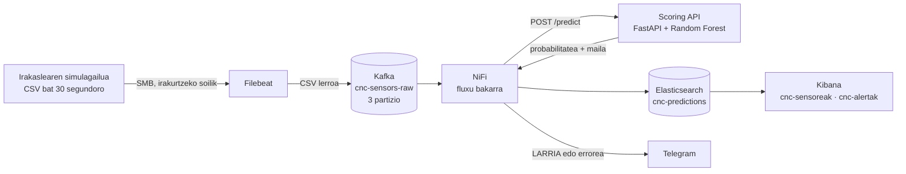

**Offline ikaskuntza eta denbora errealeko inferentzia.** Ikaskuntza behin gertatzen da, notebook-ean, 8.000 erregistro historikorekin; emaitza `models/cnc_failure_model.pkl` da. Inferentzia etengabea da: API-ak eredua abiaraztean kargatzen du eta NiFi-tik iristen den irakurketa bakoitza ebaluatzen du (mediana: 17 segundo CSV fitxategitik Elasticsearch-era). Bereizketa honi esker eredua berriz entrena daiteke sistema gelditu gabe: `.pkl` berria gorde eta API-a berrabiarazi.

**Kontrol-begizta:**

```
sentsorea → iragarpena → alerta → mantentze-langilea → esku-hartzea → sentsore-datu berriak
```

Begizta ez da guztiz automatikoa: sistemak gomendatu egiten du, eta pertsona batek erabakitzen du (*human-in-the-loop*).

**Autonomia-mailak:**

| Maila | Zer egiten du sistemak | CNC Guard |
|---|---|---|
| 0 | Datuak erakutsi bakarrik | 1. fasea (`cnc-sensoreak`) |
| 1 | Arriskua kalkulatu eta abisatu | ✅ **Gaur egungo maila** (alertak + Telegram) |
| 2 | Ekintza gomendatu (lan-agindua proposatu) | Hurrengo urratsa izan liteke |
| 3 | Ekintza egin, pertsona batek baieztatuta | Ez |
| 4 | Ekintza automatikoa (makina gelditu) | Ez: segurtasun-osagai bihurtuko litzateke eta AI Act-en arrisku altukoa izango litzateke |

### b) Adimen artifiziala aplikatzen den eremuak

| Eremua | Adibidea | CNC Guard-ekin zer lotura |
|---|---|---|
| Industria 4.0 | Mantentze prediktiboa, kalitate-kontrola | Gure kasua |
| Energia | Turbinen eta transformadoreen hutsegiteak aurreikusi | Arkitektura bera, beste sentsore batzuekin |
| Garraioa | Trenen eta hegazkinen mantentzea (bibrazioak, tenperaturak) | Ikaskuntza gainbegiratua etiketatutako matxurekin |
| Osasuna | Diagnostiko-laguntza irudietan | Ikusmen artifiziala (1.2 f) |
| Finantzak | Iruzur-detekzioa | Klase-desoreka bera: iruzurrak % 1 baino gutxiago |
| Logistika | Eskariaren aurreikuspena | Denbora-serieak |

### d) Eraginkortasun operatiboa hobetzen duten elkarreragin-modu berriak

| Lehen | CNC Guard-ekin |
|---|---|
| Makina hautsi eta gero konpondu (korrektiboa) | Abisua jaso eta konponketa programatu (prediktiboa) |
| Mantentze-arduradunak makinak banan-banan begiratu | Telegram mezu bat iristen zaio, makina eta probabilitatearekin |
| Erabakiak esperientzian oinarrituta | Erabakiak datuetan oinarrituta (dashboard-ak, recall-a zuzenean) |
| Ustekabeko geldialdiak (orduak, piezarik gabe) | Geldialdi programatuak (ordubete, teknikaria eta piezak prest) |

Ekoizpenean neurtuta: 257 hutsegitetik 235 garaiz detektatu ziren. Ustekabean geratu ziren 22 hutsegiteek eta 357 alerta faltsuek 159.150 € balio dute; sistemarik gabe 1.233.600 € izango lirateke ([7. atala, README](../README.md#7-emaitzak-ekoizpenean)).

## 1.2 Ereduak (IE2)

### a) Arazoak ebazteko sistema baten oinarrizko eskakizunak

| Eskakizuna | Zergatik | Nola betetzen dugu |
|---|---|---|
| Datu etiketatuak | Ikaskuntza gainbegiratuak adibideak behar ditu | `machine_failure` etiketa: 271 hutsegite 8.000 erregistrotan |
| Datu-fluxu fidagarria | Datu galdu bat hutsegite galdu bat izan daiteke | Kafka buffer-a, NiFi-ko "berriro saiatu" begiztak (BDA IE3) |
| Latentzia txikia | Hutsegitea gertatu aurretik abisatu | Mediana 17 s; eredua memorian (`lifespan`) |
| Metrika egokiak | % 3,4 bakarrik dira hutsegiteak | Recall, precision, ROC-AUC, kostua (ez accuracy) |
| Azalgarritasuna | Teknikariak alertaz fidatu behar du | `feature_importances_`, probabilitatea alerta bakoitzean |
| Giza gainbegiraketa | Erabakia pertsonarena da | Sistemak ez du makina gelditzen |
| Mantentze-gaitasuna | Fabrika aldatu egiten da (*drift*) | Entrenamendua eta inferentzia bereizita |

### b) Adimen artifizialeko ereduen sailkapena

Gure arazoa **ikasketa gainbegiratuko sailkapen bitarra** da: badakigu makina bakoitzak huts egin zuen ala ez, eta hori iragartzen ikasi behar du ereduak.

| Eredua | Familia | Abantailak | Desabantailak | CNC Guard-en |
|---|---|---|---|---|
| Erregresio logistikoa | Lineala, gainbegiratua | Azkarra, interpretagarria | Erlazio linealak bakarrik | Probatua: recall 0,98 baina 734 alerta faltsu |
| Erabaki-zuhaitza | Zuhaitzak | Oso ulergarria | Gainegokitzeko joera | Bakarrik ez |
| **Random Forest** | **Ensemble, bagging** | Sendoa, ez-lineala, `feature_importances_` | Zuhaitz bakarra baino astunagoa | ✅ **Aukeratua**: kostu txikiena |
| HistGradientBoosting | Ensemble, boosting | Askotan zehatza | Parametro gehiago, errazago gainegokitzen da | Probatua: 13 hutsegite galdu |
| Isolation Forest | Ez-gainbegiratua, anomaliak | Ez du etiketarik behar | "Arraroa" ez da beti "hutsegitea" | Etiketarik ez bagenu |
| Autoencoder | Ez-gainbegiratua, sare neuronala | Patroi konplexuak (bibrazio-seinaleak) | Datu eta konputazio asko, zaila azaltzen | Gure 8 aldagaientzat gehiegizkoa |

**Bagging eta boosting:** bagging-ean (Random Forest) zuhaitz asko paraleloan entrenatzen dira, bakoitza datuen lagin desberdin batekin, eta botoen bidez erabakitzen da: bariantza murrizten du. Boosting-ean zuhaitzak bata bestearen atzetik entrenatzen dira, bakoitza aurrekoaren akatsak zuzentzen: alborapena murrizten du, baina zaratarekiko sentikorragoa da.

**Gainbegiratua vs ez-gainbegiratua CNC telemetrian:** etiketak ditugunez, eredu gainbegiratu batek zuzenean ikasten du zer den hutsegite bat, eta neurtu daiteke (recall, precision). Eredu ez-gainbegiratu batek (Isolation Forest, autoencoder) makina "arraroak" detektatuko lituzke; hutsegite-historiarik gabeko makina berrietan (G12) edo bibrazio-seinale gordinekin erabilgarria izango litzateke.

### d) Arrazoiketa zehaztugabearen ereduak (logika lausoa)

Logika klasikoan "tenperatura altua da" egia edo gezurra da; **logika lausoan** 0 eta 1 arteko maila bat du (adibidez, 308 K "% 70 altua" da). Kontrolagailu lauso batek horrelako arauak erabiltzen ditu: *"higadura altua BADA ETA torque-a altua BADA, arriskua altua da"*. CNC Guard-en antzeko ideia dago: ereduak ez du bai/ez erantzuten, **probabilitate** bat baizik, eta OK / KONTUZ / LARRIA mailek tarteka itzultzen dute. Logika lausoak arauak aditu batek idaztea eskatzen du; gure ereduak datuetatik ikasten ditu.

### e) Arauetan oinarritutako sistemak

Sistema aditu batek "BALDIN … ORDUAN …" arauak erabiltzen ditu. AI4I datu-multzoko hutsegiteak, hain zuzen, arau fisikoekin sortu ziren:

| Hutsegitea | Araua |
|---|---|
| HDF (beroa ez da xahutzen) | Tenperatura-diferentzia < 8,6 K **eta** abiadura < 1.380 rpm |
| PWF (potentzia) | Potentzia < 3.500 W edo > 9.000 W |
| OSF (gainkarga) | Higadura × torque > 11.000 (L), 12.000 (M), 13.000 (H) min·N·m |
| TWF (higadura) | Higadura 200–240 min artean, ausaz |
| RNF (ausazkoa) | % 0,1 |

Ereduak ez zekien arau hauen berri, eta hala ere bere kabuz aurkitu zituen: aldagai garrantzitsuenak `torque_Nm`, `tool_wear_min`, `rpm` eta `power_est` dira (OSF, TWF, PWF), eta `temp_diff` HDFrekin lotuta dago. Benetako fabrika batean arauak ez dira ezagutzen; horregatik da erabilgarria ML.

### f) Ikusmen artifizialeko sistemak

Ikusmen artifizialak irudiak aztertzen ditu, normalean sare neuronal konboluzionalekin (CNN). CNC makinetan erabilgarria izango litzateke **tresnaren higadura kamera batekin neurtzeko** edo **piezaren kalitatea egiaztatzeko** (pitzadurak, akabera). CNC Guard-ek datu tabularrak erabiltzen ditu, baina kamera bat gehituz gero, `tool_wear_min` estimatu beharrean zuzenean neurtu ahal izango litzateke.

### g) Ereduaren egokitasuna inplementaziorako

**Klase-desoreka eta accuracy-ren tranpa.** Beti "ez du huts egingo" esaten duen eredu batek % 96,6ko accuracy-a lortuko luke, hutsegite bakar bat ere detektatu gabe (G5). Horregatik recall-a lehenesten dugu.

**Erroreen kostua.** FN bat (detektatu gabeko hutsegitea) = 4 h geldirik × 1.200 €/h = **4.800 €**. FP bat (alerta faltsua) = beharrezkoa ez den ikuskapena, **150 €** suposatu dugu. FN bat FP bat baino 32 aldiz garestiagoa da.

```
Kostua = FN × 4.800 € + FP × 150 €
```

| Atalasea | Recall | Precision | FN | FP | Kostua |
|---|---|---|---|---|---|
| 0,50 (lehenetsia) | 0,76 | 0,89 | 13 | 5 | 63.150 € |
| **0,15 (aukeratua)** | **0,89** | **0,41** | **6** | **69** | **39.150 €** |

0,11 atalasea apur bat merkeagoa litzateke (34.350 €), baina alerta faltsu gehiagorekin. Alerta gehiegi faltsuak badira, teknikariek kasu egiteari utz diezaiokete; horregatik 0,15.

**Programatutako geldialdiaren paradoxa:** alerta faltsu batek ere geldialdi bat dakar, baina programatua (ordubete, piezak prest). Ustekabeko matxura batek orduak irauten ditu. Horregatik onartzen ditugu 69 alerta faltsu, 7 hutsegite gutxiago galtzearen truke.

**Ekoizpenerako prest:** eredua `joblib`-ekin serializatua, FastAPI zerbitzuan, eredua behin kargatuta. **Ekoizpenean egiaztatua:** 7.550 irakurketatan recall 0,91 eta precision 0,40, notebook-eko balioen berdinak.

## 1.3 Printzipio legal eta etikoak (IE6)

### a) Arrisku legal eta etikoak

**AI Act-en araberako sailkapena.** EBko AI Act-ek lau maila ditu: debekatua, altua, mugatua eta minimoa.

- **Gure diseinuan** sistemak abisatu bakarrik egiten du, eta pertsona batek erabakitzen du. Ez da makinaren segurtasun-osagaia: **arrisku mugatu edo minimoko** sistema da.
- **Makinak automatikoki geldituko balitu**, segurtasun-osagai bihurtuko litzateke. Orduan Makineriaren Erregelamendua (EB 2023/1230) aplikatuko litzateke eta, AI Act-en 6. artikuluaren arabera, **arrisku altuko** sistema izango litzateke: adostasun-ebaluazioa, **CE markaketa**, kudeaketa-sistema eta erregistroa.

Arrisku altukoa ez izan arren, arrisku altuko sistemen betebehar batzuk borondatez betetzen ditugu:

| AI Act | Zer eskatzen du | Nola betetzen dugu |
|---|---|---|
| 10. art. | Datuen kalitatea | Train eta test datuak bereizita (G8); EDA dokumentatua; ingest pipeline-ak |
| 12. art. | Gertaeren erregistroa | Iragarpen guztiak `cnc-predictions`-en, `timestamp` eta `ingested_at`-ekin |
| 13. art. | Gardentasuna | Alerta bakoitzak probabilitatea erakusten du, ez bakarrik bai/ez |
| 14. art. | Giza gainbegiraketa | Erabakia mantentze-arduradunak hartzen du |
| 15. art. | Zehaztasuna eta sendotasuna | Metrikak dokumentatuta; ekoizpeneko recall-a dashboard-ean |

**Erantzukizuna.** AI Act-ek bi rol bereizten ditu: **hornitzailea** (sistema garatzen duena, gu) eta **erabiltzailea** (*deployer*, ARAKAIN). Hornitzaileak eredua ondo entrenatu, probatu eta mugak dokumentatu behar ditu (horregatik dokumentatzen ditugu galdutako 6 hutsegiteak eta kostu-suposizioak). Erabiltzaileak argibideen arabera erabili eta alertak gainbegiratu behar ditu. Makina automatikoki geldituko balitz eta horrek kalteak eragingo balitu, Makineriaren Erregelamenduaren arabera **fabrikatzaileak** (makina + sistema merkaturatzen duenak) izango luke erantzukizun nagusia.

**Azalgarritasuna (XAI).** `feature_importances_`-ek erakusten du zein aldagaik eragiten duten gehien: `torque_Nm` 0,22, `tool_wear_min` 0,20, `rpm` 0,19, `power_est` 0,19. Etorkizunean SHAP erabil liteke alerta bakoitza banan-banan azaltzeko ("alerta hau higadura 215 min delako eta torque-a 62 N·m delako piztu da").

**Langileen kontrol ezkutua.** Mantentze prediktiboko sistema bat erraz bihur daiteke langileak kontrolatzeko tresna, makinen datuak txandekin gurutzatuz gero. **CNC Guard makinen egoera neurtzeko da, ez pertsonen errendimendua neurtzeko**: indizeetan ez dago operadoreari buruzko eremurik, eta ez dugu txandekin gurutzatzen.

### b) Datuen pribatutasuna

Datu industrialak bakarrik ditugu (tenperatura, rpm, torque…), izenik eta NANik gabe. Hala ere:

- Datuak makina eta orduarekin lotuta daude. **Txanden zerrendarekin gurutzatuz gero**, jakin daiteke zein operadore zegoen makina bakoitzean: datu pertsonala da orduan (GDPR 4. art.), eta lan-arloko tratamenduak GDPRren 88. artikulua bete beharko luke.
- Prozesuaren parametroak (abiadurak, torque-a, higadura) enpresaren **sekretu industriala** dira (2016/943 Zuzentaraua).

### c) Legezkotasuna betetzea

Datu-minimizazioa (GDPR 5.1.c): sentsoreen bost neurketak eta horietatik kalkulatutako hiru aldagaiak bakarrik. Helburu-mugapena: datuak makinen mantentzerako bakarrik. Datu-multzoa (AI4I 2020) CC BY 4.0 lizentziapean dago, eta aitortzen dugu.

### d) Security by Design

| Neurria | Egoera |
|---|---|
| Irakaslearen datu-karpeta irakurtzeko soilik muntatuta (`ro`) | ✅ Eginda |
| API-a token bidez babestuta (`Authorization: Bearer`) | ✅ Eginda |
| API-ak sarrerak balioztatzen ditu (motak eta tarteak) | ✅ Eginda |
| Filebeat registry: daturik ez galdu, ez bikoiztu | ✅ Eginda |
| Ingest pipeline-ak datu okerrak baztertzen ditu | ✅ Eginda |
| Windows-eko suhesian behar diren portuak bakarrik irekita (8443, 5601, 9200, 29092, 8444) | ✅ Eginda |
| `.env` fitxategia GitHub-etik kanpo (`.gitignore`) | ✅ Eginda |
| Zerbitzuen arteko trafikoa Docker sare barnean | ✅ Eginda |
| Elasticsearch eta Kibana pasahitzik gabe; Kafka PLAINTEXT | ❌ Klaserako onargarria; ekoizpenean segurtasuna eta TLS |
| Pasahitzak `docker-compose.yml`-en; Telegram tokena NiFi fluxuan | ❌ `.env`, Docker secrets edo NiFi-ko parametro sentikorrak |
| API-ko CORS `allow_origins=["*"]` | ⚠️ Ekoizpenean jatorri zehatzak |

### e) Privacy by Design

| # | Printzipioa (Cavoukian) | CNC Guard-en |
|---|---|---|
| 1 | Proaktiboa | Arriskuak diseinu-fasean aztertuak (atal hau) |
| 2 | Pribatutasuna lehenetsia | Telemetriak ez du langileen daturik |
| 3 | Diseinuan txertatua | Indizeetan ez dago operadoreari buruzko eremurik |
| 4 | Funtzionaltasun osoa | Ereduak ez du pertsonen daturik behar |
| 5 | Muturretik muturrerako segurtasuna | 1.3 d atala |
| 6 | Gardentasuna | Langileei azaldu behar zaie zer datu biltzen diren eta zertarako |
| 7 | Erabiltzailearekiko errespetua | Datuak mantentzerako bakarrik |

### f) Genero-joerak eta beste alborapen batzuk

Gure datuetan ez dago pertsonarik, beraz ez dago genero-alborapenik. Baina **selekzio-alborapena** egon daiteke makina-moten artean: L motak 4.830 erregistro eta 197 hutsegite ditu; H motak 789 eta 16 bakarrik. Horregatik recall-a mota bakoitzeko neurtu dugu (talde bakoitzean detekzio-tasa antzekoa izatea, *Equal Opportunity* metrikak bezala):

| Mota | Hutsegiteak validation-ean | Detektatuak | Recall |
|---|---|---|---|
| L | 48 | 42 | 0,88 |
| M | 4 | 4 | 1,00 |
| H | 2 | 2 | 1,00 |

Galdutako 6 hutsegiteak L motakoak dira. M eta H motetan hutsegite gutxiegi daude ondorio sendoak ateratzeko.

**ALTAI laburpena:**

| Galdera | Erantzuna |
|---|---|
| Giza gainbegiraketa? | ✅ Erabakia mantentze-arduradunarena |
| Sendoa erroreen aurrean? | ✅ Kafka buffer-a, "berriro saiatu", 0 galera proba errealetan |
| Alborapenak aztertuta? | ✅ Recall-a makina-motaren arabera |
| Erabakiak azal daitezke? | ✅ `feature_importances_` eta probabilitatea |
| Datu pertsonalik? | ✅ Ez |
| Auditoriarako erregistroak? | ✅ `cnc-predictions` |
| Drift-a zaintzen da? | ⚠️ Ekoizpeneko recall-a dashboard-ean ikusten da, baina ez dago alerta automatikorik |

---

# 2. Ikaskuntza Automatikoko Sistemak (IAS)

## 2.1 AA indartsua eta ahula (IE1)

### a) Berezitasunak

| | AA ahula (estua) | AA indartsua (orokorra, AGI) |
|---|---|---|
| Zer da | Ataza zehatz **bakarra** ondo egiten duen sistema | Edozein ataza intelektual ulertu eta ikasteko gai den sistema |
| Egoera | Existitzen da, industrian erabiltzen da | Ez da existitzen; ikerketa eta eztabaida filosofikoa |
| Adibideak | Spam-iragazkiak, itzultzaileak, **CNC Guard** | — |
| Ulermena | Ez du ulertzen: patroiak estatistikoki aurkitzen ditu | Benetako ulermena eta orokortzeko gaitasuna izango lituzke |

**CNC Guard AA ahula da**, eta hori da behar duguna: ataza bakarra du (5 neurketatik hutsegitea iragarri); ez daki zer den CNC makina bat edo "tenperatura" bat; ez da gai beste ezer egiteko, eta makina-mota berri bat gehitzen bada ez da bere kabuz egokituko (G12).

### b) AA eta ikaskuntza automatikoa (ML)

ML AAren zati bat da, ez sinonimoa:

```
Adimen artifiziala
 ├─ AA sinbolikoa / klasikoa: arauak eskuz idatziak ("BALDIN ... ORDUAN ...")
 └─ Ikaskuntza automatikoa (ML): arauak datuetatik ikasten dira
      └─ Deep learning: sare neuronal sakonak
```

| | Arau finkoak (mantentze tradizionala) | ML eredua (CNC Guard) |
|---|---|---|
| Arauak nork | Aditu batek: "higadura > 200 min bada, aldatu" | Ereduak, datu historikoetatik |
| Aldagai-konbinazioak | Zailak | 8 aldagai batera, ez-linealki |
| Azalgarritasuna | Osoa | Partziala (`feature_importances_`) |
| Datuak behar ditu | Ez | Bai, etiketatuak |
| Egoera berrietara egokitzea | Arauak berridatzi | Berriz entrenatu |
| Emaitza | Bai/ez | Probabilitatea: arriskua mailaka |

### c) Aplikazio-esparruak

AA ahula: mantentze prediktiboa, kalitate-kontrola, eskariaren aurreikuspena, iruzur-detekzioa, gomendio-sistemak. AA indartsua (balizkoa): ikerketa zientifiko autonomoa, edozein lanbide, inork planteatu gabeko arazoak ebaztea.

### d) AA ahularen arazoak

- Ataza zehatzetik kanpo ez du ezer egiten.
- Datuen menpe dago: datu txarrak → eredu txarra (horregatik datuen kalitatea, BDA IE3).
- Datuetan dauden alborapenak errepikatzen ditu (makina-motak, AAE 1.3 f).
- "Kutxa beltza" izan daiteke (XAI behar da).
- Ingurunea aldatzen bada (*drift*), okertu egiten da.

### e) AA indartsuaren arazoak

Kontrol-arazoa (bere helburuak gureekin bat datozela nola ziurtatu), erantzukizuna eta eskubideak, lanpostuen ordezkapen masiboa, eta ez dakigu nola eraiki, ezta posible den ere.

### f) Abantailak arazoak ebazteko

AA ahula zehatza, neurgarria (recall, ROC-AUC), merkea eta kontrolatzeko erraza da: arazo industrial bat ebazteko behar dena. AA indartsua arazo orokorretarako izango litzateke, baina ez dago, eta mantentze prediktiborako ez litzateke beharrezkoa.

## 2.2 Ikaskuntza automatikoa (IE2)

### a) Printzipioak

- **Datuetatik ikastea:** ereduak adibideak ikusten ditu (sarrera → irteera) eta patroiak aurkitzen ditu.
- **Orokortzea:** helburua datu berriekin asmatzea da, ez entrenamendu-datuak buruz ikastea. Horregatik ebaluatzen dugu ikusi gabeko datuekin (validation eta ekoizpena).
- **Gainegokitzea eta azpiegokitzea:** eredu konplexuegiak buruz ikasten du; sinpleegiak ez du ikasten. Random Forest-ek zuhaitz askoren botoekin gainegokitzea murrizten du.
- **Datuen kalitatea:** "garbage in, garbage out".

### b) Motak eta erabilerak

| Mota | Datuak | Zer egiten du | CNC makinetan |
|---|---|---|---|
| **Gainbegiratua — sailkapena** | Etiketatuak | Kategoria bat iragarri | **Huts egingo du ala ez (CNC Guard)** |
| Gainbegiratua — erregresioa | Etiketatuak | Zenbaki bat iragarri | Tresnari geratzen zaion bizitza (minututan) |
| Gainbegiratu gabea | Etiketarik gabe | Taldeak edo anomaliak aurkitu | Makina "arraro" bat, historiarik gabe |
| Erdi-gainbegiratua | Etiketa gutxi | Bien konbinazioa | Etiketatzea garestia denean |
| Errefortzu bidezkoa | Sariak | Ekintzak ikasi | Ebaketa-abiadura optimoa (kontrol optimoa) |

**Zergatik gainbegiratua:** etiketak ditugu (271 hutsegite); gainbegiratutako ereduak zehatzagoak eta neurgarriak dira; ez-gainbegiratu batek "arraroa" dena detektatuko luke, eta arraroa ez da beti hutsegitea; errefortzu bidezkoak makinarekin esperimentatu beharko luke, eta fabrika batean ez da onargarria.

### c) Teknikak eta tresnak

| Urratsa | Teknika | Tresna |
|---|---|---|
| EDA | Estatistika deskribatzailea, korrelazioak | `pandas`, `seaborn` |
| Ezaugarriak | Feature engineering | `pandas`, `numpy` |
| Aurreprozesamendua | Imputazioa, eskalatzea, one-hot | `SimpleImputer`, `StandardScaler`, `OneHotEncoder`, `ColumnTransformer` |
| Zatiketa | Train/validation estratifikatua | `train_test_split(stratify=y)` |
| Desoreka | Klase-pisuak / SMOTE | `class_weight`, `imbalanced-learn` |
| Modelizazioa | Random Forest (bagging) | `scikit-learn` |
| Ebaluazioa | Recall, precision, ROC-AUC, confusion matrix, balidazio gurutzatua | `sklearn.metrics`, `cross_validate` |
| Doikuntza | Atalasearen doikuntza | `precision_recall_curve` |
| Serializazioa | Eredua fitxategian | `joblib` |
| Inferentzia | REST zerbitzua | `FastAPI`, `uvicorn` |
| Streaming | Datu-fluxua | Filebeat, Kafka, NiFi |

### d) Moten arteko desberdintasunak · e) Teknikak mota bakoitzarekin

| Mota | Etiketak | Ebaluazioa | Tresnak |
|---|---|---|---|
| Gainbegiratua | Bai | Metrika objektiboak (recall, RMSE) | scikit-learn, XGBoost, LightGBM |
| Gainbegiratu gabea | Ez | Zailagoa (silhouette, adituaren iritzia) | scikit-learn (KMeans, IsolationForest), Elastic ML |
| Deep learning | Normalean bai, asko | Metrika berak, datu gehiagorekin | PyTorch, TensorFlow/Keras |
| Errefortzu bidezkoa | Ez; sariak | Sari metatua | Gymnasium, Stable-Baselines3 |

## 2.3 Ikaskuntza gainbegiratua CNC Guard-en (IE3)

### a) Datu etiketatuak eta EDA

`data/ai4i2020_train.csv`: 8.000 erregistro, 13 zutabe, balio faltarik gabe. **271 hutsegite (% 3,39)**: 28,5 irakurketa on hutsegite bakoitzeko. Hutsegite-tasa mota bakoitzean: L % 4,08 · M % 2,44 · H % 2,03.

<p align="center">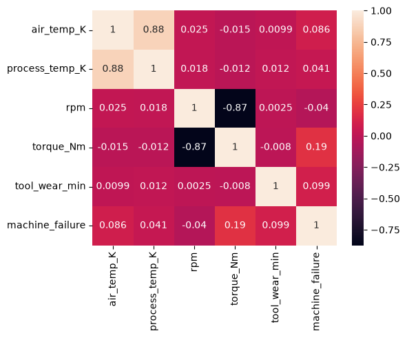</p>

Korrelazio nagusiak: aireko eta prozesuko tenperaturak 0,88; rpm eta torque −0,87. `machine_failure`-rekin korrelazio handiena torque-ak du (0,19), baina bakarrik ez da nahikoa: hutsegiteak konbinazioen ondorio dira.

### b) Datuen hautaketa

| Datuak | Erabilera |
|---|---|
| Sentsoreen 5 neurketak + `machine_type` | Ereduaren sarrera |
| `failure_TWF/HDF/PWF/OSF/RNF` | **Kanpoan**: hutsegitea bera dira (*data leakage*) |
| `machine_id` | **Kanpoan** ereduan (identifikatzaile bat besterik ez); ebaluazioan erabilia (makinaz makina) |
| % 80 / % 20, `stratify=y`, `random_state=42` | Entrenamendua (6.400) / validation (1.600, 54 hutsegite) |
| `ai4i2020_test.csv` (simulagailua) | **Inoiz ez entrenamenduan**: ekoizpeneko ebaluazioa |

### c) Entrenamendua eta ezaugarri garrantzitsuak

**Feature engineering:**

| Aldagaia | Formula | Zergatik |
|---|---|---|
| `air_temp_C`, `process_temp_C` | K − 273,15 | Teknikarientzat ulergarriagoa |
| `temp_diff` | prozesua − airea | Berotze erreala; bero-disipazioko hutsegitearekin lotua (HDF) |
| `power_est` | torque × rpm × 2π / 60 | Potentzia wattetan; potentzia-hutsegitearekin lotua (PWF) |

Aurreprozesamendua `Pipeline` baten barruan dago (`SimpleImputer` + `StandardScaler` zenbakietan, `OneHotEncoder` `machine_type`-n), eta horri esker API-ak notebook-eko prozesu berbera aplikatzen du. SMOTE `ImbPipeline` baten barruan dago: **entrenamendu-zatian bakarrik** aplikatzen da, ez validation-ean (*data leakage*-rik ez).

**Aldagaien garrantzia** (Random Forest, `feature_importances_`):

| Aldagaia | Garrantzia |
|---|---|
| `torque_Nm` | 0,22 |
| `tool_wear_min` | 0,20 |
| `rpm` | 0,19 |
| `power_est` | 0,19 |
| `temp_diff` | 0,10 |
| `air_temp_C` | 0,06 |
| `process_temp_C` | 0,04 |
| `machine_type` (L/M/H) | 0,01 |

Interpretazio fisikoa: higatutako tresna batek esfortzu handiarekin (torque, potentzia) lehenago huts egiten du (OSF, TWF), eta potentzia-muturrek PWF eragiten dute. Guk sortutako `power_est` eta `temp_diff` lehen bostetan daude: feature engineering-ak balio izan du. Makina-motak ia ez du eraginik, besteek bere informazioa jada dutelako.

### d) Ebaluazioa

| Atalasea 0,50 | Atalasea 0,15 |
|---|---|
| 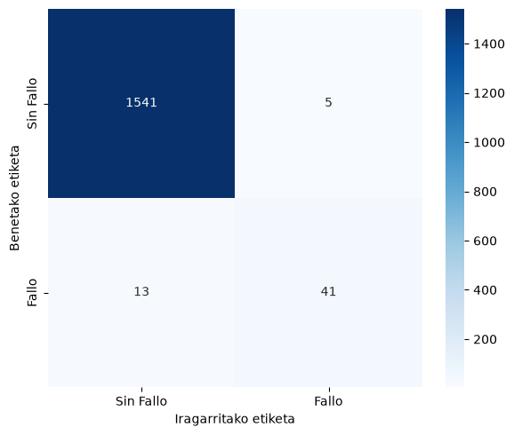 | 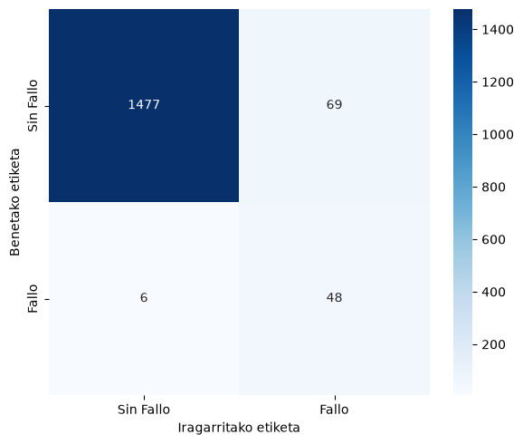 |

| | Recall | Precision | F1 | ROC-AUC | TP | FN | FP |
|---|---|---|---|---|---|---|---|
| Atalasea 0,50 | 0,76 | 0,89 | 0,82 | 0,979 | 41 | 13 | 5 |
| **Atalasea 0,15** | **0,89** | **0,41** | **0,56** | 0,979 | **48** | **6** | **69** |

Interpretazioa: 0,15ekin 10 hutsegitetik 9 detektatzen dira. Alerten % 41 dira egiazkoak: 5 alertatik 2 inguru. Kostuaren arabera, trukea merezi du (1.2 g).

### e) Doikuntza

Bi teknika alderatu ditugu desorekarako (class_weight eta SMOTE) eta atalasea doitu dugu precision-recall kurbarekin:

<p align="center">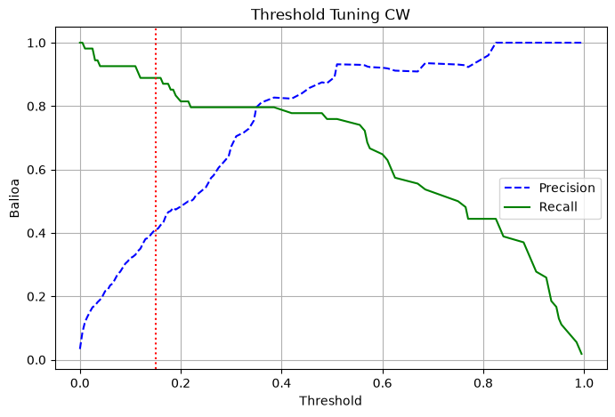</p>

| Aldaera | Recall | Precision | FN | FP | Kostua |
|---|---|---|---|---|---|
| class_weight, 0,50 | 0,76 | 0,89 | 13 | 5 | 63.150 € |
| SMOTE, 0,50 | 0,83 | 0,68 | 9 | 21 | 46.350 € |
| SMOTE, 0,15 | 0,87 | 0,30 | 7 | 112 | 50.400 € |
| **class_weight, 0,15** | **0,89** | **0,41** | **6** | **69** | **39.150 €** |

SMOTE-k hutsegite sintetikoak sortzen ditu interpolazioz; atalase baxuarekin alerta faltsu gehiegi ematen ditu (112). `class_weight='balanced'` + 0,15 da merkeena.

<p align="center">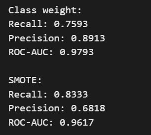</p>

<p align="center"><sub>Notebook-eko irteera (0,50 atalasea): class_weight-ek precision hobea, SMOTE-k recall pixka bat altuagoa baina ROC-AUC baxuagoa.</sub></p>

### f) Inplementazioa

`joblib` → `models/cnc_failure_model.pkl` → FastAPI (`/health`, `/predict`) → NiFi-k irakurketa bakoitzeko deitzen dio. API-ak eredua behin kargatzen du (`lifespan`), sarrerak balioztatzen ditu (Pydantic: motak, `machine_type` L/M/H, tenperaturen tarteak, `rpm` > 0, torque eta higadura ≥ 0), erroreak kudeatzen ditu (422, 503, 500) eta alerta-maila kalkulatzen du (OK < 0,15 ≤ KONTUZ < 0,70 ≤ LARRIA). Xehetasunak: [AAP 3.1 e](#e-programaren-egitura).

### g) Ereduaren arriskuak eta nola murriztu ditugun

| Arriskua | Neurria |
|---|---|
| Data leakage | `failure_*` kanpoan; SMOTE entrenamenduan bakarrik; test datuak ez dira entrenatzeko erabiltzen; `machine_failure` API-an gordetzen da baina ereduari ez zaio pasatzen |
| Accuracy-ren tranpa | Recall, precision, ROC-AUC eta kostua |
| Gainegokitzea | Random Forest + balidazio gurutzatua |
| Alborapena makina-moten artean | Recall-a mota bakoitzeko |
| Model drift | Ekoizpeneko recall-a dashboard-ean; entrenamendua eta inferentzia bereizita |
| Bertsio-ezberdintasunak | `scikit-learn==1.9.1` notebook-ean eta API-an |

### h) Optimizazioa proba-datuekin

**Balidazio gurutzatua** (5-fold estratifikatua, entrenamendu-datuekin):

| Metrika | Batezbestekoa ± desbideratzea |
|---|---|
| Recall (0,50) | 0,74 ± 0,10 |
| Precision (0,50) | 0,88 ± 0,05 |
| ROC-AUC | 0,978 ± 0,019 |

ROC-AUC egonkorra da zatiketa guztietan; recall-a gehiago aldatzen da, validation zati bakoitzean ~43 hutsegite bakarrik daudelako.

**Ekoizpeneko balidazioa** (simulagailuaren datuak, ereduak inoiz ikusi gabeak, 7.550 irakurketa): recall **0,91**, precision **0,40**. Notebook-eko emaitzak berresten dira.

## 2.4 Emaitzen kalitatea (IE6)

### a) Algoritmoen egokitasuna

| Eredua (0,15) | Recall | Precision | ROC-AUC | FN | FP | Kostua |
|---|---|---|---|---|---|---|
| Erregresio logistikoa | 0,98 | 0,07 | 0,923 | 1 | 734 | 114.900 € |
| HistGradientBoosting | 0,76 | 0,61 | 0,969 | 13 | 26 | 66.300 € |
| **Random Forest** | **0,89** | **0,41** | **0,979** | **6** | **69** | **39.150 €** |

Erregresio logistikoak ia hutsegite guztiak harrapatzen ditu, baina 734 alerta faltsurekin: lineala denez, ez ditu "higadura altua ETA torque altua" bezalako konbinazioak ikasten. HistGradientBoosting zehatzagoa da alertetan, baina 13 hutsegite galtzen ditu. Random Forest-ek ematen du kostu txikiena.

### b) Aplikazio praktikoa

| Proba | Emaitza |
|---|---|
| Muturretik muturrera | CSV fitxategitik Elasticsearch-era: mediana 17 s; Kibanan eta Telegram-en ikusgai |
| Desakoplamendua (Kafka) | NiFi geldirik egon zen bitartean Kafka-k 7.080 mezu gorde zituen, eta NiFi piztean guztiak prozesatu ziren |
| Datu-galerarik ez | API-a itzalita zegoela, NiFi-k "berriro saiatu" ilaran gorde zituen: 0 galera |
| Datu okerrak | `machine_type = "T"` → API-ak 422 → Telegram "DATO NO PROCESADO"; JSON lerro bat → `ConvertRecord`-ek baztertu |
| Ekoizpeneko asmatze-maila | TP 235 · FN 22 · FP 357 · TN 6.936 (`cnc-alertak` dashboard-ean, zuzenean) |

### c) Konputazioaren oinarrizko printzipioak praktikan

Ereduaren inferentzia arina da: Random Forest batek zuhaitz bakoitza erroetatik hostora zeharkatzen du (sakonera ~log n), beraz iragarpen batek milisegundo batzuk behar ditu. Kafka-k partizioetan banatzen du lana (3), eta Elasticsearch-ek alderantzizko indizeak eta BKD zuhaitzak erabiltzen ditu bilaketak eta agregazioak azkar egiteko.

### d) Sistema adimendunen teknikak erabiltzen dituzten aplikazioak

CNC Guard bera: datu-fluxua (Filebeat, Kafka, NiFi), ML zerbitzua (FastAPI) eta BI (Kibana, Telegram) konbinatzen dituen aplikazio osoa.

### e) Informazioa automatikoki ateratzea datu-bolumen handietatik

Simulagailuak eguneko ~28.800 irakurketa sortzen ditu; `cnc-predictions`-ek 50.000 dokumentu baino gehiago ditu. Inork ezer egin gabe: Filebeat-ek irakurri, Kafka-k gorde, NiFi-k eraldatu, API-ak iragarri, Elasticsearch-ek gorde eta Kibanak KPIak eta agregazioak kalkulatzen ditu (hutsegite-tasa, makina aktiboak, recall-a zuzenean).

---

# 3. Adimen Artifizialaren Programazioa (AAP)

## 3.1 Programazio-lengoaiak (IE1)

### a) Lengoaien ezaugarriak aplikazio-motaren arabera

| Aplikazio-mota | Gure proiektuan | Zer behar du lengoaiak |
|---|---|---|
| Datuen azterketa | Notebook-a: 8.000 erregistro | Taulekin lan erraza, grafikoak, interaktibitatea |
| Ikaskuntza automatikoa | Random Forest entrenatu eta ebaluatu | ML liburutegi helduak, kalkulu numeriko azkarra |
| Web zerbitzua | Scoring API-a | REST, JSON, datuen balioztatzea |
| Integrazioa | NiFi, Elasticsearch, Docker | HTTP/JSON, edukiontziak |

| Ezaugarria | Zer da | Zergatik garrantzitsua |
|---|---|---|
| Interpretatua / konpilatua | Zuzenean exekutatu / aurrena makina-kodera itzuli | Interpretatua azkarragoa probatzeko (notebook-a) |
| Tipaketa | Estatikoa / dinamikoa | Dinamikoak garapena arintzen du; akatsak ekiditeko Pydantic |
| Paradigma | Prozedurazkoa, objektuetara bideratua, funtzionala | Python-ek hirurak onartzen ditu |
| Ekosistema | Liburutegiak | Erabakigarria: ez dugu Random Forest bat hutsetik idatzi nahi |

### b) Lengoaia egokiena

| Lengoaia | Indarguneak | Ahulguneak | CNC Guard-erako |
|---|---|---|---|
| **Python** | ML ekosistema osoena, FastAPI, Jupyter | Python hutsa motela (C-ko liburutegiek konpontzen dute) | ✅ **Aukeratua** |
| R | Estatistika eta grafikoak | API eta integraziorako ahulagoa | Azterketarako bakarrik |
| Java / Scala | Azkarra; Kafka eta Spark | ML liburutegi gutxiago, kode gehiago | Big Data handietarako |
| C++ | Oso azkarra | Garapen motela | Liburutegien barnean |
| JavaScript | Web API-ak | ML ekosistema txikia | Ez |

**Zergatik Python:**

1. **Ekosistema bakarrean dena:** `pandas`, `numpy`, `matplotlib`, `seaborn`, `imbalanced-learn`, `scikit-learn`, `joblib`, `FastAPI`, `pydantic`, `uvicorn`.
2. **Entrenamendua eta ekoizpena lengoaia berean:** ezaugarriak (`temp_diff`, `power_est`, °C) notebook-ean eta API-an formula berberekin. Beste lengoaia batean API-a idatziz gero, formulak bi aldiz idatzi beharko lirateke.
3. **FastAPI ekoizpenerako:** Pydantic bidezko balioztatzea (422 automatikoa), Swagger (`/docs`) automatikoa, `async` eta `uvicorn` zerbitzari azkarra.
4. **Integrazio erraza:** NiFi-k HTTP + JSON bidez deitzen dio; Python-en JSON-a hiztegi bat da.
5. **Abiadura nahikoa:** `numpy` eta `scikit-learn` barnetik C/Cython-en daude; datuak 30 segundoro iristen dira.

### c) AA garatzeko lengoaien ezaugarriak · d) Lengoaia egokiena AArako

| Beharra | Python-en |
|---|---|
| Kalkulu numeriko azkarra | `numpy` |
| Datu tabularrak | `pandas` |
| Algoritmo prestatuak | `scikit-learn` |
| Prototipatze azkarra | Jupyter |
| Bistaratzea | `matplotlib`, `seaborn` |
| Ereduak gorde/kargatu | `joblib` |
| Ekoizpena | `FastAPI` |
| Deep learning (behar izanez gero) | `PyTorch`, `TensorFlow` |

### e) Programaren egitura

Entrenamendua eta ekoizpena guztiz bereizita daude:

```
OFFLINE (behin)                                  ONLINE (etengabe)
notebooks/02_training.ipynb                      scoring/score_api.py
  ├─ datuak kargatu (pandas)                       ├─ abiaraztean: eredua kargatu (lifespan)
  ├─ EDA eta feature engineering                   ├─ POST /predict
  ├─ Pipeline: aurreprozesamendua + RF   .pkl      │    ├─ sarrera balioztatu (Pydantic)
  ├─ ebaluatu eta atalasea aukeratu  ────────►     │    ├─ 8 ezaugarriak kalkulatu
  └─ joblib.dump(...)               models/        │    ├─ predict_proba
                                                   │    └─ alerta-maila (OK/KONTUZ/LARRIA)
                                                   └─ GET /health
```

| Atala (`score_api.py`) | Kodea | Zertarako |
|---|---|---|
| Eredua behin kargatu | `@asynccontextmanager async def lifespan(app)` | `.pkl`-a memorian; eskaera bakoitzean kargatuta oso motela litzateke (G9) |
| Sarrerako eskema | `class SentsoreEskaera(BaseModel)` | Motak, `machine_type: Literal["L","M","H"]`, tenperaturak 250–350 K eta 250–400 K, `rpm` > 0, torque eta higadura ≥ 0; okerra bada 422 |
| Irteerako eskema | `class PredikzioErantzuna(BaseModel)` | Erantzunak beti forma bera |
| Segurtasuna | `HTTPBearer` + `token_egiaztatu` | Token gabe edo okerrarekin, baztertu; tokena `.env`-en |
| Neurketa | `@app.middleware("http")` | `X-prozesatze-denbora` goiburua erantzun bakoitzean |
| Osasuna | `GET /health` | Eredua kargatuta dagoen |
| Iragarpena | `POST /predict` | Ezaugarriak, `predict_proba`, maila |
| Erroreak | `HTTPException(503)`, `HTTPException(500)` | 503: eredurik ez; 500: iragarpenean errorea (log-ean idatzita) |

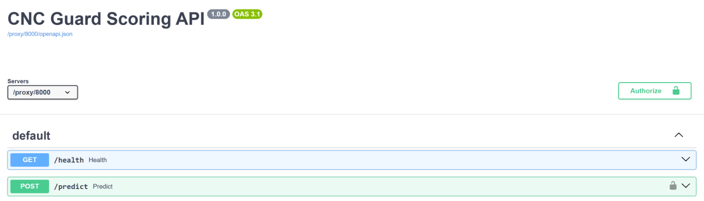

<p align="center">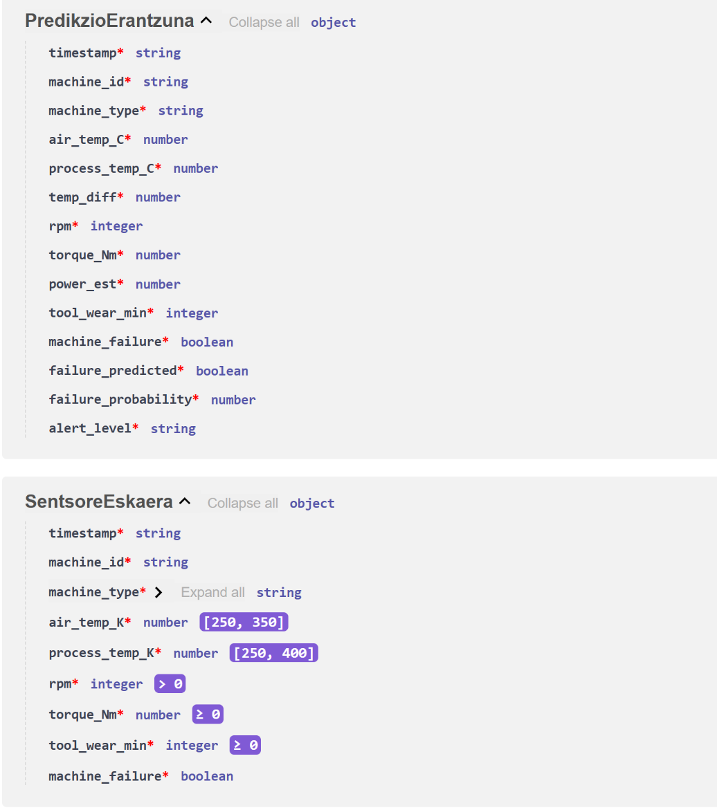</p>

**Kode-estiloa:** izenak euskaraz eta esanguratsuak (`eredua`, `token_egiaztatu`, `SentsoreEskaera`); konstanteak maiuskulaz (`EREDU_BIDE`, `TOKEN_BALIOA`), PEP8; konfigurazioa kodetik kanpo (`.env`, `os.getenv`).

### f) Markatze-lengoaiak

| Lengoaia | Non | Etiketek ematen duten informazioa |
|---|---|---|
| YAML | `docker-compose.yml`, `filebeat.yml` | Konfigurazioa; koska-tarteak hierarkia adierazten du |
| JSON | NiFi fluxuak, mapping-a, API-a, `.ipynb` | Objektuak `{}`, zerrendak `[]`, motak |
| NDJSON | `dashboards/kibana_export.ndjson` | JSON objektu bat lerro bakoitzeko |
| Markdown | `README.md`, `docs/*.md` | `#` izenburuak, `|` taulak, kodea |
| HTML | Swagger UI, Kibana | Web-orriak (automatikoki sortuak) |
| CSV | Simulagailua | Goiburuak zutabe-izenak; komak bereizten ditu (testu mugatua, ez markatze-lengoaia) |

YAML gizakientzat irakurgarriagoa da (konfigurazioa); JSON programen arteko trukerako estandarra (API-ak, NiFi).

## 3.2 AA aplikazioa garatzea (IE2)

### a) AA plataformak

| Plataforma | Abantailak | Desabantailak | Guretzat |
|---|---|---|---|
| **scikit-learn (lokala)** | Doakoa, sinplea, datu tabularretarako bikaina, datuak etxean | Ez du GPU edo datu oso handirik erabiltzen | ✅ Aukeratua |
| TensorFlow / PyTorch | Sare neuronalak, GPU | Gehiegizkoa 8 aldagairentzat | Ez |
| Spark MLlib | Milioika erregistro, klusterrak | Konplexua | Ez (orain) |
| AWS SageMaker / Azure ML / Vertex AI | MLOps osoa, eskalagarria | Ordaindu; datuak enpresatik kanpo (sekretu industriala) | Ez |
| Elastic Machine Learning | Anomaliak indizeetan bertan | Ordainpeko lizentzia; ez-gainbegiratua | Ez |

### b) Eredu-inguruneak

| Ingurunea | Zertarako |
|---|---|
| Jupyter Notebook | Esperimentazioa: EDA, grafikoak, entrenamendua |
| VS Code (code-server) | Taldeko editore partekatua, API-aren kodea eta terminala |
| Python venv (`.venv`) | Bertsio zehatzak isolatuta (`scoring/requirements.txt`) |
| Docker Compose | Zerbitzu guztiak komando bakarrarekin |
| Git / GitHub | Bertsio-kontrola, adarrak (`develop_model`, `develop_nifi`…) eta pull request-ak |

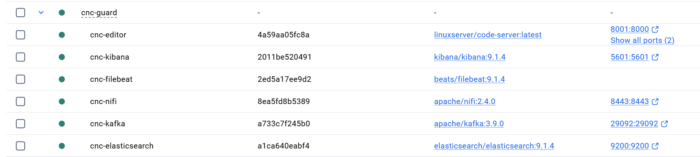

### c) Ereduaren definizioa

- **Arazoa:** ikasketa gainbegiratuko sailkapen bitarra (`machine_failure` = true/false).
- **Desoreka:** % 3,4 bakarrik dira hutsegiteak. Accuracy-k engainatzen du (% 96,6 ezer egin gabe); recall eta ROC-AUC erabiltzen ditugu.
- **Desorekaren tratamendua:** `class_weight='balanced'`, SMOTE-rekin alderatua (entrenamenduan bakarrik) eta atalasearen doikuntza (0,15).
- **Eredua:** Random Forest: hutsegiteak aldagaien konbinazio ez-linealen ondorio dira (adibidez, tenperatura-diferentzia txikia **eta** abiadura baxua).

### d) Inplementazioa

- `Pipeline(ColumnTransformer + RandomForestClassifier(200, class_weight='balanced', random_state=42))`.
- `joblib` serializazioa: `models/cnc_failure_model.pkl`.
- FastAPI `/health` eta `/predict`; alerta-atalaseak **KONTUZ ≥ 0,15**, **LARRIA ≥ 0,70**.
- NiFi-rekin denbora errealean integratua; ekoizpenean 7.550 irakurketarekin egiaztatua (recall 0,91).

### e) Emaitzen ebaluazioa eta hobekuntza

| Urratsa | Emaitza |
|---|---|
| Lehen eredua (0,50) | Recall 0,76: 54tik 13 hutsegite galdu |
| Feature engineering (`temp_diff`, `power_est`, °C) | `power_est` eta `temp_diff` lehen bost aldagaietan |
| Atalasea 0,15 | Recall 0,89: 6 galdu bakarrik. Kostua 63.150 € → 39.150 € |
| Balidazio gurutzatua (5-fold) | ROC-AUC 0,978 ± 0,019: egonkorra |
| Beste ereduekin alderatu | Random Forest merkeena (logistikoa 114.900 €, HGB 66.300 €) |
| Makinaz makina (`groupby`) | Galdutako 6 hutsegiteak L motako 5 makinatan: CNC-038 (2), CNC-040, 041, 042, 043 |
| Ekoizpena | Recall 0,91, precision 0,40 |

`groupby`-ak erakusten du akatsak ez daudela makina guztietan banatuta: L motako makina gutxi batzuetan pilatzen dira. Hurrengo urrats bat makina horien historia aztertzea izango litzateke (adibidez, makina bakoitzaren hutsegite-tasa historikoa aldagai gisa).

---

# 4. Big Data Sistemak (BDS)

## 4.1 Datuak eskuratu eta aztertu (IE1)

### a) Matematika diskretua, logika eta konplexutasuna

- **Logika algoritmikoa:** NiFi-ko `RouteOnAttribute`-k adierazpen boolear bat ebaluatzen du (`${alert_level:equals('LARRIA')}`); ingest pipeline-ak `if` baldintza bat (`ctx.machine_id == null || ctx.timestamp == null`).
- **Konplexutasuna:** Kafka-k mezuak partizioetan banatzen ditu (hash bidez), eta Elasticsearch-ek alderantzizko indizeak eta BKD zuhaitzak erabiltzen ditu, bilaketak O(log n) inguruan egiteko. Random Forest-en iragarpen batek zuhaitz bakoitzaren sakonera bakarrik zeharkatzen du.
- **Multzoak:** `cardinality` agregazioak (makina aktiboak) HyperLogLog++ algoritmoa erabiltzen du: balio desberdinak gutxi gorabehera zenbatzen ditu, memoria gutxirekin.

### b) Informazioa automatikoki ateratzea

Sistemak sentsore-datuak eta inferentziaren emaitzak dokumentu berean gordetzen ditu, eta Kibanak automatikoki kalkulatzen ditu: makina aktiboak, hutsegite-tasa, tenperaturaren joera, arrisku-mailak, LARRIA alertak eta ekoizpeneko recall-a. Horrela informazio operatiboa (makinen egoera) eta prediktiboa (arriskua) uztartzen dira.

### c) Iturriak eta datu-motak konbinatu

| Iturria | Mota | Formatua |
|---|---|---|
| Sentsoreen telemetria | Erdi-egituratua | CSV (goiburua + 10 lerro) |
| Makinen metadatuak | Egituratua | `machine_id`, `machine_type` |
| Ereduaren iragarpenak | Egituratua | JSON (API-aren erantzuna) |
| Benetako emaitza | Egituratua | `machine_failure` (boolean) |
| Alertak | Mezua | Telegram testua |

Dena **egitura komun batean** batzen da: dokumentu bakoitzak `timestamp` (date) eta `machine_id` (keyword) ditu, eta mapping esplizituak mota bakoitza zehazten du (`float`, `integer`, `boolean`, `keyword`).

### d) Datu-multzo konplexua eta erlazioak

`cnc-predictions`-eko dokumentu bakoitzak hiru informazio-mota erlazionatzen ditu: neurketak, ereduaren iragarpena eta benetako emaitza. Erlazio horri esker ekoizpeneko confusion matrix-a kalkula daiteke dashboard-ean bertan.

### f) Informazio-sistemak hautatu eta integratu

| Indizea | Edukia | Konfigurazioa |
|---|---|---|
| `cnc-sensors` | 1. faseko irakurketak (65.000) | `elasticsearch/cnc-sensors-mapping.json` + `cnc-sensors-pipeline` |
| `cnc-predictions` | Irakurketa + iragarpena + etiketa (50.000+) | `cnc-predictions-template` + `cnc-predictions-pipeline` |

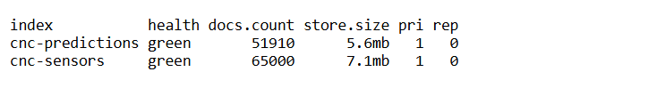

Dokumentu baten adibidea (CNC-009, LARRIA, benetan huts egin zuena):

<p align="center">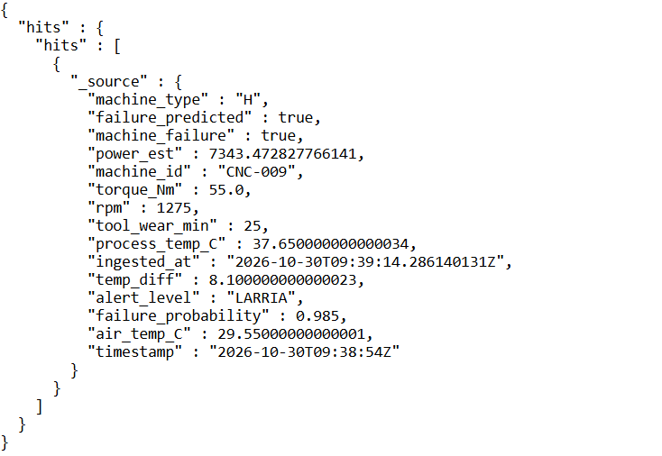</p>

Ingest pipeline-ak (`index.default_pipeline`): (1) `drop` — `machine_id` edo `timestamp` gabeko dokumentuak (edo goiburu-itxurakoak) baztertu; (2) `set ingested_at` — iristeko ordua, latentzia neurtzeko.

| Eremua | Mota | Zergatik |
|---|---|---|
| `timestamp`, `ingested_at` | `date` | Denbora-tarteak, histogramak |
| `machine_id`, `machine_type`, `alert_level` | `keyword` | Taldekatu eta iragazteko; `text`-ek hitzetan zatituko lituzke |
| Tenperaturak, torque, potentzia, probabilitatea | `float` | Batezbestekoak, maximoak |
| `rpm`, `tool_wear_min` | `integer` | Zenbaki osoak |
| `machine_failure`, `failure_predicted` | `boolean` | Bai/ez |

### g) Kostu- eta kalitate-irizpideak

| Irizpidea | Gure datua |
|---|---|
| Biltegiratzea | `cnc-predictions`: 51.910 dokumentu 5,6 MB-tan (~110 byte dokumentuko). Eguneko ~28.800 irakurketa → ~3 MB egunean, ~1,1 GB urtean |
| Lizentziak | Dena kode irekia (Kafka, NiFi, Elasticsearch/Kibana basic). Kibanako Telegram konektorea ordainpekoa → NiFi-tik egin |
| Hardwarea | PC bakarra: ES 1 GB heap, NiFi 1–2 GB heap |
| Kalitatea: osotasuna | 0 mezu galdu etenaldi-probetan |
| Kalitatea: baliozkotasuna | Eskema (NiFi), Pydantic (API), mapping eta pipeline (ES) |
| Kalitatea: berehalakotasuna | Latentzia mediana 17 s |
| Kalitatea: bakartasuna | Bikoiztuen egiaztapena (BDA 5.2 a) |

## 4.2 Aginte-koadroak (IE2)

### a) Bistaratze-liburutegiak eta teknikak

| Tresna | Mota | Erabilera |
|---|---|---|
| **Kibana Lens** | Dashboard interaktiboa, koderik gabe | ✅ Gure bi dashboard-ak |
| Kibana TSVB / Vega | Denbora-serie aurreratuak / pertsonalizatuak | Behar izanez gero |
| **Matplotlib / Seaborn** | Python, grafiko estatikoak | ✅ Notebook-a (korrelazioak, matrizeak, PR kurba) |
| Grafana | Metrika-dashboard-ak | Kibanaren alternatiba |
| Power BI / Tableau | BI tresnak | Negozio-txostenetarako |

| Grafikoa | Datu-mota | Zergatik |
|---|---|---|
| Line chart | Denbora-seriea | Joerak eta gorakadak |
| Heatmap | Bi dimentsio + kantitatea | Higadura × mota: non pilatzen diren hutsegiteak |
| KPI / Metric | Zenbaki bat | Zuzendaritzarentzat begi-kolpe batean |
| Gauge | Balio bat eskala batean | Arriskua "zenbat" den intuitiboki |
| Data table | Xehetasuna | Zein makina, noiz, zenbat |

### b) Helburua eta datuen izaera gurutzatu

Datuak denbora-serieak dira (30 segundoro), eta helburua hutsegiteak aurreikustea. Horregatik: tenperatura eta probabilitatea denboran zehar (joerak), higadura × mota heatmap-ean (hutsegiteak non pilatzen diren), eta mailak koloreekin (berdea < % 15, horia % 15–70, gorria ≥ % 70). Heatmap-ak erakusten du hutsegite gehienak L motako makinetan eta 200–250 min-ko higaduran daudela: **mantentze-erabakia**, L makinetan tresna 200 minutu baino lehen aldatzea.

### c) Aginte-koadroa

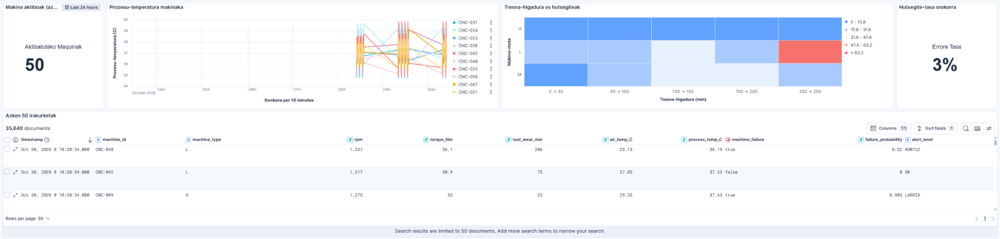

<p align="center">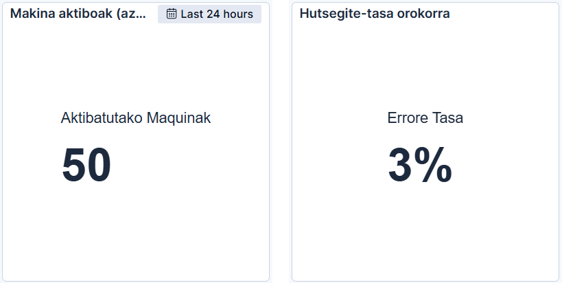</p>

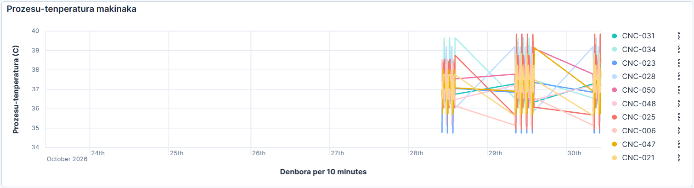

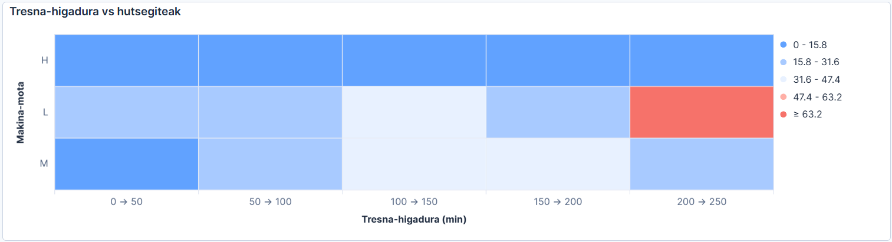

`cnc-sensoreak`: makina aktiboak (5 min), prozesu-tenperatura makinaka (°C), higadura vs hutsegiteak (heatmap), hutsegite-tasa, azken 50 irakurketak.

### d) Iragartzeko teknikak

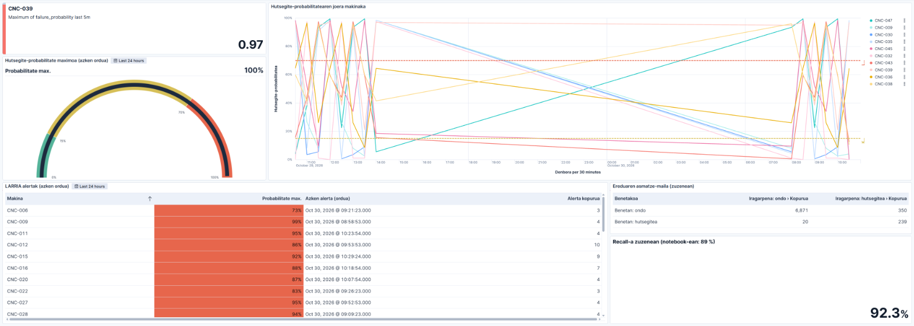

<p align="center">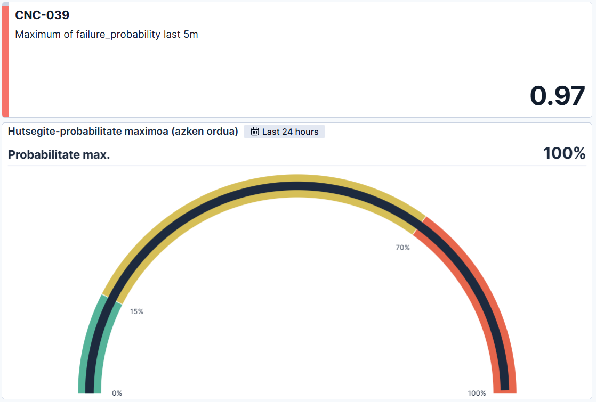</p>

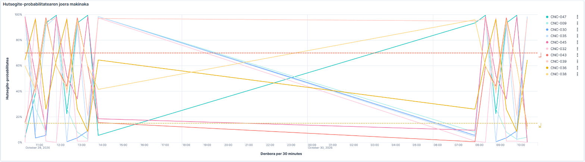

<p align="center"><sub>10-29 arratsaldetik 10-30 goizera ez zegoen daturik: lerro zuzenek tarte hutsaren bi aldeak lotzen dituzte.</sub></p>

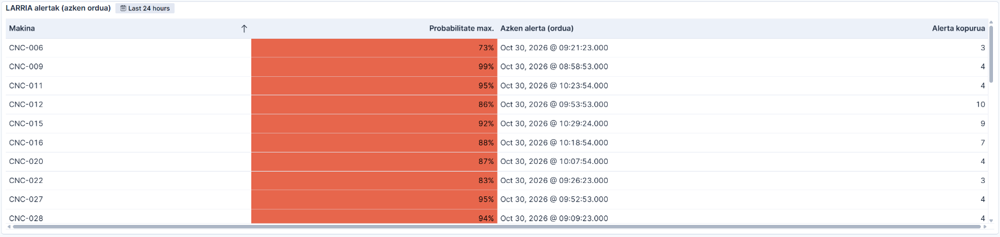

<p align="center">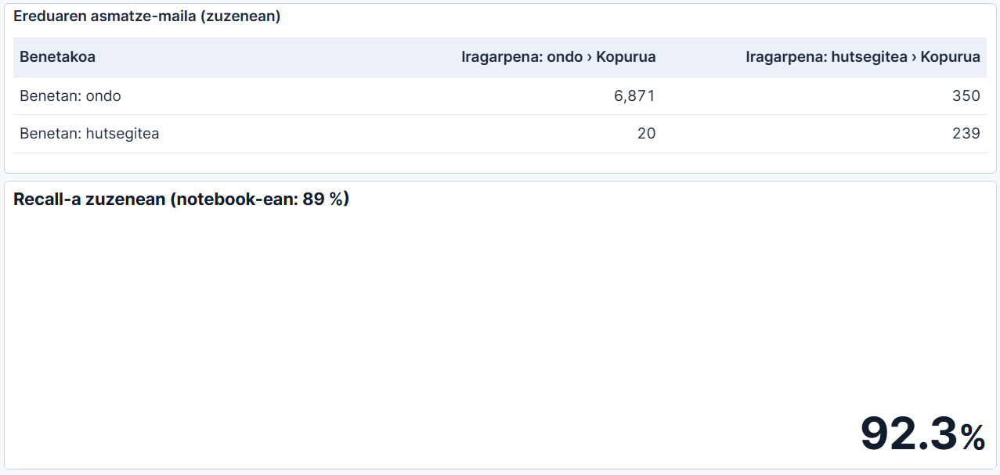</p>

`cnc-alertak`: arriskutsuena orain, probabilitate maximoa (gauge), probabilitatearen joera makinaka, LARRIA alertak, ereduaren asmatze-maila (ekoizpeneko confusion matrix-a) eta recall-a zuzenean.

### e) Analisiaren eragina helburuetan

Ekoizpenean, 257 hutsegitetik 235 garaiz detektatu ziren (% 91). Kostuan: 159.150 € CNC Guard-ekin vs 1.233.600 € sistemarik gabe (−% 87). Dashboard-ak berak erakusten du eragin hori zuzenean ("Ereduaren asmatze-maila" eta "Recall-a zuzenean").

## 4.3 Datuak kudeatu eta biltegiratu (IE3)

### a) Hainbat iturritatik atera eta biltegiratu

| Urratsa | Konfigurazioa |
|---|---|
| Iturria | Irakaslearen SMB karpeta (`\\192.168.75.150\cnc-stream`), Docker bolumen gisa, **irakurtzeko soilik** |
| Filebeat | `filestream`, `exclude_lines: ['^timestamp']`, `fingerprint.enabled: false` (fitxategiak < 1.024 byte), `file_identity: path`, `codec.format: '%{[message]}'` (CSV lerroa bakarrik) |
| Kafka | Topic `cnc-sensors-raw`, 3 partizio |
| NiFi | CSV → JSON, API, Elasticsearch |
| Elasticsearch | Makinaren eta denboraren arabera kontsultatzeko (`machine_id` keyword, `timestamp` date) |

### b) Datuetatik balioa ateratzeko helburua

Helburua ustekabeko geldialdiak murriztea da (1.200 €/h). Horretarako teknologia eraginkorrak behar dira: datuak segundo gutxitan prozesatu (Kafka + NiFi), iragarri (API) eta erabakietarako bistaratu (Kibana, Telegram).

### c) Iraultza digitala eta datu-bolumena

50 makinak eguneko ~28.800 irakurketa sortzen dituzte. Fabrika osoa (1.000 makina, segundoro) eguneko 86 milioi irakurketa izango lirateke. Horrelako bolumena ezin da eskuz aztertu: banatutako sistemak (Kafka, Elasticsearch) eta ikaskuntza automatikoa behar dira balioa ateratzeko.

### d) Sistema eraginkorrak eta seguruak

**Karga-probak:** sistemak bat-bateko karga handiak jasan ditu etenaldien ondoren: 7.080 mezu batera (2026-10-27) eta 1.160 (2026-10-21), galerarik gabe. Ekoizpeneko latentziaren P95-ak (25 min) erakusten du karga horiek nola xurgatzen diren: Kafka-k gordetzen ditu eta NiFi-k bere erritmoan prozesatzen ditu.

**Hobekuntzak:** NiFi-ko backpressure-a eta Kafka-ren partizioak (paraleloan irakurtzeko); eskalatzeko, Kafka broker gehiago, NiFi klusterra eta Elasticsearch nodo gehiago (4.4 c).

**Segurtasun-neurriak:**

| Neurria | Zergatik |
|---|---|
| Suhesian portu jakin batzuk bakarrik (8443, 5601, 9200, 29092, 8444) | Erasogune txikiagoa |
| SMB karpeta irakurtzeko soilik | Inork ezin ditu jatorrizko datuak ezabatu (G2) |
| API-a Bearer token-arekin | Baimenik gabeko iragarpenik ez |
| NiFi HTTPS eta erabiltzailearekin | Fluxuak ezin ditu edonork aldatu |
| `.env` GitHub-etik kanpo | Kredentzialak ez dira argitaratzen |
| Mugak (ES pasahitzik gabe, Kafka PLAINTEXT) | Dokumentatuta AAE 1.3 d-n, ekoizpeneko konponbidearekin |

### e) Diziplina anitzeko lana

Taldean bakoitzak arlo bat eraman du (pipeline-a eta NiFi, eredua eta notebook-a, Elasticsearch/Kibana eta dokumentazioa), GitHub-eko adarren eta pull request-en bidez integratuta.

## 4.4 Biltegiratze banatua eta bistaratzea (IE4)

### a) Egituratu gabeko agertokiak

Gure datuak egituratuak dira, baina fabrika batean egituratu gabeko datuak ere badaude: teknikarien oharrak (testu librea), tresnaren argazkiak, bibrazio-seinaleak (audio) eta makinen log-ak. Elasticsearch-ek testu librea `text` eremuetan bila dezake (adibidez, "rodamendua" duten oharrak), eta irudiak eta seinaleak deep learning-ekin aztertu beharko lirateke.

### b) BI aplikazioa

Kibana da gure BI aplikazioa: bi dashboard, KPIak, alerta-taula eta ekoizpeneko asmatze-maila; Telegram-ek alerta kritikoak aktiboki bidaltzen ditu.

### c) Biltegiratze banatua eta erredundantea

| Sistema | Banaketa | Kopiak | Gure konfigurazioa | Ekoizpenean |
|---|---|---|---|---|
| **Elasticsearch** | Indizea **shard**-etan, nodoetan banatuta | **Erreplikak** beste nodo batean | 1 shard, **0 erreplika** (nodo bakarra) | 3 nodo, 1 erreplika gutxienez |
| **Kafka** | Topic-a **partizio**-etan, broker-etan banatuta | **Replication factor**, ISR | 3 partizio, **RF=1** | 3 broker, RF=3, `min.insync.replicas=2` |
| HDFS | Blokeak (128 MB), DataNode-etan | Bloke bakoitza 3 aldiz | — | — |

**Zergatik 0 erreplika eta RF=1?** Nodo bakarra dugu. Kopia bat nodo berean gordetzeak ez du ezer babesten: nodoa erortzen bada, bi kopiak galtzen dira. Gainera, Elasticsearch-ek ez du erreplika bat bere shard nagusiaren nodo berean jartzen: erreplika bat eskatuko bagenu, kluster-a **yellow** egoeran geratuko litzateke. Orain **green** dago. Kluster erredundante batean (3 nodo), nodo bat erortzean erreplikak shard nagusi bihurtzen dira, eta zerbitzuak ez du etenik.

### e) Datuen egitura automatikoki prozesatzea

Datuen egitura automatikoki egiaztatzen eta eraldatzen da: CSVReader-ek eskema batekin irakurtzen du, JsonRecordSetWriter-ek JSON idazten du, API-ak ezaugarriak kalkulatzen ditu, eta Elasticsearch-eko plantillak eta ingest pipeline-ak mapping-a eta kalitate-araua aplikatzen dituzte dokumentu berri bakoitzari, eskuzko esku-hartzerik gabe.

### f) Bistaratze-moduak

Ikus 4.2. Denbora-tarteak arrazoituta: **7 egun** joeretarako, **5 minutu** "orain"erako, **ordu bat** LARRIA alertetarako; 30 segundoro freskatzen dira, simulagailuaren erritmoan.

---

# 5. Big Data Aplikatua (BDA)

## 5.1 Biltegiratze-soluzioa eta irenstea (IE1)

### a) Soluzioa diseinatzeko prozesua

1. **Eskakizunak:** denbora errealean, daturik galdu gabe, makinaren eta denboraren arabera kontsultatzeko.
2. **Datu-eredua:** dokumentu bat irakurketa bakoitzeko, `timestamp` + `machine_id` + neurketak + iragarpena.
3. **Mapping-a eta plantilla:** mota bakoitza esplizituki.
4. **Irenstea:** Filebeat → Kafka → NiFi.
5. **Kalitatea:** ingest pipeline-ak, eskema, API-ko balioztatzea.
6. **Egiaztatu:** etenaldi-probak, bikoiztuak, latentzia, ekoizpeneko emaitzak.

### b) Irensteko prozedurak eta mekanismoak

| Kontzeptua | Gure balioa | Zertarako |
|---|---|---|
| Topic | `cnc-sensors-raw` | Irakurketa guztien kanala |
| Partizioak | 3 | Paraleloan irakurtzeko; partizio bakoitzean ordena mantentzen da |
| Consumer group | `nifi-cnc-scoring` (1. fasean `nifi-cnc-ingest` ere bai) | Talde bakoitzak mezu guztiak jasotzen ditu, bere kabuz |
| Offset-ak | Talde bakoitzeko | Gelditu eta piztean, utzitako lekutik jarraitzen du |

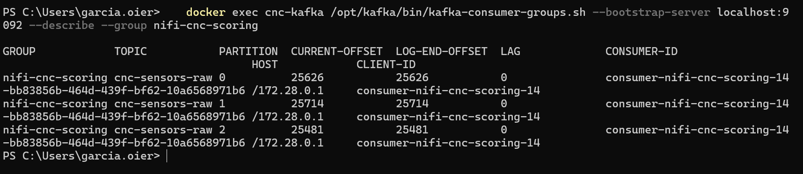

2026-10-27ko proba: irakurketak 10-26an sortu ziren (`timestamp`), Kafka-k gorde zituen NiFi geldirik zegoen bitartean, eta biharamunean iritsi ziren Elasticsearch-era (`ingested_at`):

<p align="center">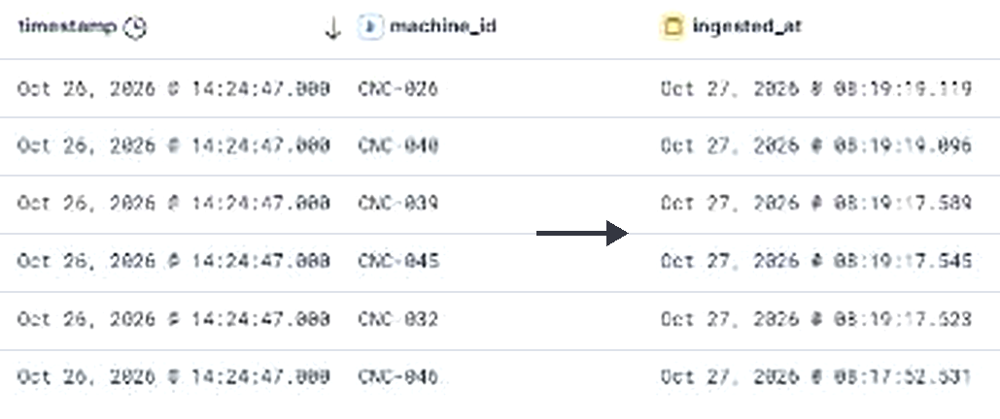</p>

<p align="center"><sub>Kibana Discover-eko zatia (<code>cnc-predictions</code>, 2026-10-27 08:19an ateratakoa): ezkerrean sortze-ordua, eskuinean Elasticsearch-era iritsitako ordua.</sub></p>

**Kontsumitzaileen etenaldi eta berrabiarazteak:**

| Data | Etenaldia | Emaitza |
|---|---|---|
| 2026-10-21 | NiFi 58 min geldirik | 1.160 irakurketa jaso ziren piztean (58 × 20): 0 galdu, 0 bikoiztu |
| 2026-10-27 | NiFi eta API-a gau osoan | 7.080 mezu Kafka-tik; API-a itzalita zegoenez "berriro saiatu" ilaran itxaron zuten: 0 galdu |
| 2026-10-30 | API-a 2 minutuz geldirik | NiFi berriro saiatu zen, eta API-a piztean ilarakoak prozesatu zituen |

### c) Datu-formatu egokia

| Urratsa | Formatua | Zergatik |
|---|---|---|
| Garraioa (Filebeat → Kafka) | CSV lerroa | Arina: Filebeat-en JSON osoa (host, log.file…) ez da behar |
| Eraldaketa eta API-a | JSON | Motak (zenbakiak, boolearrak), API-en estandarra |
| Biltegiratzea | JSON dokumentuak + mapping | Bilaketak eta agregazioak |
| Esportazioak | NDJSON (Kibana), JSON (NiFi) | Inportatzeko modukoak |

### d) Biltegiratutako datuak prozesatzea

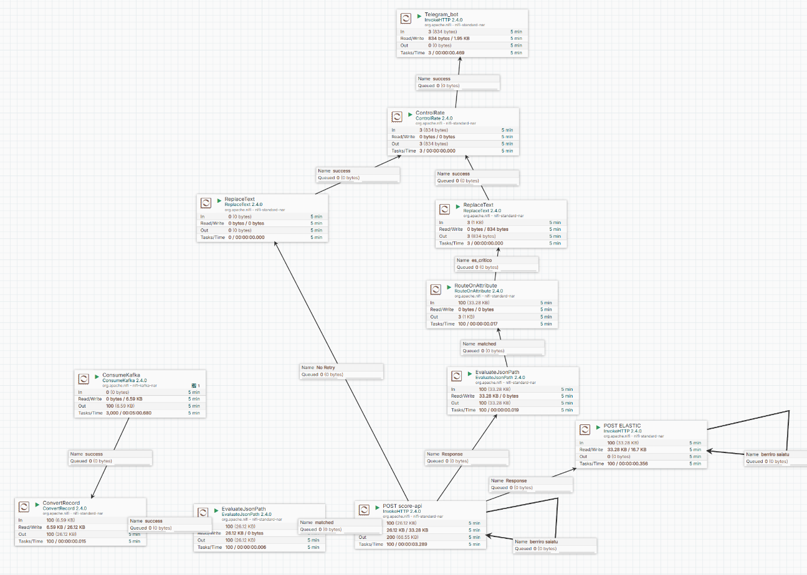

Datuen bidea: `ConsumeKafka` → `ConvertRecord` → `EvaluateJsonPath` → `POST score-api` → `POST ELASTIC`, "berriro saiatu" begiztekin:

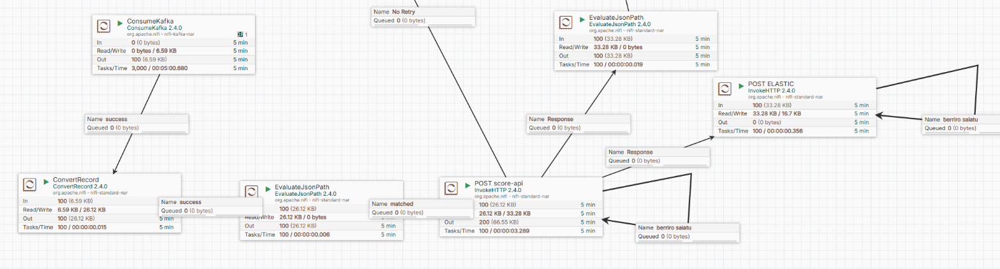

Alerten bidea: LARRIA (eskuinean) eta API-ak baztertutako datuak (`No Retry`, ezkerrean) Telegram-era:

<p align="center">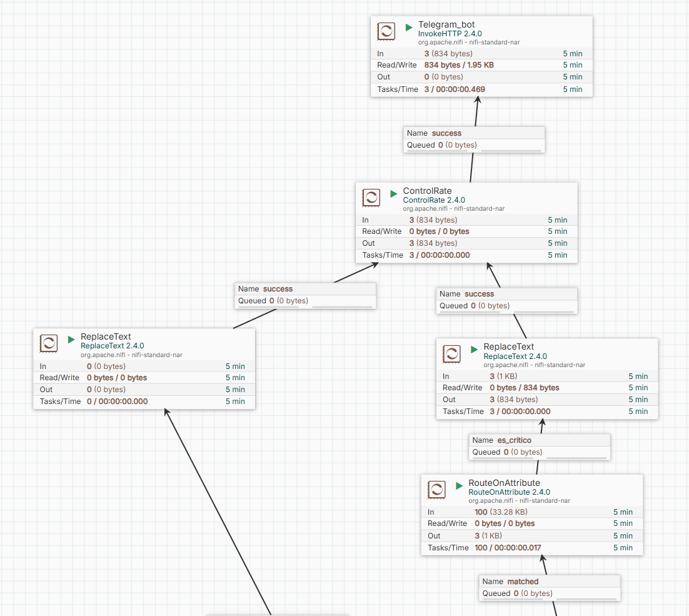</p>

| Prozesadorea | Zer egiten du |
|---|---|
| `ConsumeKafka` | Mezuak irakurri (`nifi-cnc-scoring` taldea) |
| `ConvertRecord` (CSVReader + JsonRecordSetWriter) | CSV → JSON, eskema esplizituarekin (14 eremu, motekin) |
| `EvaluateJsonPath` | `machine_id` atributu gisa atera (errore-mezuetarako) |
| `InvokeHTTP` (`POST score-api`) | API-ari deitu; `Retry`/`Failure` → bere buruarengana |
| `InvokeHTTP` (`POST ELASTIC`) | `cnc-predictions`-en gorde; `Retry`/`Failure` → bere buruarengana |
| `EvaluateJsonPath` → `RouteOnAttribute` | `alert_level` atera; `es_critico` = LARRIA |
| `ReplaceText` → `ControlRate` → `InvokeHTTP` | Telegram mezua prestatu, makina bakoitzeko 2 minutuan behin gehienez, bidali |
| `POST score-api`-ren `No Retry` → Telegram | API-ak baztertutako datuak (4xx) abisatu |

### e) Emaitzak bezeroarentzat

Hiru maila: **Telegram** (mantentze-arduradunarentzat, LARRIA bakoitzean), **dashboard-ak** (taldearentzat eta zuzendaritzarentzat) eta **README-ko taula** (emaitzak begi-kolpe batean). Mailak hitz arruntetan: OK, KONTUZ ("ikuskapena programatu"), LARRIA ("gaur bertan").

## 5.2 Datuen osotasuna (IE3)

### a) Datuen kalitatea

| Arazoa | Non | Neurria | Probatua |
|---|---|---|---|
| CSV goiburua | Filebeat | `exclude_lines: ['^timestamp']` | ✅ |
| Goiburuak Filebeat-etik ihes egiten badu | Elasticsearch | Pipeline: `machine_id == "machine_id"` → `drop` | ✅ Proba-dokumentua baztertua |
| Eremu nagusirik gabe | Elasticsearch | Pipeline: `drop` | ✅ `{"rpm": 1}` baztertua |
| Formatu okerra | NiFi | CSVReader eskema | ✅ JSON lerro bat → `ConvertRecord` failure |
| Balio okerrak | API | Pydantic: `machine_type` L/M/H, tarteak | ✅ `"T"` → 422 → Telegram |
| Bikoiztuak (fitxategiak) | Filebeat | Registry-a | ✅ 303 fitxategi aurkitu, 93 berriak bakarrik bidali |
| Bikoiztuak (dokumentuak) | Elasticsearch | `machine_id` + `timestamp` egiaztapena | ✅ Ikus behean |
| Proba-datuak | Elasticsearch | `_delete_by_query` | ✅ Proba-makinak ezabatuta |

**Bikoiztuen azterketa (2026-10-30):** `cnc-predictions`-en 50.270 dokumentu daude eta 44.865 `machine_id + timestamp` konbinazio desberdin (gutxi gorabehera, `cardinality` agregazioa). Egunero ~% 11 errepikatzen dira. Kasu bat aztertuta (CNC-047, 2026-10-21 07:53:32), lau dokumentuek neurketa eta probabilitate desberdinak dituzte (0,000tik 0,125era): **ez dira bikoiztuak**, simulagailuaren irakurketa desberdinak baizik, segundo berean. `cnc-sensors`-en, 2026-10-20an 10.250 dokumentu eta ~5.600 konbinazio desberdin daude: itxuraz, muntaketa-egunean datu batzuk berriz irentsi ziren.

**Inferentzian duen eragina:** datu oker batek iragarpen okerra ematen du (`rpm = 0` → `power_est = 0` → PWF iragarpena → alerta faltsua). Horregatik datuak API-ra iritsi aurretik garbitzen dira, eta API-ak berak tarteak egiaztatzen ditu: `rpm` > 0 izan behar da, eta `rpm = 0` duen irakurketa bat 422 errorearekin baztertzen da.

### b) Bolumena eta osotasuna

| Mekanismoa | Nola babesten du |
|---|---|
| Kafka buffer-a | NiFi gelditzen bada, mezuak Kafka-n (LAG); piztean offset-etik |
| NiFi ilarak | Backpressure: 10.000 FlowFile / 1 GB; beteta, aurreko prozesadorea gelditzen da |
| "Berriro saiatu" begiztak | API-a edo Elasticsearch erortzen badira, berriz saiatu |
| Filebeat registry | Berrabiaraztean ez du bikoizten |

Proba errealak: 5.1 b. Hobetzeko: `ConvertRecord`-en `failure` eta `POST ELASTIC`-en `No Retry` erlazioak gaur egun amaitu egiten dira (ezabatu); `cnc-errors` indize batera bidaliz gero, baztertutako lerroak kontatu eta aztertu ahal izango lirateke.

### c) Egiaztapen-baturak · d) Zerbitzariaren zeregina

| Sistema | Checksum-a | Zerbitzariaren zeregina |
|---|---|---|
| HDFS | Bloke bakoitzaren checksum-a idaztean kalkulatu eta irakurtzean egiaztatu | DataNode-ek blokeak aldizka egiaztatzen dituzte eta hondatuak NameNode-ari jakinarazten dizkiote, beste kopia batetik berriz kopiatzeko |
| Kafka | Mezu-sorta bakoitzak CRC32 bat | Broker-ak egiaztatzen du idaztean; kontsumitzaileak irakurtzean |
| Elasticsearch (Lucene) | Segmentu-fitxategi bakoitzak checksum bat | Shard-ak kopiatzean eta berreskuratzean egiaztatzen da |

## 5.3 Big Data negozio-erabakietarako (IE5)

### a) Datuen hautaketa BIrako

| Datua | Zertarako |
|---|---|
| Sentsoreen neurketak | Ereduaren sarrera; joerak eta balio anormalak |
| `machine_id` | Makinen arteko alderaketak, "zein makinara joan" |
| `machine_type` | Hutsegite-tasa desberdina (L % 4,08 · M % 2,44 · H % 2,03) |
| `timestamp` | Denbora-serieak eta "orain" |
| `failure_probability`, `alert_level` | Mantentze-erabakiak |
| `machine_failure` | Ereduaren asmatze-maila ekoizpenean |

### b) Garbiketa eta eraldaketa

Goiburuak iragazi (Filebeat), CSV → JSON motekin (NiFi), K → °C eta ezaugarri berriak (API), balio baliogabeak baztertu (Pydantic, ingest pipeline), eta API-aren sarrera notebook-eko prozesu berarekin prestatu (`Pipeline`).

### c) Big Data-k BIren balioa biderkatzen du

Datu historikoek bakarrik "zer gertatu zen" esaten dute. Datu-fluxu jarraitua + eredua konbinatzean, BIk "zer gertatuko den" esaten du, eta erabakiak aldez aurretik har daitezke.

### d) Enpresa-datuak bateratu

Telemetria, ereduaren emaitzak eta negozio-kostuak (1.200 €/h geldialdia, 150 € ikuskapena) konbinatu ditugu kostu-analisian. Benetako enpresa batean, gainera: lan-aginduak, piezen kostuak eta produkzio-plana (geldialdia zein ordutan den merkeena jakiteko).

### e) Informazioaren interpretazioa

| Datuek diotena | Erabakia |
|---|---|
| LARRIA alerta | Teknikaria makinara gaur bertan (Telegram) |
| KONTUZ alerta | Ikuskapena hurrengo txandan |
| Heatmap: L motako makinak, higadura > 200 min | L makinetan tresna 200 minutu baino lehen aldatu |
| Makina batek alerta asko (LARRIA taula) | Makina hori sakonago aztertu (CNC-012: 10 alerta 24 orduan) |
| Ekoizpeneko recall-a jaisten bada | Eredua berriz entrenatu (drift) |

**Alerta okerren ondorioak:** 357 alerta faltsuk 53.550 € balio dute (alferrikako ikuskapenak), eta 22 hutsegite galduk 105.600 €. Alerta faltsuak murrizteko atalasea igo daiteke, baina hutsegite gehiago galduko lirateke: 0,15 da oreka merkeena.

### f) BI eredu baten ezarpena

`cnc-alertak` dashboard-a erabakiak denbora errealean hartzeko diseinatuta dago: arriskutsuena orain (metric), arrisku maximoa (gauge), joera (line chart), LARRIA alertak (taula), eta ereduaren asmatze-maila zuzenean, sistemari zenbat fida daitekeen jakiteko. Telegram-ek alerta kritikoak bidaltzen ditu, inork pantailari begira egon beharrik gabe.
