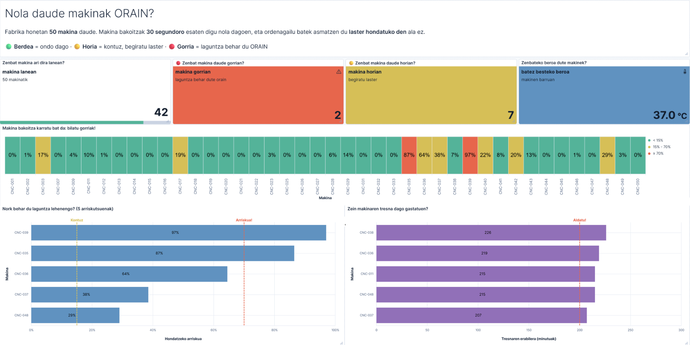
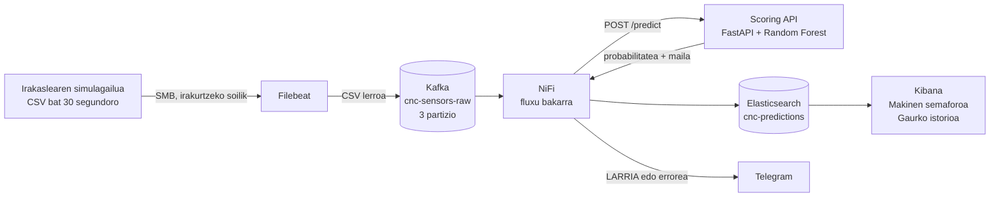
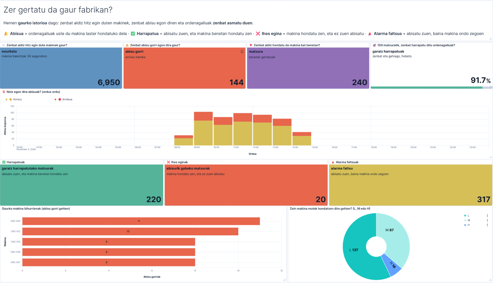

# CNC Guard: CNC makinen mantentze prediktiboa

**AABD Espezializazioa · Erronka 1 · Uni Eibar-Ermua · 5. taldea · 2026-2027**

ARAKAIN Makineriak enpresak 50 CNC makina ditu Bilboko fabrikan. Makina bat geldirik dagoen ordu bakoitzak **1.200 €** balio du. Orain arte makina hautsi arte itxaroten zen, eta gero konpontzen zen. Horri **mantentze korrektiboa** esaten zaio.

CNC Guard-en helburua makina hautsi **aurretik** abisatzea da: **mantentze prediktiboa**. Horretarako sistemak hiru gauza egiten ditu, erronkaren hiru faseetan:

1. Makinen sentsoreen datuak denbora errealean jaso eta gorde (1. fasea).
2. Datu historikoekin eredu bat entrenatu, hutsegiteak iragartzeko (2. fasea).
3. Eredua sisteman jarri: irakurketa bakoitzari arrisku bat eman eta, arriskua handia denean, alerta bat sortu Kibanan eta Telegram-en (3. fasea).



<p align="center"><sub>Makinen semaforoa dashboard-a: makina bakoitzaren egoera azken 5 minutuetan (2026-11-03, 14:17–14:23).</sub></p>

### Emaitzak laburrean

| | Proba-datuekin (notebook-a, 1.600 irakurketa) | Ekoizpenean (simulagailua, 7.550 irakurketa) |
|---|---|---|
| Garaiz harrapatutako hutsegiteak (**recall**) | **% 89** (54tik 48) | **% 91** (257tik 235) |
| Benetakoak diren alertak (**precision**) | % 41 | % 40 |
| Erroreen kostua, CNC Guard-ekin | 39.150 € | 159.150 € |
| Erroreen kostua, sistemarik gabe | 259.200 € | 1.233.600 € |

Nola irakurri taula: 100 hutsegitetik 89-91 garaiz abisatzen dira, eta 10 alertatik 4 dira benetako hutsegiteak. Ereduak berdin funtzionatzen du proba-datuekin eta datu berriekin (ekoizpenean); beraz, ez ditu datuak buruz ikasi. Kostuak nola kalkulatzen diren [4. atalean](#4-eredua-2-fasea) eta [9. atalean](#9-enpresarentzat-zer-egin-alerta-bakoitzarekin) azaltzen da.

> Hitz tekniko bat ulertzen ez baduzu (recall, topic-a, FlowFile, mapaketa...), begiratu [hiztegia](docs/dokumentazioa.md#hiztegia).

---

## Aurkibidea

1. [Nola funtzionatzen du](#1-nola-funtzionatzen-du)
2. [Arkitektura](#2-arkitektura)
3. [Datuak eta datuen kalitatea](#3-datuak-eta-datuen-kalitatea)
4. [Eredua (2. fasea)](#4-eredua-2-fasea)
5. [Iragarpenak denbora errealean (3. fasea)](#5-iragarpenak-denbora-errealean-3-fasea)
6. [Dashboard-ak](#6-dashboard-ak)
7. [Datuak ez galtzeko neurriak](#7-datuak-ez-galtzeko-neurriak)
8. [Emaitzak ekoizpenean](#8-emaitzak-ekoizpenean)
9. [Enpresarentzat: zer egin alerta bakoitzarekin](#9-enpresarentzat-zer-egin-alerta-bakoitzarekin)
10. [Erabaki teknikoak eta mugak](#10-erabaki-teknikoak-eta-mugak)
11. [Abiarazi](#11-abiarazi)
12. [Karpetak eta dokumentazioa](#12-karpetak-eta-dokumentazioa)

---

## 1. Nola funtzionatzen du

CNC Guard ez da programa bakar bat. Hainbat zatik batera lan egiten dute, eta **sistema adimendun** bat osatzen dute. Pertsona baten antzera, hiru zati ditu:

| Zatia | Zer egiten du | Gure osagaiak |
|---|---|---|
| **Pertzepzioa** (zentzumenak) | Makinak nola dauden neurtu eta datuak bildu | Simulagailua, Filebeat, Kafka, NiFi |
| **Inferentzia** (burmuina) | Datuetatik ondorio bat atera: makina honek huts egingo al du? | Random Forest eredua, scoring API-an |
| **Erantzuna** (ekintza) | Arriskua jakinarazi, pertsona batek erabaki dezan | OK / KONTUZ / LARRIA mailak, Kibana eta Telegram |

Hiru ideia garrantzitsu:

- **Behin ikasi, beti iragarri.** Eredua behin entrenatzen da, datu historikoekin (notebook-a), eta fitxategi batean gordetzen da (`.pkl`). Gero API-ak fitxategi hori erabiltzen du irakurketa berri bakoitzerako, ikasten jarraitu gabe. Horri esker iragarpenak azkarrak dira, eta eredua berriz entrena daiteke sistema gelditu gabe.
- **Azken erabakia pertsona batek hartzen du.** Sistemak abisatu egiten du, baina ez du makina gelditzen. Mantentze-arduradunak erabakitzen du zer egin. Nahita egin dugu horrela: makina bere kabuz geldituko balitz, sistema segurtasun-osagai bat izango litzateke, eta Europako AI Act legearen arabera arrisku altukoa.
- **AA ahula da.** Ataza bakar bat ondo egiteko egina dago (hutsegiteak iragartzea), eta ez daki beste ezer egiten.

---

## 2. Arkitektura



Datuen bidea, urratsez urrats:

1. **Simulagailua.** Irakaslearen zerbitzariak CSV fitxategi bat sortzen du 30 segundoro, goiburu batekin eta 10 irakurketarekin. Karpeta sarean partekatuta dago (SMB), eta guk **irakurtzeko soilik** muntatzen dugu.
2. **Filebeat.** Beats familiako agente arina da. Fitxategi berriak irakurtzen ditu, goiburua kentzen du eta lerro bakoitza Kafka-ra bidaltzen du. Kafka-ren **ekoizlea** (*producer*) da.
3. **Kafka.** Mezuak `cnc-sensors-raw` **topic**-ean gordetzen ditu, 3 **partiziotan**. Ekoizlearen eta kontsumitzailearen artean dago, bitartekari gisa: bata gelditzen bada, besteak ez du ezer galtzen. Horri **desakoplamendua** esaten zaio.
4. **NiFi.** Kafka-ren **kontsumitzailea** (*consumer*) da. Mezu bakoitza **FlowFile** bat da, eta **prozesadoreek** urratsez urrats lantzen dute: CSV-tik JSON-era bihurtu, API-ari galdetu, Elasticsearch-en gorde eta, arriskua handia bada, Telegram-era abisua bidali.
5. **Scoring API.** Python-ez (FastAPI) idatzitako zerbitzua. Irakurketa bat jasotzen du, eta hutsegite-probabilitatea eta alerta-maila itzultzen ditu.
6. **Elasticsearch.** Irakurketa, iragarpena eta benetako emaitza dokumentu berean gordetzen ditu, `cnc-predictions` **indizean**.
7. **Kibana.** Elasticsearch-eko datuak bi dashboard-etan erakusten ditu, 30 segundoro freskatuta.

| Osagaia | Zergatik hau |
|---|---|
| Filebeat | *Registry* batean gogoratzen du zer irakurri duen. Berrabiaraztean ez du ezer bikoizten, ezta galtzen ere |
| Kafka | Mezuak gordetzen ditu (*buffer*). NiFi edo API-a gelditzen badira, mezuek Kafka-n itxaroten dute, eta piztean utzitako lekutik jarraitzen da (**offset**-etik) |
| NiFi | Fluxuak arrastatu eta askatu bidez egiten dira, kode gabe. Ilarek eta "berriro saiatu" konexioek ez dute daturik galtzen uzten |
| Scoring API | Eredua behin kargatzen du abiaraztean; API-a token batekin babestuta dago |
| Elasticsearch | Bilaketak eta kalkuluak (agregazioak) oso azkar egiten ditu. **Mapaketa** batek eremu bakoitzaren mota finkatzen du (data, testua, zenbakia...) |
| Kibana | Dashboard-ak koderik gabe egiten dira (Lens), eta automatikoki freskatzen dira |

**Zer arkitektura mota da?** Datuak iristen diren heinean prozesatzen dira (**streaming**), ez multzoka gauean (**batch**). Prozesatzeko bide bakarra dago, eta horregatik **Kappa arkitekturaren** antzekoa da: dena stream bat da. Eredua entrenatzea, berriz, batch lan bat da: behin egiten da, datu historikoekin.

Kafka-ko gaian ikusitako **Bronze / Silver / Gold** geruzekin ere azal daiteke:

| Geruza | Gure sisteman |
|---|---|
| **Bronze** (datu gordinak) | Kafka-ko `cnc-sensors-raw` topic-a: CSV lerroak, ezer aldatu gabe |
| **Silver** (datu garbiak eta egituratuak) | NiFi-k JSON bihurtutako irakurketak, datu-mota zuzenekin, eta API-ak kalkulatutako ezaugarriak |
| **Gold** (KPIak eta laburpenak) | Elasticsearch-eko iragarpenak eta Kibanako adierazleak: makinak gorrian, abisuak orduz ordu, asmatze-maila |

### NiFi fluxua

Erronkaren 1. fasean bi NiFi fluxu genituen: bata irakurketak `cnc-sensors` indizean gordetzeko, eta bestea iragarpenak `cnc-predictions`-en gordetzeko. Orain **fluxu bakarra** dago: `cnc-predictions`-ek irakurketa, bere iragarpena eta benetako emaitza (`machine_failure`) dokumentu berean gordetzen ditu. Horrela bi dashboard-ek indize bera erabiltzen dute, eta ez dago bi indize lotu beharrik. `cnc-sensors` indizea (65.000 irakurketa, 2026-10-16tik 29ra) eta `nifi-flows/fase1_ingest.json` fluxua 1. faseko emaitza gisa gorde ditugu.


| Urratsa | Prozesadoreak | Zer egiten du |
|---|---|---|
| Irakurri | `ConsumeKafka` (kontsumitzaile-taldea: `nifi-cnc-scoring`) | Kafka-ko mezuak hartu |
| Bihurtu | `ConvertRecord` (CSVReader + JsonRecordSetWriter) | CSV lerroa JSON bihurtu, eremu bakoitza bere motarekin |
| Iragarri | `InvokeHTTP` (`POST score-api`) | API-ari galdetu. Huts egiten badu, berriro saiatzen da |
| Gorde | `InvokeHTTP` (`POST ELASTIC`) | Erantzuna `cnc-predictions`-en gorde. Huts egiten badu, berriro saiatzen da |
| Alerta | `EvaluateJsonPath` → `RouteOnAttribute` → `ReplaceText` → `ControlRate` → `InvokeHTTP` | Maila LARRIA bada, Telegram mezu bat bidali. Makina bakoitzeko gehienez mezu bat 2 minutuan |
| Errorea | `POST score-api`-ren `No Retry` harremana → Telegram | API-ak irakurketa bat baztertzen badu (datu okerra), "DATO NO PROCESADO" abisua |

---

## 3. Datuak eta datuen kalitatea

**Simulagailua.** 30 segundoro `cnc_batch_AAAAMMDD_HHMMSS_NNNNN.csv` fitxategi bat sortzen du, goiburu batekin eta 10 irakurketarekin: minutuko 20 irakurketa eta eguneko 28.800 inguru. **Denbora-serie erregularra** da, tarte finkoetan iristen delako. Datuak AI4I 2020 datu-multzoaren **test** zatitik datoz: ereduak ez ditu inoiz ikusi.

| Eremua | Mota (mapaketan) | Zer da |
|---|---|---|
| `timestamp` | date | Irakurketaren data eta ordua |
| `machine_id` | keyword | Makina: CNC-001etik CNC-050era |
| `machine_type` | keyword | Makina-mota: L (arina), M (ertaina) edo H (astuna) |
| `air_temp_K`, `process_temp_K` | float | Aireko eta prozesuko tenperatura, Kelvinetan. API-ak Celsius-era pasatzen ditu (`air_temp_C`, `process_temp_C`) |
| `rpm` | integer | Biraketa-abiadura (bira minutuko) |
| `torque_Nm` | float | Torkea (N·m): makinak egiten duen indarra |
| `tool_wear_min` | integer | Tresnaren higadura: zenbat minutu daraman lanean |
| `machine_failure` | boolean | Benetan huts egin zuen ala ez. **Ereduak ez du ikusten**: ekoizpenean ereduak zenbat asmatzen duen neurtzeko bakarrik gordetzen dugu |
| `failure_TWF/HDF/PWF/OSF/RNF` | 0/1 | Hutsegite-mota. **Ez ditugu erabiltzen**: hutsegitea bera adierazten dute, eta erabiliz gero ereduak "tranpa" egingo luke (*data leakage*) |

**Entrenamendu-datuak.** `data/ai4i2020_train.csv` fitxategiak 8.000 erregistro ditu, eta horietatik **271 dira hutsegiteak (% 3,39)**. Hau da, hutsegite bakoitzeko 28,5 irakurketa on daude. Horri **klase-desoreka** esaten zaio, eta [4. atalean](#4-eredua-2-fasea) azaltzen dugu nola konpondu dugun.


### Datuen kalitatea

Datu txarrek iragarpen txarrak ematen dituzte. Adibidez, `rpm = 0` bada, potentzia ere 0 da, eta ereduak potentzia-hutsegite bat iragarriko luke (alerta faltsua). Horregatik urrats bakoitzean babes bat jarri dugu:

| Arazoa | Non | Nola | Probatuta |
|---|---|---|---|
| CSV goiburua datu bat balitz bezala sartzea | Filebeat | `exclude_lines: ['^timestamp']` | Bai: indizeetan ez dago goibururik |
| Fitxategi bera bi aldiz irakurtzea | Filebeat | Registry-a (`filebeat-data` bolumena) | Bai: IPa aldatzean 303 fitxategi aurkitu zituen, eta 93 berriak bakarrik bidali |
| Mota okerrak (testua zenbaki baten ordez) | NiFi | CSVReader, eskema batekin | Bai: JSON formatuko lerro bat baztertu zen |
| Balio ezinezkoak edo makina-mota okerra | Scoring API | Pydantic: `machine_type` L/M/H bakarrik; tenperaturak tarte batean; `rpm` > 0; torkea eta higadura ≥ 0 | Bai: `machine_type = "T"` → 422 errorea eta Telegram abisua (2026-10-29) |
| `machine_id` edo `timestamp` gabeko dokumentuak | Elasticsearch | Ingest pipeline-a: `drop` | Bai: proba-dokumentuak baztertuta |
| Bikoiztuak | Elasticsearch | Makina eta ordu bera duten irakurketak bilatu | Bai: % 11 inguru, baina neurketa desberdinekin (adibidez, CNC-047ren 4 irakurketa ordu berean, probabilitate desberdinekin). Simulagailuaren irakurketa desberdinak dira, ez bikoiztuak |

---

## 4. Eredua (2. fasea)

Fitxategiak: `notebooks/02_training.ipynb` (entrenamendua) eta `models/cnc_failure_model.pkl` (gordetako eredua).

**Zer egiten du ereduak?** Irakurketa bat jasotzen du (tenperaturak, abiadura, torkea, higadura eta makina-mota) eta 0 eta 1 arteko zenbaki bat ematen du: makina horrek huts egiteko **probabilitatea**. **Ikaskuntza gainbegiratua** da: iraganeko irakurketa bakoitzean badakigu makinak huts egin zuen ala ez (**etiketa**), eta ereduak hori iragartzen ikasten du. Bi aukera bakarrik daudenez (hutsegitea bai ala ez), **sailkapen bitarra** da.

| Urratsa | Zer egin dugu | Zergatik |
|---|---|---|
| 1. Datuak aztertu (EDA) | Taulak, korrelazioak eta grafikoak | Datuak ezagutzeko: ez dago balio faltarik, eta % 3,39 bakarrik dira hutsegiteak |
| 2. Ezaugarri berriak (*feature engineering*) | `temp_diff` = prozesuko tenperatura − aireko tenperatura. `power_est` = torkea × rpm × 2π / 60 (potentzia, wattetan). Tenperaturak °C-tan | Bi tenperaturak oso lotuta daude (0,88), eta rpm eta torkea ere bai (−0,87). Konbinatuta informazio berria ematen dute |
| 3. Datuak prestatu | `Pipeline` bat: balio faltak bete (`SimpleImputer`), zenbakiak eskala berean jarri (`StandardScaler`) eta makina-mota zenbaki bihurtu (`OneHotEncoder`) | Prozesu bera notebook-ean eta API-an |
| 4. Klase-desoreka | `class_weight='balanced'`: hutsegite batek 28 irakurketa onek adina balio du. SMOTE ere probatu dugu | Bestela ereduak "beti ondo" esatea ikasiko luke |
| 5. Eredua | Random Forest, 200 zuhaitz | Konbinazioak ondo ikasten ditu: "higadura altua ETA torke altua" |
| 6. Atalasea | **0,15** (0,50 beharrean) | Hutsegite bat galtzea alerta faltsu bat baino askoz garestiagoa da |

<p align="center"></p>

**Zer da atalasea?** Ereduak probabilitate bat ematen du, eta atalasea da noiztik aurrera esaten dugun "hau hutsegitea da". Lehenetsia 0,50 da. Guk 0,15 erabiltzen dugu: probabilitatea % 15 edo handiagoa denean, alerta. Horrela hutsegite gehiago harrapatzen dira, alerta faltsu batzuen truke.

### Emaitzak (proba-datuak: 1.600 irakurketa, 54 hutsegite)

Kostua honela kalkulatu dugu: galdutako hutsegite bakoitza (**FN**, *false negative*) = 4 ordu geldirik × 1.200 € = **4.800 €**; alerta faltsu bakoitza (**FP**, *false positive*) = alferrikako ikuskapen bat = **150 €**.

| Aukera | Recall | Precision | Galduak (FN) | Alerta faltsuak (FP) | Kostua |
|---|---|---|---|---|---|
| class_weight, atalasea 0,50 | 0,76 | 0,89 | 13 | 5 | 63.150 € |
| SMOTE, atalasea 0,50 | 0,83 | 0,68 | 9 | 21 | 46.350 € |
| SMOTE, atalasea 0,15 | 0,87 | 0,30 | 7 | 112 | 50.400 € |
| **class_weight, atalasea 0,15 (erabiltzen duguna)** | **0,89** | **0,41** | **6** | **69** | **39.150 €** |

- **Recall 0,89:** benetako 100 hutsegitetik 89 harrapatzen ditu.
- **Precision 0,41:** 100 alertatik 41 dira benetako hutsegiteak.
- **ROC-AUC 0,979:** ereduak hutsegiteak eta irakurketa onak zenbateraino bereizten dituen (0,5 = zoria, 1 = perfektua).

| Atalasea 0,50 | Atalasea 0,15 |
|---|---|
|  |  |

<p align="center"><sub>Nahasmen-matrizeak (confusion matrix): 0,15 atalasearekin 13 hutsegite galdu beharrean 6 galtzen dira.</sub></p>

<p align="center"></p>

**Beste ereduekin alderatuta** (atalasea 0,15):

| Eredua | Familia | Recall | Precision | ROC-AUC | FN | FP | Kostua |
|---|---|---|---|---|---|---|---|
| Erregresio logistikoa | Lineala | 0,98 | 0,07 | 0,923 | 1 | 734 | 114.900 € |
| HistGradientBoosting | Zuhaitz askoren konbinazioa (boosting) | 0,76 | 0,61 | 0,969 | 13 | 26 | 66.300 € |
| **Random Forest** | **Zuhaitz askoren konbinazioa (bagging)** | **0,89** | **0,41** | **0,979** | **6** | **69** | **39.150 €** |

Erregresio logistikoak ia dena harrapatzen du, baina 734 alerta faltsurekin: teknikariek ez liokete kasurik egingo. HistGradientBoosting-ek alerta gutxiago ematen ditu, baina 13 hutsegite galtzen ditu. Random Forest da merkeena.

**Balidazio gurutzatua** (5-fold, 0,50 atalasearekin): entrenamendu-datuak 5 zatitan banatu, eta 5 aldiz entrenatu eta probatu dugu, zati desberdinekin. Emaitza: recall 0,74 ± 0,10 · precision 0,88 ± 0,05 · ROC-AUC 0,978 ± 0,019. Emaitza egonkorra da: ez dago zatiketa bakar baten zortearen menpe.

**Aldagai garrantzitsuenak** (`feature_importances_`): torkea 0,22 · higadura 0,20 · rpm 0,19 · `power_est` 0,19 · `temp_diff` 0,10. Zentzua du: gastatuta dagoen eta indar handia egiten duen tresna bat lehenago apurtzen da. Guk sortutako bi aldagaiak (`power_est` eta `temp_diff`) lehen bostetan daude.

**Makina-motaren arabera:** galdutako 6 hutsegiteak L motako 5 makinatan daude (CNC-038 bi aldiz, CNC-040, 041, 042 eta 043). Recall-a: L 0,88 (48tik 42) · M 1,00 (4tik 4) · H 1,00 (2tik 2).

---

## 5. Iragarpenak denbora errealean (3. fasea)

`scoring/score_api.py` (FastAPI). NiFi-k irakurketa bakoitza `POST /predict` helbidera bidaltzen du. API-ak 8 ezaugarriak kalkulatzen ditu, notebook-ean bezala, eta hau itzultzen du:

| Eremua | Adibidea | Zer da |
|---|---|---|
| `machine_id` | `CNC-009` | Makina |
| `air_temp_C`, `process_temp_C`, `temp_diff`, `power_est` | `29.55`, `37.65`, `8.1`, `7343.5` | API-ak kalkulatutako ezaugarriak |
| `failure_probability` | `0.985` | Hutsegite-probabilitatea |
| `failure_predicted` | `true` | `true`, probabilitatea 0,15 edo handiagoa bada |
| `alert_level` | `LARRIA` | Alerta-maila (ikus behean) |
| `machine_failure` | `true` | Benetako emaitza. Ebaluaziorako bakarrik; ereduak ez du erabiltzen |

| Maila | Probabilitatea | Esanahia | Kolorea |
|---|---|---|---|
| **OK** | % 15 baino gutxiago | Ez dago arriskurik | Berdea |
| **KONTUZ** | % 15etik % 70era | Ikuskapena programatu | Horia |
| **LARRIA** | % 70 edo gehiago | Makina gaur bertan begiratu (Telegram abisua) | Gorria |

**Zergatik ez erronkaren % 50 / % 80 mugak?** Gure ereduak % 15etik aurrera "ikusten" ditu hutsegiteak ([4. atala](#4-eredua-2-fasea)). % 50eko muga jarriz gero, % 15 eta % 50 arteko kasuak OK gisa agertuko lirateke, eta notebook-ean berreskuratutako hutsegiteak berriz galduko genituzke. Horregatik mailak gure eredura egokitu ditugu. API-ak, Kibanako koloreek eta notebook-eko ebaluazioak muga berak erabiltzen dituzte.


Sarrerako eskemak (`SentsoreEskaera`) balioak egiaztatzen ditu: tenperaturak tarte batean, `rpm` > 0, torkea eta higadura ≥ 0. Irteerakoak (`PredikzioErantzuna`) beti forma bera du:

<p align="center"></p>

**Benetako adibide bat.** Elasticsearch-en gordetako LARRIA iragarpen bat, benetan huts egin zuen makina batena (`machine_failure: true`). CNC-009-k tenperatura-diferentzia txikia (8,1 K, 8,6 K baino gutxiago) eta abiadura baxua (1.275 rpm, 1.380 baino gutxiago) ditu batera. Hori da AI4I datuetako bero-hutsegitearen (HDF) araua. Ereduak ez zekien arau hori: datuetatik ikasi du.

<p align="center"></p>

**Telegram abisua** (LARRIA bakoitzean, makina bakoitzeko gehienez 2 minutuan behin):

<p align="center"></p>

---

## 6. Dashboard-ak

Bi dashboard ditugu Kibanan, biak `cnc-predictions` indizearen gainean. Bakoitzak galdera bakar bati erantzuten dio, eta fabrikako edozein langilek ulertzeko moduan daude idatzita:

| Dashboard-a | Galdera | Denbora-tartea |
|---|---|---|
| **Makinen semaforoa** | Nola daude makinak orain? Zein makinara joan behar da lehenengo? | Azken 5 minutuak |
| **Gaurko istorioa** | Zer gertatu da gaur? Zenbat asmatu du ereduak? | Gaur, 00:00etatik aurrera |

Biak 30 segundoro freskatzen dira, simulagailuaren erritmoan. Koloreak beti berdinak dira: **berdea** % 15 baino gutxiago, **horia** % 15–70, **gorria** % 70 edo gehiago.

### Makinen semaforoa

Irudia dokumentu honen hasieran dago.

| Panela | Grafiko mota | Zer erakusten du |
|---|---|---|
| Zenbat makina ari dira lanean? | Metrika (KPI) | Azken 5 minutuetan datuak bidali dituzten makinak, 50etik |
| Zenbat makina daude gorrian? | Metrika | Probabilitatea % 70 edo gehiago duten makinak |
| Zenbat makina daude horian? | Metrika | Probabilitatea % 15–70 duten makinak |
| Zenbateko beroa dute makinek? | Metrika | Prozesuko batez besteko tenperatura (°C) |
| Makina bakoitza karratu bat da | Heatmap | Makina bakoitzaren probabilitate handiena, kolorez |
| Nork behar du laguntza lehenengo? | Barra-diagrama | 5 makina arriskutsuenak, % 15 eta % 70eko lerroekin |
| Zein makinaren tresna dago gastatuen? | Barra-diagrama | Higadura handiena duten 5 makinak, 200 minutuko lerroarekin |

### Gaurko istorioa

| Panela | Grafiko mota | Zer erakusten du |
|---|---|---|
| Zenbat aldiz hitz egin dute makinek gaur? | Metrika | Gaurko irakurketa kopurua |
| Zenbat abisu gorri egon dira gaur? | Metrika | LARRIA mailako irakurketak |
| Zenbat aldiz hondatu da makina bat benetan? | Metrika | Benetako hutsegiteak (`machine_failure`) |
| 100 matxuratik, zenbat harrapatu ditu ordenagailuak? | Metrika | Ekoizpeneko recall-a, zuzenean |
| Noiz egon dira abisuak? | Barra-diagrama pilatua | KONTUZ eta LARRIA abisuak, orduz ordu |
| Harrapatuak, Ihes eginak, Alarma faltsuak | 3 metrika | Ekoizpeneko nahasmen-matrizea: TP, FN eta FP |
| Gaurko makina bihurrienak | Barra-diagrama | LARRIA abisu gehien izan dituzten 5 makinak |
| Zein makina motak hondatzen dira gehien? | Donut | Benetako hutsegiteak makina-motaren arabera (L, M, H) |



<p align="center"><sub>Gaurko istorioa dashboard-a, 2026-11-03ko egun osoa.</sub></p>

**Lehen bertsioa.** 1. eta 3. faseetan erronkak eskatutako grafikoak (line chart-ak, gauge-a eta data table-ak) `cnc-sensoreak` eta `cnc-alertak` dashboard-etan egin genituen. Gero bi dashboard hauekin ordezkatu genituen, errazago irakurtzeko. Lehen bertsioaren argazkiak eta bi bertsioen arteko alderaketa [dokumentazioaren 4.2 atalean](docs/dokumentazioa.md#42-aginte-koadroak-ie2) daude.

---

## 7. Datuak ez galtzeko neurriak

| Mekanismoa | Nola babesten du |
|---|---|
| **Kafka buffer-a** | NiFi gelditzen bada, mezuak Kafka-n geratzen dira. Piztean, utzitako offset-etik jarraitzen du |
| **NiFi ilarak** | Prozesadore bakoitzaren artean ilara bat dago. Beteta badago (**back-pressure**: 10.000 FlowFile), aurreko prozesadorea gelditu egiten da, eta ez da ezer galtzen |
| **"Berriro saiatu"** | `InvokeHTTP`-ren `Retry` eta `Failure` harremanak prozesadore berera itzultzen dira: API-a edo Elasticsearch erortzen badira, berriro saiatzen da |
| **Filebeat registry** | Berrabiaraztean ez ditu lerroak bikoizten |

**Benetako probak:**

| Data | Zer gertatu zen | Emaitza |
|---|---|---|
| 2026-10-21 | NiFi 58 minutuz geldirik | Piztean 1.160 irakurketa jaso ziren (58 min × 20/min): 0 galdu, 0 bikoiztu |
| 2026-10-27 | NiFi eta API-a gau osoan geldirik | NiFi-k Kafka-ko 7.080 mezu irakurri zituen. API-a itzalita zegoenez, "berriro saiatu" ilaran itxaron zuten, eta API-a piztean guztiak prozesatu ziren: 0 galdu |
| 2026-10-29 | Kafka-ren egoera | 3 partiziotan 76.821 mezu, LAG 0: NiFi-k dena irakurrita du |


2026-10-27ko proba Kibanan: irakurketak 10-26an sortu ziren (`timestamp`, ezkerrean), baina NiFi geldirik zegoen bitartean Kafka-k gorde zituen, eta biharamunean iritsi ziren Elasticsearch-era (`ingested_at`, eskuinean). Bat ere ez zen galdu:

<p align="center"></p>

<p align="center"><sub>Kibana Discover-eko zatia (<code>cnc-predictions</code>), 2026-10-27 08:19an ateratakoa.</sub></p>

---

## 8. Emaitzak ekoizpenean

**Bi egun simulagailuarekin.** 2026-10-29 09:15etik (`machine_failure` indizera iristen hasi zenetik) 2026-10-30eko goizera arte, simulagailuaren **7.550 irakurketa**:

| | Ereduak: ondo | Ereduak: hutsegitea |
|---|---|---|
| **Benetan: ondo** | 6.936 | 357 (alerta faltsuak) |
| **Benetan: hutsegitea** | **22** (galduak) | **235** (garaiz harrapatuak) |

- **Recall 0,91** eta **precision 0,40**. Notebook-ean 0,89 eta 0,41 ziren: ereduak ez du okerrera egiten datu berriekin.
- Batez besteko probabilitatea **0,68** da benetako hutsegiteetan, eta **0,02** besteetan. Ereduak ondo bereizten ditu bi taldeak.
- **Kostua:** 22 × 4.800 + 357 × 150 = **159.150 €**. Sistemarik gabe, 257 hutsegiteak ustekabean gertatuko lirateke: 257 × 4.800 = **1.233.600 €**.
- **Latentzia** (CSV fitxategitik Elasticsearch-era): mediana **17 segundo**. Irakurketen % 5ek 25 minutu baino gehiago behar izan zituzten, baina ez latentzia normalagatik: geldialdi baten ondoren Kafka-k gordetako mezuak berandu iritsi ziren.
- Azken 24 orduetan: OK 6.892 · KONTUZ 432 · LARRIA 156.

**Egun oso bat Kibanan (2026-11-03).** Gaurko istorioa dashboard-ak egunaren kontua zuzenean erakusten du:


Egun horretan 6.950 irakurketatik 240 izan ziren benetako hutsegiteak. Ereduak 220 harrapatu zituen eta 20 galdu (recall % 91,7), eta 317 alarma faltsu eman zituen (precision % 41). Notebook-eko emaitza berberak dira.

---

## 9. Enpresarentzat: zer egin alerta bakoitzarekin

| Maila | Zer egin | Zergatik |
|---|---|---|
| **OK** | Ezer ez | Makina ondo dago |
| **KONTUZ** | Ikuskapena hurrengo txandan programatu | Geldialdi programatu labur bat askoz merkeagoa da ustekabeko matxura bat baino |
| **LARRIA** | Telegram abisua jaso, eta teknikaria makinara gaur bertan | Hutsegite bat galtzeak 4.800 € inguru balio du (4 h × 1.200 €/h) |

**Programatutako geldialdia vs ustekabeko matxura.** Alerta faltsu batek ere geldialdi bat dakar, baina **programatua**: teknikaria eta piezak prest daude, eta ordubete inguruan konpontzen da. Ustekabeko matxura batek, berriz, orduak irauten ditu, eta inork ez du prestatuta. Horregatik onartzen ditugu alerta faltsu batzuk (precision 0,41), hutsegite gutxiago galtzearen truke (recall 0,89). 0,15 atalasearekin notebook-eko erroreen kostua 63.150 €-tik 39.150 €-ra jaisten da; sistemarik gabe 259.200 € izango lirateke.

Kostu hauek gure suposizioetan oinarritzen dira (konponketa 4 ordu, ikuskapena 150 €). Enpresak bere benetako zenbakiekin egiaztatu beharko lituzke.

---

## 10. Erabaki teknikoak eta mugak

| Erabakia | Zergatik |
|---|---|
| Filebeat, eta ez NiFi-k fitxategiak zuzenean irakurtzea | Registry-ak lerroz lerro gogoratzen du zer irakurri duen, bikoiztu gabe. NiFi-ko `GetFile`-k fitxategiak ezabatu egingo lituzke |
| Kafka erdian | Buffer gisa: NiFi edo API-a erortzen badira, ez da daturik galtzen (frogatuta: 7.080 mezu) |
| NiFi fluxu bakarra eta `cnc-predictions` indize bakarra | Irakurketa, iragarpena eta benetako emaitza dokumentu berean: dashboard-ak eta ebaluazioa errazagoak |
| Random Forest + `class_weight` | Konbinazioak ikasten ditu, aldagaien garrantzia ematen du, eta desoreka zuzentzen du datuak aldatu gabe |
| Atalasea 0,15 | Kostuaren araberakoa (FN bat FP bat baino 32 aldiz garestiagoa). 0,11 apur bat merkeagoa litzateke (34.350 €), baina alerta faltsu gehiagorekin, eta teknikariek alertei kasu egiteari utz diezaiekete |
| API-ak eredua behin kargatzen du (`lifespan`) | Iragarpen bakoitzak milisegundo batzuk behar ditu, ez segundoak |
| Telegram NiFi-tik, eta ez Kibanatik | Doakoa da (Kibanako konektoreek ordainpeko lizentzia behar dute), eta alerta datu-bidean bertan sortzen da |
| Sistemak ez du makina gelditzen | Giza gainbegiraketa (AI Act, 14. artikulua) |
| API-a editorearen edukiontzian, uvicorn-ekin | Taldeak kodea zuzenean aldatu eta probatu dezake (`--reload`). Horregatik `docker-compose.yml`-ek ez du `scoring-api` zerbitzurik |

### Mugak eta hobekuntzak

| Muga | Ekoizpenean nola egingo genukeen |
|---|---|
| Elasticsearch eta Kibana pasahitzik gabe; Kafka zifratu gabe (PLAINTEXT) | Segurtasuna aktibatu: erabiltzaileak, rolak eta TLS |
| Pasahitzak eta Telegram tokena konfigurazio-fitxategietan | `.env` fitxategia, Docker secrets edo NiFi-ko parametro sentikorrak |
| Nodo bakarra: 0 erreplika eta errepikatze-faktorea 1 | Gutxienez 3 nodo, erreplika 1 eta errepikatze-faktorea 3 |
| `ConvertRecord`-ek baztertutako lerroak ezabatu egiten dira, kontatu gabe | `cnc-errors` indize batera bidali, aztertzeko |
| Eredua ez da bere kabuz berriz entrenatzen | Ekoizpeneko recall-a zaindu (Gaurko istorioa dashboard-ean dago) eta jaisten bada berriz entrenatu (*model drift*) |

---

## 11. Abiarazi

**Aurretik:** Docker Desktop instalatuta, eta `.env` fitxategia proiektuaren karpetan:

```
VM_IP=<PC-aren IPa>
API_TOKEN=<API-aren tokena>
```

**Lehen aldiz** (PowerShell, proiektuaren karpetan):

```powershell
docker compose up -d --build
docker compose ps        # 6 edukiontzi: kafka, filebeat, nifi, elasticsearch, kibana, editor
```


**Egunero** (lehendik dauden edukiontziak piztu, ezer berriz sortu gabe):

```powershell
docker compose start
```

> Kontuz: `docker-compose.yml` aldatu ondoren `docker compose up -d` exekutatzen bada, aldatutako edukiontziak berriz sortzen dira, eta NiFi-ko fluxuak eta editoreko Python-a galtzen dira.

**Elasticsearch** (behin bakarrik):

```powershell
$ES = "http://localhost:9200"
Invoke-RestMethod -Method Put "$ES/_ingest/pipeline/cnc-predictions-pipeline" -ContentType "application/json" -InFile elasticsearch\cnc-predictions-pipeline.json
Invoke-RestMethod -Method Put "$ES/_index_template/cnc-predictions-template"  -ContentType "application/json" -InFile elasticsearch\cnc-predictions-template.json
```

**Scoring API-a** (editorean: `http://<IP>:8444`). Editorearen irudiak ez du Python-ik, eta lehen aldiz instalatu behar da:

```powershell
docker exec -u root cnc-editor bash -c "apt-get update && apt-get install -y python3 python3-venv python3-pip"
```

Gero, editoreko terminalean:

```bash
cd ~/workspace/cnc-guard
python3 -m venv .venv                       # lehen aldiz bakarrik
source .venv/bin/activate
pip install -r scoring/requirements.txt     # lehen aldiz bakarrik
uvicorn score_api:app --app-dir scoring --reload --host 0.0.0.0 --port 8000
```

`Eredua ondo kargatu da memoriak.` mezua agertu behar da. Egiaztatzeko (PowerShell; editoreak bere 8000 portua PC-aren **8001** portuan argitaratzen du):

```powershell
curl.exe -H "Authorization: Bearer <API_TOKEN>" http://localhost:8001/health
# {"status":"ok","model_loaded":true}
```

**NiFi** (`https://<IP>:8443/nifi`): `nifi-flows/fase3_streaming.json` inportatu eta abiarazi. **Kibana** (`http://<IP>:5601`): Stack Management → Saved objects → Import → `dashboards/kibana_export.ndjson`.

**LARRIA alerta bat simulatzeko (demoa):** CSV lerro bat Kafka-ra bidali, simulagailuak egiten duen bezala. Balioak gainkarga-hutsegite (OSF) baten modukoak dira, eta ereduak 0,94 inguru ematen du:

```powershell
$ts = (Get-Date).ToUniversalTime().ToString("yyyy-MM-ddTHH:mm:ssZ")
"$ts,CNC-DEMO,L,299.0,309.5,1400,62.0,215,1,0,0,0,1,0" | docker exec -i cnc-kafka /opt/kafka/bin/kafka-console-producer.sh --bootstrap-server localhost:9092 --topic cnc-sensors-raw
```

Demoaren ondoren, proba-datua ezabatu:

```powershell
curl.exe -X POST "http://localhost:9200/cnc-predictions/_delete_by_query" -H "Content-Type: application/json" -d '{\"query\":{\"term\":{\"machine_id\":\"CNC-DEMO\"}}}'
```

| Zerbitzua | URLa |
|---|---|
| NiFi | `https://<IP>:8443/nifi` |
| Kibana | `http://<IP>:5601` |
| Elasticsearch | `http://<IP>:9200` |
| Scoring API (Swagger) | `http://<IP>:8444/proxy/8000/docs` |
| Editorea | `http://<IP>:8444` |

---

## 12. Karpetak eta dokumentazioa

```
cnc-guard/
├── README.md                    ← dokumentu hau
├── docker-compose.yml           ← zerbitzu guztiak
├── filebeat/filebeat.yml        ← CSV → Kafka
├── nifi-flows/
│   ├── fase1_ingest.json        ← 1. fasea (irakurketak → cnc-sensors)
│   └── fase3_streaming.json     ← fluxu bakarra: API, cnc-predictions eta Telegram
├── elasticsearch/               ← mapaketa, plantilla eta ingest pipeline-ak
├── notebooks/02_training.ipynb  ← EDA, entrenamendua eta ebaluazioa
├── models/cnc_failure_model.pkl ← entrenatutako eredua
├── scoring/                     ← FastAPI (score_api.py, requirements.txt)
├── dashboards/kibana_export.ndjson
├── data/ai4i2020_train.csv
└── docs/
    ├── dokumentazioa.md         ← ebaluazio-irizpideen araberako azalpena
    ├── galderak.md              ← G1–G12 galderen erantzunak
    └── irudiak/                 ← pantaila-argazkiak
```

| Dokumentua | Edukia |
|---|---|
| [`docs/dokumentazioa.md`](docs/dokumentazioa.md) | Hiztegia, eta moduluz moduluko azalpena ebaluazio-irizpideen arabera: sistema adimenduna, ereduak, AI Act eta GDPR, ikaskuntza automatikoa, programazioa, Big Data datu-bidea eta BI |
| [`docs/galderak.md`](docs/galderak.md) | Erronkako G1–G12 galderen erantzunak |
| [`ENUNTZIATUA.md`](ENUNTZIATUA.md) | Erronkaren enuntziatua |
