# CNC Guard: CNC makinen mantentze prediktiboa

**AABD Espezializazioa · 1. erronka · Uni Eibar-Ermua · T5 taldea · 2026-2027**

Taldea: Dorkaitz, Fabrizio, Oier eta Unai.

ARAKAIN Makineriak enpresak 50 CNC makina ditu Bilboko fabrikan. Makina bat geldirik dagoen ordu bakoitzak **1.200 €** balio du. Orain arte makina hautsi arte itxaroten zen, eta gero konpontzen zen. Horri **mantentze korrektiboa** esaten zaio.

CNC Guard-en helburua makina hautsi **aurretik** abisatzea da: **mantentze prediktiboa**. Horretarako, sistemak hiru gauza egiten ditu, erronkaren hiru faseetan:

1. Makinen sentsore-datuak denbora errealean jaso eta gorde (1. fasea).
2. Datu historikoekin eredu bat entrenatu, hutsegiteak iragartzeko (2. fasea).
3. Eredua sisteman jarri: irakurketa bakoitzari arrisku bat eman eta, arriskua handia denean, abisua bidali Kibanara eta Telegram-era (3. fasea).

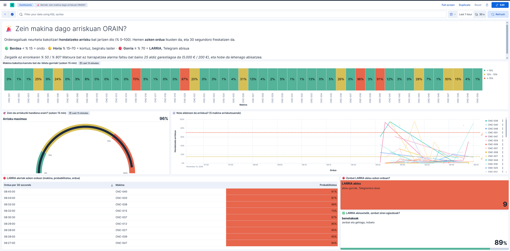

<p align="center"><sub>Alertak dashboard-a (2026-11-12): makina bakoitza karratu bat da, eta kolorea bere hutsegite-arriskua.</sub></p>

### Emaitzak laburrean

| | Notebook-a (balidazioa, 1.600 irakurketa) | Ekoizpena (simulagailua, 7.550 irakurketa) |
|---|---|---|
| Garaiz harrapatutako hutsegiteak (**recall**) | **% 89** (54tik 48) | **% 91** (257tik 235) |
| Egiazkoak diren alertak (**precision**) | % 41 | % 40 |
| Kostua, CNC Guard-ekin | 58.200 € | 251.900 € |
| Kostua, sistemarik gabe | 270.000 € | 1.285.000 € |

Nola irakurri taula: 100 hutsegitetik 89-91 garaiz abisatzen dira, eta 10 alertatik 4 dira benetako hutsegiteak. Ereduak berdin funtzionatzen du notebook-ean eta inoiz ikusi ez dituen datuekin; beraz, ez ditu datuak buruz ikasi. Kostuak irakaslearen kostu-taula ofizialarekin kalkulatu ditugu ([4.6 atala](#46-kostuen-analisia)).

---

## Aurkibidea

1. [Nola funtzionatzen du](#1-nola-funtzionatzen-du)
2. [Arkitektura](#2-arkitektura)
3. [1. fasea: datuak jaso eta gorde](#3-1-fasea-datuak-jaso-eta-gorde)
4. [2. fasea: eredua entrenatu](#4-2-fasea-eredua-entrenatu)
5. [3. fasea: iragarpenak denbora errealean](#5-3-fasea-iragarpenak-denbora-errealean)
6. [Emaitzak ekoizpenean](#6-emaitzak-ekoizpenean)
7. [Enpresarentzat: zer egin alerta bakoitzarekin](#7-enpresarentzat-zer-egin-alerta-bakoitzarekin)
8. [Alderdi legalak eta etikoak](#8-alderdi-legalak-eta-etikoak)
9. [Erabaki teknikoak eta mugak](#9-erabaki-teknikoak-eta-mugak)
10. [Pentsatzeko galderak](#10-pentsatzeko-galderak)
11. [Adimen artifizialeko agenteen erabilera](#11-adimen-artifizialeko-agenteen-erabilera)
12. [Abiarazi](#12-abiarazi)
13. [Karpetak eta fitxategiak](#13-karpetak-eta-fitxategiak)
14. [Hiztegia](#14-hiztegia)
15. [Erreferentziak](#15-erreferentziak)

---

## 1. Nola funtzionatzen du

CNC Guard ez da programa bakar bat. Hainbat zatik batera lan egiten dute, eta **sistema adimendun** bat osatzen dute. Pertsona baten antzera, hiru zati ditu:

| Zatia | Zer egiten du | Gure osagaiak |
|---|---|---|
| **Pertzepzioa** (zentzumenak) | Makinak nola dauden neurtu eta datuak bildu | Simulagailua, Filebeat, Kafka eta NiFi |
| **Inferentzia** (burmuina) | Datuetatik ondorio bat atera: makina honek huts egingo al du? | Random Forest eredua, scoring API-an |
| **Erantzuna** (ekintza) | Arriskua jakinarazi, pertsona batek erabaki dezan | OK / KONTUZ / LARRIA mailak, Kibana eta Telegram |

Hiru ideia garrantzitsu:

- **Behin ikasi, beti iragarri.** Eredua behin entrenatzen da, datu historikoekin (notebook-a), eta fitxategi batean gordetzen da (`.pkl`). Gero API-ak fitxategi hori erabiltzen du irakurketa berri bakoitzerako, ikasten jarraitu gabe. Horri esker iragarpenak azkarrak dira, eta eredua berriz entrena daiteke sistema gelditu gabe.
- **Azken erabakia pertsona batek hartzen du.** Sistemak abisatu egiten du, baina ez du makina gelditzen. Mantentze-arduradunak erabakitzen du zer egin ([8. atala](#8-alderdi-legalak-eta-etikoak)).
- **AA ahula da.** Ataza bakar bat ondo egiteko egina dago (hutsegiteak iragartzea), eta ez daki beste ezer egiten.

**Erabilitako AA teknikak.** **Ikaskuntza gainbegiratua** da: iraganeko irakurketa bakoitzean badakigu makinak huts egin zuen ala ez (**etiketa**), eta ereduak hori iragartzen ikasten du. Bi aukera bakarrik daudenez (hutsegitea bai ala ez), **sailkapen bitarra** da. Eredua **Random Forest** bat da: 200 erabaki-zuhaitzek bozkatzen dute (*ensemble* eredua). Gainera, **atalasea doitu** dugu, hau da, zein probabilitatetatik aurrera den alerta, kostuen arabera.

---

## 2. Arkitektura

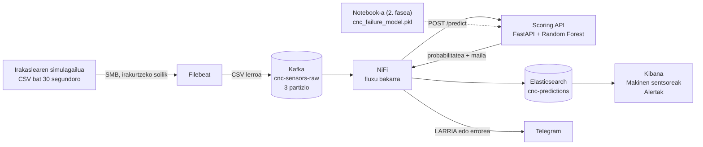

Datuen bidea, urratsez urrats:

1. **Simulagailua.** Irakaslearen zerbitzariak CSV fitxategi bat sortzen du 30 segundoro, goiburu batekin eta 10 irakurketarekin. Karpeta sarean partekatuta dago (SMB), eta guk **irakurtzeko soilik** muntatzen dugu.
2. **Filebeat.** Fitxategi berriak irakurtzen ditu, goiburua kentzen du eta lerro bakoitza Kafka-ra bidaltzen du. Kafka-ren **ekoizlea** (*producer*) da.
3. **Kafka.** Mezuak `cnc-sensors-raw` **topic**-ean gordetzen ditu, 3 **partiziotan**. Ekoizlearen eta kontsumitzailearen artean dago, bitartekari gisa: bata gelditzen bada, besteak ez du ezer galtzen. Horri **desakoplamendua** esaten zaio.
4. **NiFi.** Kafka-ren **kontsumitzailea** (*consumer*) da. Mezu bakoitza **FlowFile** bat da, eta **prozesadoreek** urratsez urrats lantzen dute: CSV-tik JSON-era bihurtu, API-ari galdetu, Elasticsearch-en gorde eta, arriskua handia bada, Telegram-era abisua bidali.
5. **Scoring API.** Python-ez (FastAPI) idatzitako zerbitzua. Irakurketa bat jasotzen du, eta hutsegite-probabilitatea eta alerta-maila itzultzen ditu.
6. **Elasticsearch.** Irakurketa, iragarpena eta benetako emaitza dokumentu berean gordetzen ditu, `cnc-predictions` **indizean**.
7. **Kibana.** Elasticsearch-eko datuak bi dashboard-etan erakusten ditu, 30 segundoro freskatuta.

CSV fitxategia sortzen denetik irakurketa Elasticsearch-en dagoen arte, **17 segundo** igarotzen dira (mediana).

| Osagaia | Zergatik hau |
|---|---|
| Filebeat | *Registry* batean gogoratzen du zer irakurri duen. Berrabiaraztean ez du ezer bikoizten, ezta galtzen ere |
| Kafka | Mezuak gordetzen ditu (*buffer*). NiFi edo API-a gelditzen badira, mezuek Kafka-n itxaroten dute, eta piztean utzitako lekutik jarraitzen da (**offset**-etik) |
| NiFi | Fluxuak arrastatu eta askatu bidez egiten dira, kode gabe. Ilarek eta «berriro saiatu» konexioek ez dute daturik galtzen uzten |
| Scoring API | Eredua behin kargatzen du abiaraztean, eta token batekin babestuta dago |
| Elasticsearch | Bilaketak eta kalkuluak (agregazioak) oso azkar egiten ditu. **Mapaketa** batek eremu bakoitzaren mota finkatzen du |
| Kibana | Dashboard-ak koderik gabe egiten dira (Lens), eta automatikoki freskatzen dira |

**Edukiontziak.** Docker Compose-k zortzi edukiontzi abiarazten ditu:

| Edukiontzia | Zertarako | Portua |
|---|---|---|
| `cnc-kafka` | Kafka (KRaft modua, ZooKeeper gabe) | 29092 |
| `cnc-filebeat` | Filebeat | Ez du portu publikorik |
| `cnc-nifi` | NiFi | 8443 |
| `cnc-elasticsearch` | Elasticsearch | 9200 |
| `cnc-kibana` | Kibana. Ez da zuzenean argitaratzen: saio-hasieraren atzean dago | Ez du portu publikorik |
| `cnc-kibana-auth` eta `cnc-kibana-proxy` | Kibanaren saio-hasiera: pasahitza eskatzen du Kibanara sartu aurretik | 5601 |
| `cnc-editor` | Taldearen editorea (code-server) eta, haren barruan, scoring API-a | 8444 eta 8001 |

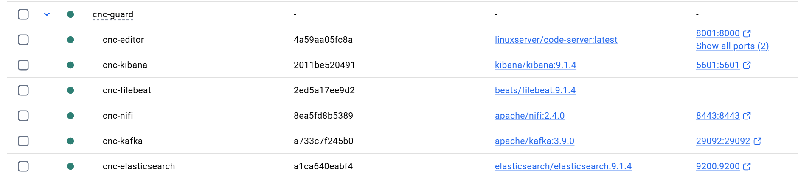

<p align="center"><sub>Docker Desktop: oinarrizko sei edukiontziak. Kibanaren saio-hasierako biak (`kibana-auth` eta `kibana-proxy`) gero gehitu genituen.</sub></p>

**Zer arkitektura mota da?** Datuak iristen diren heinean prozesatzen dira (**streaming**), ez multzoka gauean (**batch**). Prozesatzeko bide bakarra dago, eta horregatik **Kappa arkitekturaren** antzekoa da. Eredua entrenatzea, berriz, batch lan bat da: behin egiten da, datu historikoekin.

Kafka-ko gaian ikusitako **Bronze / Silver / Gold** geruzekin ere azal daiteke:

| Geruza | Gure sisteman |
|---|---|
| **Bronze** (datu gordinak) | Kafka-ko `cnc-sensors-raw` topic-a: CSV lerroak, ezer aldatu gabe |
| **Silver** (datu garbiak eta egituratuak) | NiFi-k JSON bihurtutako irakurketak, datu-mota zuzenekin, eta API-ak kalkulatutako ezaugarriak |
| **Gold** (KPIak eta laburpenak) | Elasticsearch-eko iragarpenak eta Kibanako adierazleak: hutsegite-tasa, makinak gorrian eta LARRIA abisuen asmatze-maila |

---

## 3. 1. fasea: datuak jaso eta gorde

### 3.1 Datuak

**Simulagailua.** 30 segundoro `cnc_batch_AAAAMMDD_HHMMSS_NNNNN.csv` fitxategi bat sortzen du, goiburu batekin eta 10 irakurketarekin: minutuko 20 irakurketa eta eguneko 28.800 inguru. **Denbora-serie erregularra** da, tarte finkoetan iristen delako. Lerro batek itxura hau du:

```
2026-04-29T10:57:50Z,CNC-039,L,299.0,308.6,1587,38.6,124,0,0,0,0,0,0
```

Datuak **AI4I 2020 Predictive Maintenance** datu-multzokoak dira (UCI, CC BY 4.0 lizentzia): 10.000 irakurketa. Horietatik 8.000 entrenatzeko dira (`data/ai4i2020_train.csv`), eta beste 2.000ak simulagailuak erabiltzen ditu (`ai4i2020_test.csv`). Beraz, simulagailuaren datuak ereduak inoiz ikusi ez dituen datuak dira.

| Eremua | Mota (mapaketan) | Zer da |
|---|---|---|
| `timestamp` | date | Irakurketaren data eta ordua |
| `machine_id` | keyword | Makina: CNC-001etik CNC-050era |
| `machine_type` | keyword | Makina-mota: L (arina), M (ertaina) edo H (astuna) |
| `air_temp_K`, `process_temp_K` | float | Aireko eta prozesuko tenperatura, Kelvinetan. API-ak Celsius-era pasatzen ditu (`air_temp_C`, `process_temp_C`) |
| `rpm` | integer | Biraketa-abiadura (bira minutuko) |
| `torque_Nm` | float | Torkea (N·m): makinak egiten duen indarra |
| `tool_wear_min` | integer | Tresnaren higadura: zenbat minutu daraman lanean |
| `machine_failure` | boolean | Benetan huts egin zuen ala ez. **Ereduak ez du ikusten**: ekoizpenean ereduak zenbat asmatzen duen neurtzeko bakarrik gordetzen dugu |
| `failure_TWF/HDF/PWF/OSF/RNF` | 0/1 | Hutsegite-mota. **Ez ditugu erabiltzen**: hutsegitea bera adierazten dute, eta erabiliz gero ereduak «tranpa» egingo luke (*data leakage*) |

### 3.2 Filebeat

`filebeat/filebeat.yml` fitxategiaren gakoak:

```yaml
filebeat.inputs:
  - type: filestream
    id: cnc-stream
    paths:
      - /mnt/cnc-stream/*.csv
    exclude_lines: ['^timestamp']
    prospector.scanner.fingerprint.enabled: false
    file_identity:
      path: ~

output.kafka:
  hosts:
    - "kafka:9092"
  topic: "cnc-sensors-raw"
  codec.format:
    string: '%{[message]}'
```

| Gakoa | Zer egiten du | Zergatik |
|---|---|---|
| `filestream` eta `paths` | Karpetako CSV fitxategi guztiak irakurri | Simulagailuak fitxategi berri bat sortzen du 30 segundoro |
| `exclude_lines` | Goiburu-lerroa baztertu | Goiburua ez da irakurketa bat ([G3](docs/galderak.md#g3-goiburua-elasticsearch-era-iristea)) |
| `fingerprint.enabled: false` eta `file_identity: path` | Fitxategiak bidearen arabera identifikatu | Fitxategiak 850 byte inguru dira, eta *fingerprint*-ak gutxienez 1.024 byte behar ditu: bestela ez ziren irakurtzen |
| `output.kafka` | `kafka:9092`-ra bidali, `cnc-sensors-raw` topic-era | Docker sarean zerbitzuaren izena erabiltzen da helbide gisa |
| `codec.format` | Lerro gordina bakarrik bidali | Filebeat-en metadaturik gabe, NiFi-k CSV lerroa zuzenean irakur dezan |

Filebeat-en *registry*-a `filebeat-data` bolumenean gordetzen da, eta edukiontzia berriz sortzean ere mantentzen da.

### 3.3 Kafka

Kafka **KRaft** moduan dabil: broker bat, ZooKeeper gabe. `cnc-sensors-raw` topic-ak **3 partizio** ditu. Bi **kontsumitzaile-talde** erabili ditugu, bakoitza bere *offset*-ekin: `nifi-cnc-ingest` (1. fasea) eta `nifi-cnc-scoring` (3. fasea).

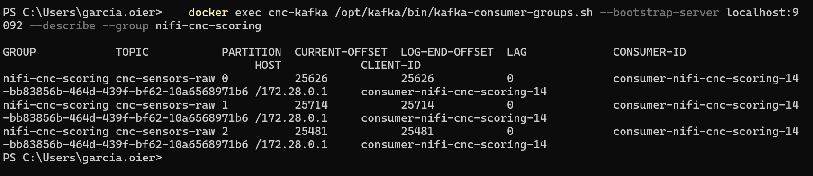

<p align="center"><sub>2026-10-29: 76.821 mezu 3 partiziotan, eta LAG 0. NiFi-k dena irakurrita du.</sub></p>

### 3.4 NiFi (1. fasea)

1. fasean, `nifi-flows/fase1_ingest.json` fluxuak irakurketak `cnc-sensors` indizean gordetzen zituen:

`ConsumeKafka` (`nifi-cnc-ingest` taldea) → `ConvertRecord` (CSVReader eskema batekin, eta JSON idazlea) → `InvokeHTTP` (`POST cnc-sensors/_doc`)

`ConvertRecord`-ek CSV lerroa JSON bihurtzen du, eremu bakoitza bere motarekin (testua, zenbakia, data). 3. fasean fluxu bakar batera pasatu ginen ([5.2 atala](#52-nifi-fluxua)). `cnc-sensors` indizea (65.000 irakurketa, 2026-10-16tik 29ra) 1. faseko emaitza gisa gorde dugu.

### 3.5 Elasticsearch

| Indizea | Fasea | Edukia |
|---|---|---|
| `cnc-sensors` | 1. fasea | Irakurketa gordinak (Kelvinetan). 65.000 dokumentu, 2026-10-16tik 29ra. Orain ez du datu berririk jasotzen |
| `cnc-predictions` | 3. fasea | Irakurketa (°C-tan), ezaugarri berriak, iragarpena, alerta-maila eta benetako emaitza, dokumentu berean |

Bi indizeek **mapaketa** finko bat dute (`timestamp` date da, `machine_id` keyword, `rpm` integer...) eta **ingest pipeline** bat. Pipeline-ak `machine_id` edo `timestamp` gabeko dokumentuak (eta goiburua) baztertzen ditu, eta `ingested_at` eremua gehitzen du: dokumentua noiz iritsi zen. Fitxategiak `elasticsearch/` karpetan daude.

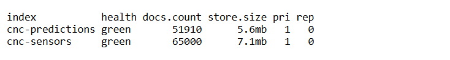

### 3.6 Datuen kalitatea

Datu txarrek iragarpen txarrak ematen dituzte. Adibidez, `rpm = 0` bada, potentzia ere 0 da, eta ereduak potentzia-hutsegite bat iragarriko luke (alerta faltsua). Horregatik urrats bakoitzean babes bat jarri dugu:

| Arazoa | Non | Nola | Probatuta |
|---|---|---|---|
| CSV goiburua datu bat balitz bezala sartzea | Filebeat | `exclude_lines: ['^timestamp']` | Bai: indizeetan ez dago goibururik |
| Fitxategi bera bi aldiz irakurtzea | Filebeat | Registry-a (`filebeat-data` bolumena) | Bai: IPa aldatzean 303 fitxategi aurkitu zituen, eta 93 berriak bakarrik bidali |
| Mota okerrak (testua zenbaki baten ordez) | NiFi | CSVReader, eskema batekin | Bai: JSON formatuko lerro bat baztertu zen |
| Balio ezinezkoak edo makina-mota okerra | Scoring API | Pydantic: `machine_type` L/M/H bakarrik; tenperaturak tarte batean; `rpm` > 0; torkea eta higadura ≥ 0 | Bai: `machine_type = "T"` → 422 errorea eta Telegram abisua (2026-10-29) |
| `machine_id` edo `timestamp` gabeko dokumentuak | Elasticsearch | Ingest pipeline-a: `drop` | Bai: proba-dokumentuak baztertuta |
| Bikoiztuak | Elasticsearch | Makina eta ordu bera duten irakurketak bilatu | Bai: % 11 inguru, baina neurketa desberdinekin. Simulagailuaren irakurketa desberdinak dira, ez bikoiztuak |

### 3.7 Datuak ez galtzeko neurriak

| Mekanismoa | Nola babesten du |
|---|---|
| **Kafka buffer-a** | NiFi gelditzen bada, mezuak Kafka-n geratzen dira. Piztean, utzitako offset-etik jarraitzen du |
| **NiFi ilarak** | Prozesadore bakoitzaren artean ilara bat dago. Beteta badago (**back-pressure**: 10.000 FlowFile), aurreko prozesadorea gelditu egiten da, eta ez da ezer galtzen |
| **«Berriro saiatu»** | `InvokeHTTP`-ren `Retry` eta `Failure` harremanak prozesadore berera itzultzen dira: API-a edo Elasticsearch erortzen badira, 10 segundoro berriro saiatzen da |
| **Filebeat registry** | Berrabiaraztean ez ditu lerroak bikoizten |

**Benetako probak:**

| Data | Zer gertatu zen | Emaitza |
|---|---|---|
| 2026-10-21 | NiFi 58 minutuz geldirik | Piztean 1.160 irakurketa jaso ziren (58 min × 20/min): 0 galdu, 0 bikoiztu |
| 2026-10-27 | NiFi eta API-a gau osoan geldirik | NiFi-k Kafka-ko 7.080 mezu irakurri zituen. API-a itzalita zegoenez, «berriro saiatu» ilaran itxaron zuten, eta API-a piztean guztiak prozesatu ziren: 0 galdu |
| 2026-10-29 | Kafka-ren egoera | 3 partiziotan 76.821 mezu, LAG 0: NiFi-k dena irakurrita du |

2026-10-27ko proba Kibanan: irakurketak 10-26an sortu ziren (`timestamp`, ezkerrean), baina NiFi geldirik zegoen bitartean Kafka-k gorde zituen, eta biharamunean iritsi ziren Elasticsearch-era (`ingested_at`, eskuinean). Bat ere ez zen galdu:

<p align="center">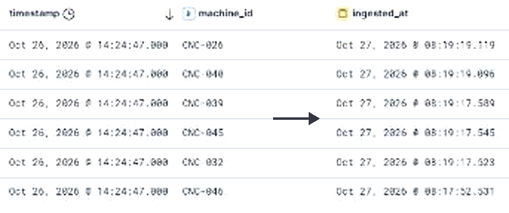</p>

### 3.8 Makinen sentsoreak dashboard-a

Erronkaren 1. faseak dashboard bat eskatzen du lau bistaratze-motekin: tenperatura denboran zehar, higadura eta hutsegiteen heatmap-a, azken 50 gertaeren taula, eta KPI txartelak. Hori da **Makinen sentsoreak** dashboard-a. Izenburuak galdera gisa idatzi ditugu, fabrikako edozein langilek uler ditzan, eta 30 segundoro freskatzen da.

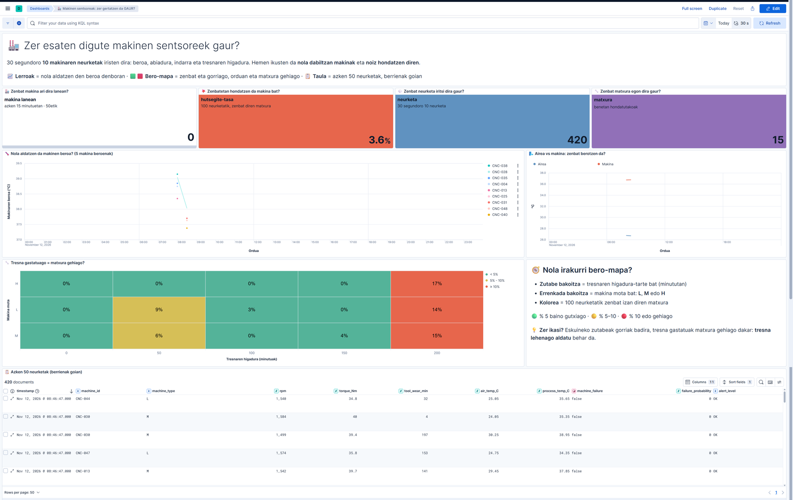

| Panela | Grafiko mota | Zer erakusten du | Erronkak eskatzen duena |
|---|---|---|---|
| Zenbat makina ari dira lanean? | Metrika (KPI) | Azken 15 minutuetan datuak bidali dituzten makinak, 50etik | KPI: makina aktiboak |
| Zenbatetan hondatzen da makina bat? | Metrika (KPI) | Hutsegite-tasa: 100 neurketatik zenbat diren matxura | KPI: hutsegite-tasa |
| Zenbat neurketa iritsi dira gaur? | Metrika | Gaurko irakurketa kopurua | |
| Zenbat matxura egon dira gaur? | Metrika | Benetako hutsegiteak (`machine_failure`) | |
| Nola aldatzen da makinen beroa? | Lerro-diagrama | Prozesuko tenperatura denboran zehar, 5 makina beroenak | Line chart: tenperatura makinaka |
| Airea vs makina: zenbat berotzen da? | Lerro-diagrama | Aireko eta makinaren tenperatura, batez beste | |
| Tresna gastatuago = matxura gehiago? | Heatmap | Hutsegite-tasa, tresnaren higadura-tartearen eta makina-motaren arabera | Heatmap: higadura eta hutsegiteak |
| Azken 50 neurketak | Taula (bilaketa gordea) | Azken 50 irakurketak, berrienak goian | Data table: azken 50 gertaerak |

Testu-panel batek heatmap-a nola irakurri azaltzen du: zutabe bakoitza higadura-tarte bat da, errenkada bakoitza makina-mota bat, eta kolorea 100 neurketatik zenbat izan diren matxura. Heatmap horrek argi erakusten du ideia nagusia: 200 minututik gorako higadurarekin, hiru makina-motetan gorria da (% 14-17).

---

## 4. 2. fasea: eredua entrenatu

Fitxategiak: `notebooks/02_training.ipynb` (azterketa, entrenamendua eta ebaluazioa) eta `models/cnc_failure_model.pkl` (gordetako eredua).

**Zer egiten du ereduak?** Irakurketa bat jasotzen du (tenperaturak, abiadura, torkea, higadura eta makina-mota), eta 0 eta 1 arteko zenbaki bat ematen du: makina horrek huts egiteko **probabilitatea**.

### 4.1 Datuen azterketa (EDA)

- 8.000 irakurketa eta 13 zutabe. Ez dago balio faltarik.
- 271 hutsegite bakarrik (**% 3,39**): hutsegite bakoitzeko 28,5 irakurketa on daude. Horri **klase-desoreka** esaten zaio.
- Makina-motak: L 4.830 irakurketa (% 4,08 hutsegite), M 2.381 (% 2,44) eta H 789 (% 2,03).

<p align="center">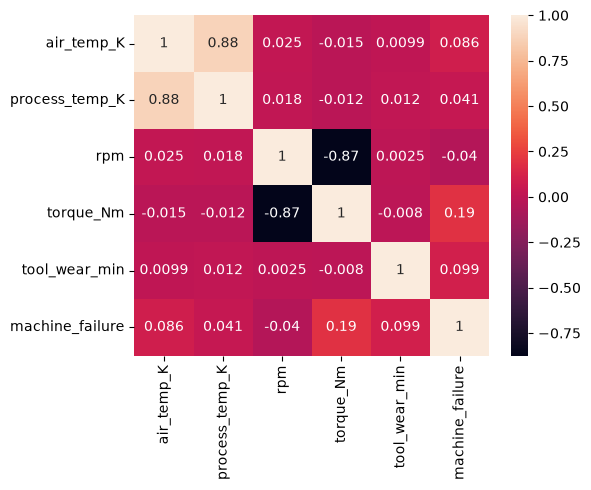</p>

Korrelazio-matrizeak bi gauza erakusten ditu. Batetik, bi tenperaturak oso lotuta daude (0,88), eta abiadura eta torkea ere bai (−0,87): elkarrekin aldatzen dira. Bestetik, aldagai batek ere ez du hutsegitea bakarrik azaltzen (torkea 0,19 da, eta higadura 0,10). Hutsegiteak **konbinazioetatik** datoz, eta horregatik behar dugu konbinazioak ikasten dituen eredu bat.

### 4.2 Aurreprozesatzea eta ezaugarri berriak

| Urratsa | Zer egin dugu | Zergatik |
|---|---|---|
| Zutabeak kendu | `failure_TWF/HDF/PWF/OSF/RNF` eta `machine_id` | Hutsegite-motak hutsegitea bera dira (*data leakage*). `machine_id` izen bat da, ez neurketa bat |
| Unitateak | Tenperaturak Kelvinetik °C-ra | Irakurtzeko errazagoa. API-ak eta Kibanak unitate berak erabiltzen dituzte |
| `temp_diff` (berria) | Prozesuko tenperatura − aireko tenperatura | AI4I datuetan, bero-hutsegitea (HDF) diferentzia hori 8,6 K baino txikiagoa denean gertatzen da, abiadura 1.380 rpm baino txikiagoa bada |
| `power_est` (berria) | Torkea × rpm × 2π / 60: potentzia, wattetan | Potentzia-hutsegitea (PWF) potentzia 3.500 W baino txikiagoa edo 9.000 W baino handiagoa denean gertatzen da. Notebook-ean ikusi dugu: hutsegiteetan 1.148-10.470 W, irakurketa onetan 3.515-8.998 W |
| Pipeline-a | `SimpleImputer` eta `StandardScaler` zenbakietan; `OneHotEncoder` makina-motan | Prozesu bera entrenatzean eta iragartzean. Eskalatzea erregresio logistikoarentzat behar da; zuhaitzek ez dute behar, baina ez die kalterik egiten |
| Zatiketa | 80/20, `stratify=y`: 6.400 entrenatzeko eta 1.600 balidaziorako (54 hutsegite). Notebook-ean, `X_test` aldagaia | Bi zatietan hutsegiteen proportzio bera |

Ezaugarri berriak ez ditugu asmatu: datuen jatorrizko arauak (UCI-ko deskribapena) eta korrelazioak begiratuta sortu ditugu. Gainera, eredu entrenatuak berak baieztatzen du baliagarriak direla: `power_est` eta `temp_diff` aldagai garrantzitsuenen artean daude ([G7](docs/galderak.md#g7-aldagai-garrantzitsuenak)).

### 4.3 Klase-desoreka

| Aukera | Zer egiten du | Gure iritzia |
|---|---|---|
| **`class_weight='balanced'`** | Hutsegite bakoitzari pisu handiagoa ematen dio entrenatzean (28,5 aldiz), datuak aldatu gabe | **Aukeratua**. 8.000 datu originalak mantentzen dira |
| SMOTE | Hutsegite sintetikoak sortzen ditu, interpolazioz, klaseak berdindu arte | Probatua ([4.4 atala](#44-ereduak-eta-haien-konparaketa)). Entrenamenduan bakarrik aplikatzen da |
| Gainlaginketa (*oversampling*) | Dauden hutsegiteak bikoiztu | Ereduak errenkada horiek buruz ikasteko arriskua |
| Azpilaginketa (*undersampling*) | Irakurketa onak ezabatu | 7.400 errenkada inguru galduko genituzke |
| **Atalasea doitu** | Ez du ereduak ikasten duena aldatzen: probabilitate bat alerta bihurtzeko muga bakarrik | **Aukeratua**, `class_weight`-ekin batera ([4.5 atala](#45-ebaluazioa-eta-atalasea)) |

### 4.4 Ereduak eta haien konparaketa

Hiru eredu entrenatu ditugu, aurreprozesatze berarekin eta zatiketa berarekin:

| Eredua | Atalasea | Recall | Precision | ROC-AUC | Galduak (FN) | Alarma faltsuak (FP) | Kostua |
|---|---|---|---|---|---|---|---|
| Random Forest + `class_weight` | 0,50 | 0,76 | 0,89 | 0,979 | 13 | 5 | 78.300 € |
| Random Forest + SMOTE | 0,50 | 0,83 | 0,68 | 0,962 | 9 | 21 | 62.700 € |
| Erregresio logistikoa (`class_weight`) | 0,50 | 0,83 | 0,16 | 0,923 | 9 | 235 | 105.500 € |
| **Random Forest + `class_weight`** | **0,15** | **0,89** | **0,41** | **0,979** | **6** | **69** | **58.200 €** |
| Random Forest + SMOTE | 0,15 | 0,87 | 0,30 | 0,962 | 7 | 112 | 71.500 € |
| Erregresio logistikoa (`class_weight`) | 0,15 | 0,98 | 0,07 | 0,923 | 1 | 734 | 167.700 € |

| Random Forest + `class_weight` (0,15) | Random Forest + SMOTE (0,15) | Erregresio logistikoa (0,15) |
|---|---|---|
| 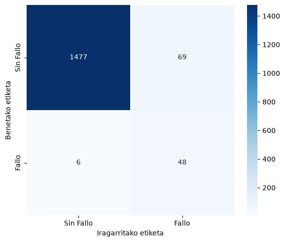 |  | 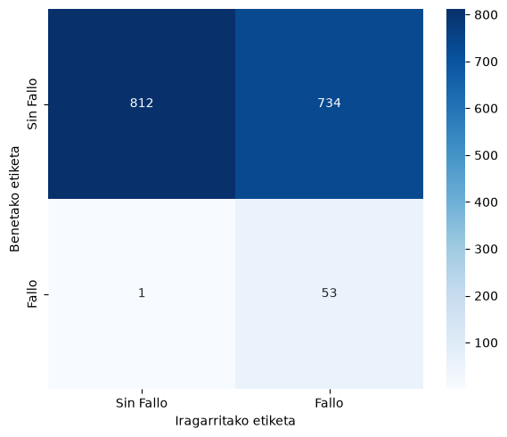 |

- **Erregresio logistikoa** eredu lineala da, eta ezin ditu konbinazioak ikasi («higadura handia ETA torke handia»). 0,15ean ia dena harrapatzen du, baina 734 alarma faltsurekin: 10 alertatik 9 baino gehiago faltsuak dira, eta teknikariek ez liokete kasurik egingo.
- **SMOTE**-k hutsegite gehiago harrapatzen ditu 0,50ean, baina atalasea doitu ondoren `class_weight` baino okerragoa da: galdu bat gehiago (7 eta 6), eta % 62 alarma faltsu gehiago (112 eta 69).
- **Random Forest + `class_weight`** da merkeena gure atalasearekin, eta ROC-AUC handiena du: arriskuak hobekien ordenatzen dituena da.

### 4.5 Ebaluazioa eta atalasea

**Zer da atalasea?** Ereduak probabilitate bat ematen du, eta atalasea da noiztik aurrera esaten dugun «hau hutsegitea da». Lehenetsia 0,50 da. Guk **0,15** erabiltzen dugu: probabilitatea % 15 edo handiagoa denean, alerta. Horrela hutsegite gehiago harrapatzen dira, alerta faltsu batzuen truke.

<p align="center">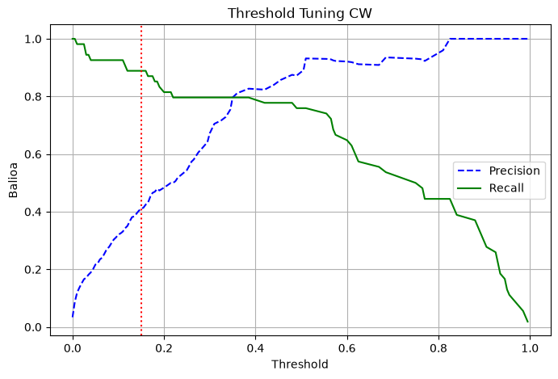</p>

Grafikoan, atalasea jaistean **recall**-a (berdea) igo egiten da eta **precision**-a (urdina) jaitsi. Puntu-lerro gorria gure 0,15 da.

| Atalasea 0,50 | Atalasea 0,15 |
|---|---|
| 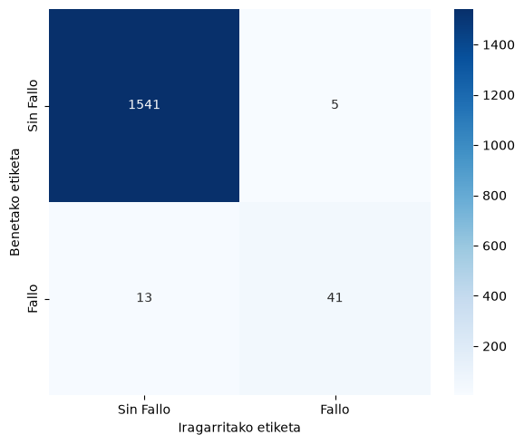 |  |

**Nahasmen-matrizeak nola irakurri.** Errenkadak benetan gertatu zena dira, eta zutabeak ereduak esan zuena. 0,15ekin, 54 hutsegitetik 48 harrapatzen dira (TP) eta 6 galtzen (FN), 0,50ekin 13 galtzen ziren bitartean. Truke: alarma faltsuak (FP) 5etik 69ra igotzen dira.

**Classification report-a** (0,15 atalasearekin):

```
              precision    recall  f1-score   support

       False       1.00      0.96      0.98      1546
        True       0.41      0.89      0.56        54

    accuracy                           0.95      1600
```

- `True` lerroa hutsegiteena da: **recall 0,89** (100 hutsegitetik 89 harrapatzen dira), **precision 0,41** (100 alertatik 41 dira egiazkoak) eta F1 0,56 (biak zenbaki bakarrean). `support` 54 da: balidazioan dauden hutsegiteak.
- `False` lerroa irakurketa onena da: ia guztiak ondo sailkatzen dira.
- **Accuracy 0,95** ez da adierazle ona hemen: beti «ondo» esaten duen eredu batek % 96,6 lortuko luke, hutsegite bat ere harrapatu gabe ([G5](docs/galderak.md#g5-accuracy-ren-tranpa)).
- **ROC-AUC 0,979**: ereduak hutsegiteak eta irakurketa onak oso ondo bereizten ditu, atalasea edozein dela ere (0,5 = zoria, 1 = perfektua).

**Zergatik recall precision baino garrantzitsuagoa?** Enuntziatuak dioen bezala, hutsegite bat ez iragartzea alerta faltsu bat baino askoz kaltegarriagoa da. Kostu-taula ofizialaren arabera, 25 aldiz garestiagoa ([4.6 atala](#46-kostuen-analisia)).

### 4.6 Kostuen analisia

Kostuak irakaslearen **kostu-taula ofizialetik** hartu ditugu (Moodle-eko «Kostuen Taula Ofiziala (Negozio-Parametroak)» mezua; argazkia [G6](docs/galderak.md#g6-recall-eta-precision-arteko-oreka) galderan):

| Kasua | Zer gertatzen da | Kostua |
|---|---|---|
| **FN** (*false negative*) | Hutsegitea ez da harrapatzen: makina ekoizpenean apurtzen da (batez beste 3 ordu × 1.200 €/h, konponketa urgentea eta piezak) | **5.000 €** |
| **FP** (*false positive*) | Alarma faltsua: alferrikako ikuskapena (45 minutu) | **200 €** |
| **TP** (*true positive*) | Hutsegitea garaiz harrapatzen da: pieza txanda-amaieran aldatzen da | **300 €** |
| **TN** (*true negative*) | Makina ondo dago, eta ez da abisurik | 0 € |

Kostu totala = FN × 5.000 + FP × 200 + TP × 300. Kalkulua Python-ez egin dugu, 0,00tik 1,00era atalase guztietarako (kodea eta emaitza [G6](docs/galderak.md#g6-recall-eta-precision-arteko-oreka) galderan):

<p align="center">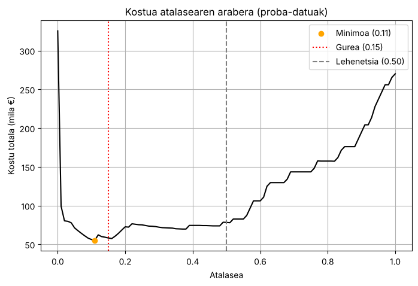</p>

| Aukera | Kostua |
|---|---|
| Sistemarik gabe (54 hutsegiteak ustekabean) | 270.000 € |
| Dena alerta (atalasea 0) | 325.400 € |
| Atalasea 0,50 (lehenetsia) | 78.300 € |
| **Atalasea 0,15 (gurea)** | **58.200 €** |
| Atalasea 0,11 (minimoa) | 55.200 € |

Kurbak irakasleak esandakoa erakusten du: bi muturrak garestiak dira, eta tartean minimo bat dago. Minimo zehatza 0,11ean dago, baina 101 alarma faltsurekin, gure 69en aurrean. **0,15 mantendu dugu**: 3.000 € gehiago dira (% 5), baina 32 alarma faltsu gutxiago. Alarma gehiegik teknikariak nekatzen ditu (**alarma-nekea**), eta alertei kasu egiteari uzten diote.

### 4.7 Eredua gorde

Notebook-aren amaieran `joblib.dump(pipe_cw, '../models/cnc_failure_model.pkl')` egiten da. **Pipeline osoa** gordetzen da (aurreprozesatzea eta Random Forest-a), eta API-ak ezaugarri berak kalkulatzen ditu; beraz, eredua ez da inoiz datu ezberdinekin elikatzen. API-a martxan dagoenean:

```powershell
curl.exe http://localhost:8001/health
# {"status":"ok","model_loaded":true}
```

---

## 5. 3. fasea: iragarpenak denbora errealean

### 5.1 Scoring API-a

`scoring/score_api.py` (FastAPI). NiFi-k irakurketa bakoitza `POST /predict` helbidera bidaltzen du.

| Zer | Nola |
|---|---|
| Eredua behin kargatu | `lifespan`: API-a abiaraztean `.pkl` fitxategia memoriara kargatzen da, ez eskaera bakoitzean ([G9](docs/galderak.md#g9-eredua-behin-kargatzea)) |
| Sarrera egiaztatu | Pydantic (`SentsoreEskaera`): `machine_type` L, M edo H; tenperaturak tarte batean (250-350 K eta 250-400 K); `rpm` > 0; torkea eta higadura ≥ 0. Bestela, 422 errorea |
| Babestu | `/predict` Bearer token batekin babestuta dago. `/health` irekita dago, egoera egiaztatzeko |
| Ezaugarriak | Notebook-eko berberak: tenperaturak °C-tan, `temp_diff` eta `power_est` |
| Denbora neurtu | Erantzun bakoitzak `X-prozesatze-denbora` goiburua du |

| Maila | Probabilitatea | Esanahia | Kolorea |
|---|---|---|---|
| **OK** | % 15 baino gutxiago | Ez dago arriskurik | Berdea |
| **KONTUZ** | % 15etik % 70era | Ikuskapena programatu | Horia |
| **LARRIA** | % 70 edo gehiago | Makina gaur bertan begiratu (Telegram abisua) | Gorria |

**Zergatik ez erronkaren % 50 / % 80 mugak?** Gure ereduak % 15etik aurrera «ikusten» ditu hutsegiteak ([4.5 atala](#45-ebaluazioa-eta-atalasea)). % 50eko muga jarriz gero, % 15 eta % 50 arteko kasuak OK gisa agertuko lirateke, eta notebook-ean berreskuratutako hutsegiteak berriz galduko genituzke. Horregatik mailak gure eredura egokitu ditugu. API-ak, Kibanako koloreek eta notebook-ak muga berak erabiltzen dituzte.

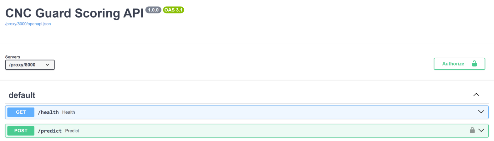

Sarrerako eskemak (`SentsoreEskaera`) balioak egiaztatzen ditu, eta irteerakoak (`PredikzioErantzuna`) beti forma bera du:

<p align="center">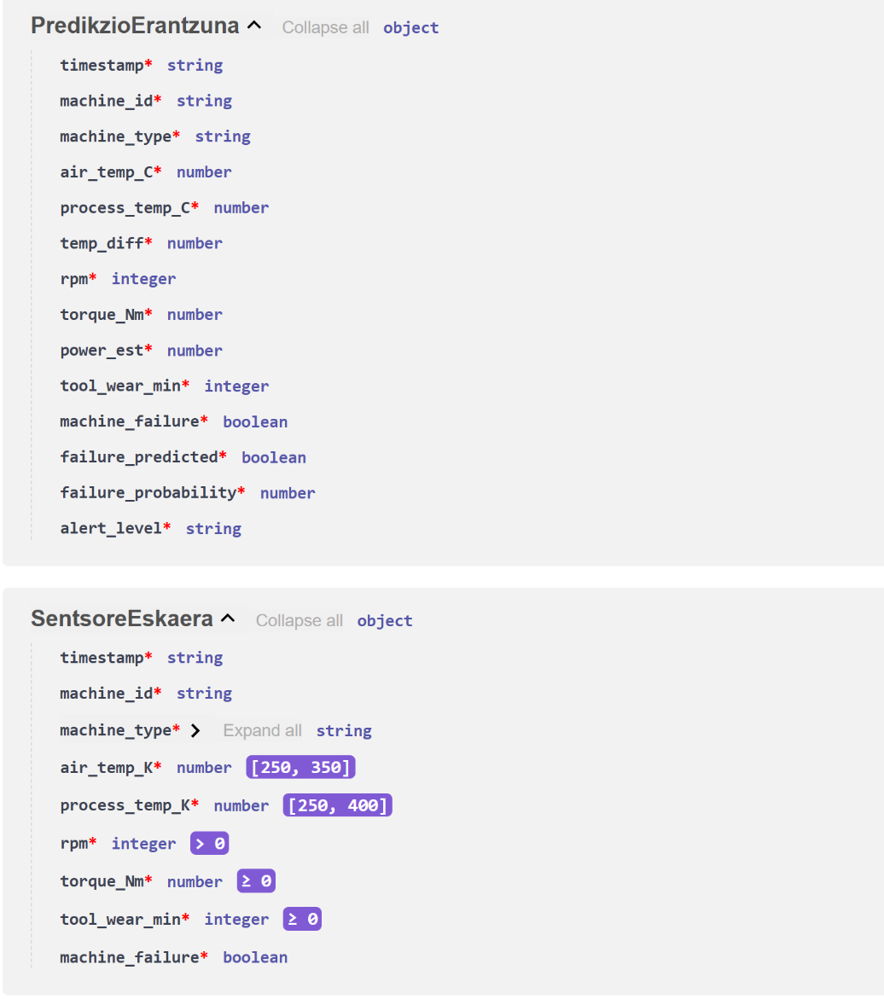</p>

**Benetako adibide bat.** NiFi-k hau bidaltzen dio API-ari:

```json
{
  "timestamp": "2026-10-30T09:38:54Z",
  "machine_id": "CNC-009",
  "machine_type": "H",
  "air_temp_K": 302.7,
  "process_temp_K": 310.8,
  "rpm": 1275,
  "torque_Nm": 55.0,
  "tool_wear_min": 25,
  "machine_failure": true
}
```

Eta API-ak erantzuten du (eremu nagusiak): `temp_diff` 8,1, `power_est` 7.343,5, `failure_probability` **0,985** eta `alert_level` **LARRIA**. Makina horrek benetan huts egin zuen (`machine_failure: true`). Tenperatura-diferentzia txikia (8,1 K, 8,6 K baino gutxiago) eta abiadura baxua (1.275 rpm, 1.380 baino gutxiago) ditu batera: AI4I datuetako bero-hutsegitearen (HDF) araua. Ereduak ez zekien arau hori: datuetatik ikasi du.

<p align="center">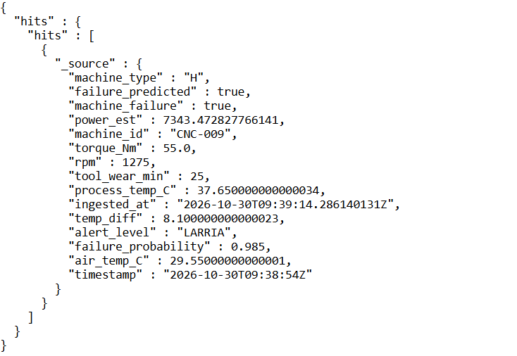</p>

### 5.2 NiFi fluxua

Orain **fluxu bakarra** dago (`nifi-flows/fase3_streaming.json`, 11 prozesadore): `cnc-predictions`-ek irakurketa, bere iragarpena eta benetako emaitza dokumentu berean gordetzen ditu. Horrela bi dashboard-ek indize bera erabiltzen dute, eta ez dago bi indize lotu beharrik ([G11](docs/galderak.md#g11-bi-indize-ala-bat)).

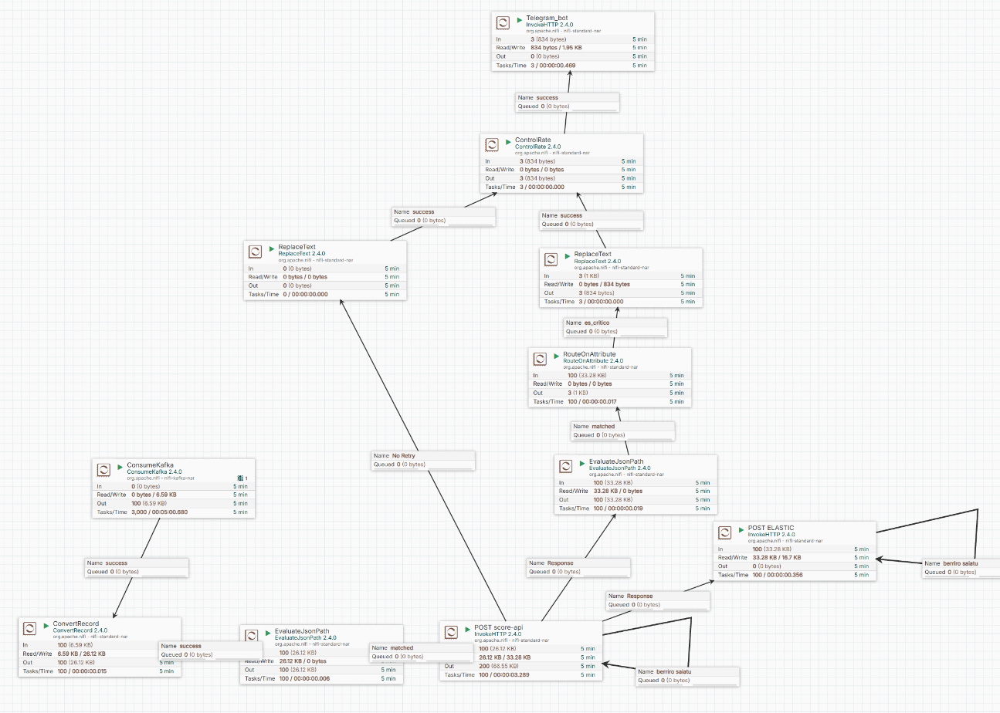

| Bidea | Prozesadoreak | Zer egiten du |
|---|---|---|
| **1. Gorde** | `ConsumeKafka` (`nifi-cnc-scoring` taldea) → `ConvertRecord` → `EvaluateJsonPath` → `POST score-api` → `POST ELASTIC` | Kafka-ko mezua JSON bihurtu, API-ari galdetu eta erantzuna `cnc-predictions`-en gorde |
| **2. Abisatu** | `EvaluateJsonPath` → `RouteOnAttribute` → `ReplaceText` → `ControlRate` → `Telegram_bot` | Maila LARRIA bada, Telegram mezu bat bidali. `ControlRate`-k makina bakoitzeko mezu bat uzten du 2 minutuan |
| **3. Errorea** | `POST score-api`-ren `No Retry` harremana («Ez saiatu») → `ReplaceText` → `ControlRate` → `Telegram_bot` | API-ak irakurketa bat baztertzen badu (datu okerra), «DATO NO PROCESADO» abisua bidali |

`POST score-api` eta `POST ELASTIC` prozesadoreen `Retry` eta `Failure` harremanak prozesadore berera itzultzen dira («berriro saiatu» konexioa): API-a edo Elasticsearch erortzen badira, FlowFile-ek itxaron egiten dute, eta 10 segundoro saiatzen da berriro. API-aren tokena eta Telegram-en tokena ez daude fluxuan idatzita: NiFi-k ingurune-aldagaietatik irakurtzen ditu (`${SCORE_API_TOKEN}` eta `${TELEGRAM_TOKEN}`).

### 5.3 Telegram abisua

LARRIA bakoitzean (makina bakoitzeko gehienez 2 minutuan behin), mantentze-arduradunak mezu hau jasotzen du (adibidea, CNC-009 irakurketarekin):

```
ALERTA CRÍTICA CNC GUARD

• Máquina: CNC-009
• Probabilidad de fallo: 98 %
• Nivel: LARRIA
• Hora de la lectura: 2026-10-30T09:38:54Z

Revisar la máquina lo antes posible.
```

API-ak irakurketa bat baztertzen badu, beste mezu bat iristen da: «ALERTA: DATO NO PROCESADO», makina, arrazoia (422 datu okerra, 500 zerbitzariaren errorea edo komunikazio-errorea) eta data.

### 5.4 Alertak dashboard-a

Erronkaren 3. faseak beste dashboard bat eskatzen du: probabilitate maximoaren gauge-a, azken orduko LARRIA alerten taula, probabilitatearen joera makinaka eta kolore-kodeak. Hori da **Alertak** dashboard-a (azken ordua, 30 segundoro freskatuta). Irudia dokumentu honen hasieran dago.

| Panela | Grafiko mota | Zer erakusten du | Erronkak eskatzen duena |
|---|---|---|---|
| Makina bakoitza karratu bat da: bilatu gorriak! | Heatmap | Makina bakoitzaren arrisku handiena azken 15 minutuetan, kolorez | Kolore-kodeak |
| Zein da arriskurik handiena orain? | Gauge | Probabilitate handiena azken 15 minutuetan | Gauge: probabilitate maximoa |
| Nola aldatzen da arriskua? | Lerro-diagrama | 5 makina arriskutsuenen probabilitatea denboran zehar, % 15 eta % 70eko lerroekin | Line chart: probabilitatearen joera makinaka |
| LARRIA alertak azken orduan | Taula | Makina, probabilitatea eta ordua | Data table: LARRIA alertak azken orduan |
| Zenbat LARRIA abisu azken orduan? | Metrika | Azken orduko abisu gorriak | |
| LARRIA abisuetatik, zenbat ziren egiazkoak? | Metrika | LARRIA abisuetatik benetako matxura direnak | |

Koloreak beti berdinak dira, bi dashboard-etan eta API-an: **berdea** % 15 baino gutxiago, **horia** % 15-70, **gorria** % 70 edo gehiago. Dashboard-ak `dashboards/kibana_export.ndjson` fitxategian daude.

**Bertsioak.** Lehen bertsioan (`cnc-sensoreak` eta `cnc-alertak`) erronkak eskatutako grafikoak genituen, baina irakurtzeko zailak ziren. Gero bi dashboard errazago egin genituen (Makinen semaforoa eta Gaurko istorioa), baina ez zituzten erronkaren grafiko guztiak. Azken bertsioak biak batzen ditu: erronkak eskatutako grafiko guztiak, langile batek ulertzeko moduan idatzita.

---

## 6. Emaitzak ekoizpenean

**Bi egun simulagailuarekin.** 2026-10-29 09:15etik (`machine_failure` indizera iristen hasi zenetik) 2026-10-30eko goizera arte, simulagailuaren **7.550 irakurketa**:

| | Ereduak: ondo | Ereduak: hutsegitea |
|---|---|---|
| **Benetan: ondo** | 6.936 | 357 (alerta faltsuak) |
| **Benetan: hutsegitea** | **22** (galduak) | **235** (garaiz harrapatuak) |

- **Recall 0,91** eta **precision 0,40**. Notebook-ean 0,89 eta 0,41 ziren: ereduak ez du okerrera egiten datu berriekin.
- Batez besteko probabilitatea **0,68** da benetako hutsegiteetan, eta **0,02** besteetan. Ereduak ondo bereizten ditu bi taldeak.
- **Kostua:** 22 × 5.000 + 357 × 200 + 235 × 300 = **251.900 €**. Sistemarik gabe, 257 hutsegiteak ustekabean gertatuko lirateke: 257 × 5.000 = **1.285.000 €**.
- **Latentzia** (CSV fitxategitik Elasticsearch-era): mediana **17 segundo**. Irakurketen % 5ek 25 minutu baino gehiago behar izan zituzten, baina ez latentzia normalagatik: geldialdi baten ondoren Kafka-k gordetako mezuak berandu iritsi ziren.
- Azken 24 orduetan: OK 6.892 · KONTUZ 432 · LARRIA 156.

**Egun oso bat (2026-11-03).** Garai hartako dashboard batek egunaren kontua zuzenean erakusten zuen:

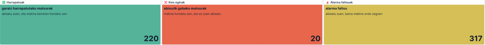

Egun horretan 6.950 irakurketatik 240 izan ziren benetako hutsegiteak. Ereduak 220 harrapatu zituen eta 20 galdu (recall % 91,7), eta 317 alarma faltsu eman zituen (precision % 41). Notebook-eko emaitza berberak dira. Kostua: 20 × 5.000 + 317 × 200 + 220 × 300 = **229.400 €**; sistemarik gabe, 240 × 5.000 = **1.200.000 €**.

**LARRIA abisuak oso fidagarriak dira.** Alertak dashboard-ean, 2026-11-12an, LARRIA abisuetatik % 89 benetako matxurak ziren:

<p align="center">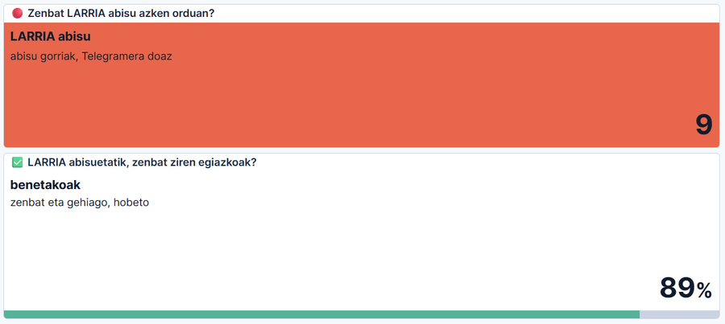</p>

---

## 7. Enpresarentzat: zer egin alerta bakoitzarekin

| Maila | Zer egin | Zergatik |
|---|---|---|
| **OK** | Ezer ez | Makina ondo dago |
| **KONTUZ** | Ikuskapena hurrengo txandan programatu | Geldialdi programatu labur bat askoz merkeagoa da ustekabeko matxura bat baino |
| **LARRIA** | Telegram abisua jaso, eta teknikaria makinara gaur bertan | Hutsegite bat galtzeak 5.000 € balio du (geldialdia, konponketa urgentea eta piezak) |

**Programatutako geldialdia vs ustekabeko matxura.** Alerta faltsu batek ere geldialdi bat dakar, baina **programatua**: teknikaria eta piezak prest daude, eta ikuskapenak 45 minutu inguru irauten du (200 €). Ustekabeko matxura batek, berriz, orduak irauten ditu, eta inor ez dago prestatuta (5.000 €). Horregatik onartzen ditugu alerta faltsu batzuk (precision 0,41), hutsegite gutxiago galtzearen truke (recall 0,89). 0,15 atalasearekin, notebook-eko kostua 78.300 €-tik 58.200 €-ra jaisten da; sistemarik gabe 270.000 € izango lirateke.

---

## 8. Alderdi legalak eta etikoak

| Gaia | Gure sisteman |
|---|---|
| **AI Act-en arrisku-maila** | **Arrisku minimoa**. Sistemak abisatu egiten du, eta ez du makina gelditzen. Makina bere kabuz geldituko balu, segurtasun-osagai bat izango litzateke, eta arrisku altukoa |
| **Giza gainbegiraketa** | **HITL** (pertsona begiztan): mantentze-arduradunak erabakitzen du zer egin alerta bakoitzarekin. AI Act-en 14. artikuluaren ideia da: pertsona batek gainbegiratu eta esku hartu ahal izatea |
| **Alarma-nekea** (*alert fatigue*) | Alerta gehiegik teknikariak nekatzen ditu, eta benetako alertak ere ez dira kontuan hartzen. Horregatik: 0,15 atalasea (ez 0,11), `ControlRate` (makina bakoitzeko mezu bat 2 minutuan) eta LARRIA maila (% 70) Telegram-erako bakarrik |
| **Automatizazio-alborapena** (*automation bias*) | Arriskua: «sistemak esan du, beraz egia da». Teknikariak makina begiratu behar du; sistemak lehentasunak ematen ditu, ez diagnostikoa |
| **Datuen pribatutasuna (GDPR)** | Datuak makinen sentsoreak dira: ez dago datu pertsonalik, eta ez da pertsonen gaineko erabaki automatizaturik hartzen (GDPR-ren 22. artikulua). Abisuak mantentze-arduradunaren Telegram txatera bakarrik doaz |
| **Segurtasuna diseinutik** (*security by design*) | API-a token batekin; Pydantic-ek datu ezinezkoak baztertzen ditu; Kibana saio-hasiera baten atzean; tokenak `.env` fitxategian, ez kodean. Mugak [9. atalean](#9-erabaki-teknikoak-eta-mugak) |

---

## 9. Erabaki teknikoak eta mugak

| Erabakia | Zergatik |
|---|---|
| Filebeat, eta ez NiFi-k fitxategiak zuzenean irakurtzea | Registry-ak lerroz lerro gogoratzen du zer irakurri duen, bikoiztu gabe. NiFi-ko `GetFile`-k fitxategiak ezabatu egingo lituzke |
| Kafka erdian | Buffer gisa: NiFi edo API-a erortzen badira, ez da daturik galtzen (frogatuta: 7.080 mezu) |
| NiFi fluxu bakarra eta `cnc-predictions` indize bakarra | Irakurketa, iragarpena eta benetako emaitza dokumentu berean: dashboard-ak eta ebaluazioa errazagoak |
| Random Forest + `class_weight` | Konbinazioak ikasten ditu, eta desoreka zuzentzen du datuak aldatu gabe. Hiru ereduetatik merkeena da ([4.4 atala](#44-ereduak-eta-haien-konparaketa)) |
| Atalasea 0,15 | Kostuaren araberakoa: FN bat FP bat baino 25 aldiz garestiagoa da. 0,11 apur bat merkeagoa litzateke (55.200 €, 58.200 €-ren ordez), baina 32 alerta faltsu gehiagorekin |
| Mailak % 15 / % 70 | Ereduaren atalasearekin koherenteak. % 50eko mugarekin, % 15-50eko arriskuak OK gisa ezkutatuko lirateke |
| API-ak eredua behin kargatzen du (`lifespan`) | Eredua ez da eskaera bakoitzean kargatzen: iragarpen bakoitzak 0,1 segundo baino gutxiago behar du |
| Telegram NiFi-tik, eta ez Kibanatik | Doakoa da (Kibanatik Telegram-era bidaltzeko webhook konektorea behar da, eta ordainpeko lizentzia eskatzen du), eta alerta datu-bidean bertan sortzen da |
| Sistemak ez du makina gelditzen | Giza gainbegiraketa eta arrisku minimoa ([8. atala](#8-alderdi-legalak-eta-etikoak)) |
| API-a editorearen edukiontzian, uvicorn-ekin | Taldeak kodea zuzenean aldatu eta probatu dezake (`--reload`). Horregatik `docker-compose.yml`-ek ez du `scoring-api` zerbitzurik |
| Kibana saio-hasiera baten atzean (`kibana-proxy`) | Elasticsearch-en segurtasuna desaktibatuta dago (erronkaren ingurunea); gutxienez, Kibanara sartzeko pasahitza eskatzen da |

### Mugak eta hobekuntzak

| Muga | Ekoizpenean nola egingo genukeen |
|---|---|
| Elasticsearch pasahitzik gabe; Kafka zifratu gabe (PLAINTEXT) | Segurtasuna aktibatu: erabiltzaileak, rolak eta TLS |
| Zerbitzu batzuen pasahitzak `docker-compose.yml` fitxategian | Pasahitz guztiak `.env` fitxategira, Docker secrets-era edo NiFi-ko parametro sentikorretara eraman |
| Nodo bakarra: 0 erreplika eta errepikatze-faktorea 1 | Gutxienez 3 nodo, erreplika 1 eta errepikatze-faktorea 3 |
| `ConvertRecord`-ek baztertutako lerroak ezabatu egiten dira, kontatu gabe | `cnc-errors` indize batera bidali, aztertzeko |
| Kibanan ez dago alerta-araurik; abisuak NiFi-tik doaz | Kibanako arau bat gehitu (adibidez, LARRIA dokumentuak indize batean idazteko) |
| API-ak ez du proba automatikorik | `pytest`-ekin probak: eskaera zuzena, 422 eta tokenik gabeko eskaera |
| Eredua ez da bere kabuz berriz entrenatzen | Ekoizpeneko asmatze-maila zaindu (Alertak dashboard-eko «LARRIA abisuetatik, zenbat ziren egiazkoak?» panela), eta jaisten bada berriz entrenatu (*model drift*) |

---

## 10. Pentsatzeko galderak

Erronkaren G1-G12 galderen erantzun osoak, frogekin eta justifikazioarekin, [docs/galderak.md](docs/galderak.md) fitxategian daude. Laburpena:

| Galdera | Erantzun laburra |
|---|---|
| [G1](docs/galderak.md#g1-filebeat-registry-rik-gabe) Registry-rik gabe | Filebeat hasieratik hasiko litzateke, eta datuak bikoiztuko lirateke. NiFi-k prozesadorearen egoeran gogoratuko luke (`ListFile` edo `TailFile`) |
| [G2](docs/galderak.md#g2-karpeta-irakurtzeko-soilik) Irakurtzeko soilik | `GetFile`-k fitxategiak ezabatzen ditu: talde baten akats batek gelako guztiak datu gabe utziko lituzke |
| [G3](docs/galderak.md#g3-goiburua-elasticsearch-era-iristea) Goiburua Elasticsearch-en | Mapaketa-errorea, edo eremuak testu gisa, eta grafikoak hondatuta. Hiru babes ditugu |
| [G4](docs/galderak.md#g4-zuzendaritzarentzako-hiru-kpi) Hiru KPI | Arriskuan dauden makinak orain, abisuen fidagarritasuna eta saihestutako kostua |
| [G5](docs/galderak.md#g5-accuracy-ren-tranpa) Accuracy | Beti «0» esaten duen ereduak % 96,6 lortuko luke, hutsegite bat ere harrapatu gabe |
| [G6](docs/galderak.md#g6-recall-eta-precision-arteko-oreka) Recall vs precision | FN bat FP bat baino 25 aldiz garestiagoa da: oreka 0,15ean, kostu-kurbaren minimoaren ondoan |
| [G7](docs/galderak.md#g7-aldagai-garrantzitsuenak) `feature_importances_` | Torkea, higadura, abiadura eta `power_est`. Intuizioarekin bat dator |
| [G8](docs/galderak.md#g8-data-leakage) Data leakage | Datuak buruz ikasi eta metrika puztuak lortzea. Train fitxategia bakarrik erabiltzen dugu, eta `failure_*` zutabeak kendu ditugu |
| [G9](docs/galderak.md#g9-eredua-behin-kargatzea) Eredua behin kargatu | Eskaera bakoitzean 0,05 s kargatzen: 1.000 makinarekin, segundoko 50 segundo. API-a ito egingo litzateke |
| [G10](docs/galderak.md#g10-alerta-baten-ondoren) Alerta baten ondoren | Kibana ez da nahikoa: Telegram abisua NiFi-tik, eta pertsona batek erabakitzen du |
| [G11](docs/galderak.md#g11-bi-indize-ala-bat) Bi indize | Bereizita garbiago, baina bikoiztuta eta JOIN-ik gabe. Guk indize bakarrera pasatu ginen |
| [G12](docs/galderak.md#g12-model-drift) Model drift | Makina-mota berria ez da ezagutzen (422). Zaindu, datu berriekin berriz entrenatu eta `.pkl` berria jarri |

Irakaslearen aurkezpenak beste sei galdera ere baditu (SMOTE, XGBoost, datu okerrak, berriz entrenatzea, feedback begizta eta ekoizpeneko ebaluazioa); haien erantzunak ere [`docs/galderak.md` fitxategiaren amaieran](docs/galderak.md#irakaslearen-aurkezpeneko-galderak) daude.

---

## 11. Adimen artifizialeko agenteen erabilera

Claude (Anthropic) laguntzaile gisa erabili dugu:

- Dokumentazioa euskaraz idazteko eta berrikusteko.
- NiFi, Filebeat eta Kafka-ren erroreak ulertzeko (adibidez, *fingerprint*-aren arazoa eta SMB karpeta izoztea).
- Kibanako dashboard-ak diseinatzeko eta kodea berrikusteko.
- Defentsa prestatzeko galdetegiekin.

Ez dugu ezer itsu-itsuan onartu: proba guztiak gure sisteman egin ditugu (Kafka-ren buffer-proba, 422 errorea, LARRIA demoa), eta zenbakiak notebook-ean eta Elasticsearch-en egiaztatu ditugu. Bi ikasgai: hasierako kostuak (4.800 € eta 150 €) suposizioak ziren, eta irakaslearen taula ofiziala iritsi zenean dena berriz kalkulatu genuen; eta NiFi-ren fluxua esportatzean Telegram-en tokena agertzen zen (HTTP URL ez da propietate sentikorra), eta orain ingurune-aldagai batean dago.

---

## 12. Abiarazi

**Aurretik:** Docker Desktop instalatuta, eta `.env` fitxategia proiektuaren karpetan (ez dago GitHub-en):

```
VM_IP=<PC-aren IPa>
API_TOKEN=<API-aren tokena>
SCORE_API_TOKEN=<API-aren token bera; NiFi-k erabiltzen du>
TELEGRAM_TOKEN=<Telegram bot-aren tokena>
```

**Kibanaren pasahitza** (behin bakarrik). `kibana-proxy/.authhash` fitxategia sortzen du (gatza eta pasahitzaren SHA-256 laburpena); pasahitza ez da inon idatzita geratzen:

```powershell
docker run --rm -it -v "${PWD}/kibana-proxy:/out" python:3.12-alpine python -c "import hashlib,secrets,getpass; s=secrets.token_hex(8); p=getpass.getpass('Pasahitza: '); open('/out/.authhash','w').write(s+':'+hashlib.sha256((s+p).encode()).hexdigest())"
```

**Lehen aldiz** (PowerShell, proiektuaren karpetan):

```powershell
docker compose up -d --build
docker compose ps        # 8 edukiontzi
```

**Egunero** (lehendik dauden edukiontziak piztu, ezer berriz sortu gabe):

```powershell
docker compose start
```

> Kontuz: `docker-compose.yml` aldatu ondoren `docker compose up -d` exekutatzen bada, aldatutako edukiontziak berriz sortzen dira, eta NiFi-ko fluxuak eta editoreko Python-a galtzen dira.

**Elasticsearch** (behin bakarrik):

```powershell
$ES = "http://localhost:9200"
Invoke-RestMethod -Method Put "$ES/_ingest/pipeline/cnc-sensors-pipeline" -ContentType "application/json" -InFile elasticsearch\cnc-sensors-pipeline.json
Invoke-RestMethod -Method Put "$ES/cnc-sensors" -ContentType "application/json" -InFile elasticsearch\cnc-sensors-mapping.json
Invoke-RestMethod -Method Put "$ES/_ingest/pipeline/cnc-predictions-pipeline" -ContentType "application/json" -InFile elasticsearch\cnc-predictions-pipeline.json
Invoke-RestMethod -Method Put "$ES/_index_template/cnc-predictions-template" -ContentType "application/json" -InFile elasticsearch\cnc-predictions-template.json
```

**Scoring API-a** (editorean: `http://<IP>:8444`). Editorearen irudiak ez du Python-ik, eta lehen aldiz instalatu behar da:

```powershell
docker exec -u root cnc-editor bash -c "apt-get update && apt-get install -y python3 python3-venv python3-pip"
```

Gero, editoreko terminalean:

```bash
cd ~/workspace/cnc-guard
python3 -m venv .venv                       # lehen aldiz bakarrik
source .venv/bin/activate
pip install -r scoring/requirements.txt     # lehen aldiz bakarrik
uvicorn score_api:app --app-dir scoring --reload --host 0.0.0.0 --port 8000
```

`Eredua ondo kargatu da memoriak.` mezua agertu behar da. Egiaztatzeko (PowerShell; editoreak bere 8000 portua PC-aren **8001** portuan argitaratzen du):

```powershell
curl.exe http://localhost:8001/health
# {"status":"ok","model_loaded":true}
```

**NiFi** (`https://<IP>:8443/nifi`): `nifi-flows/fase3_streaming.json` inportatu eta abiarazi (1. faseko fluxua, `fase1_ingest.json`, ere hor dago). Telegram-eko txataren identifikadorea `ReplaceText` prozesadoreetan konfiguratzen da.

**Kibana** (`http://<IP>:5601`, pasahitzarekin): Stack Management → Saved objects → Import → `dashboards/kibana_export.ndjson`.

**LARRIA alerta bat simulatzeko (demoa):** CSV lerro bat Kafka-ra bidali, simulagailuak egiten duen bezala. Balioak gainkarga-hutsegite (OSF) baten modukoak dira (higadura handia eta torke handia), eta ereduak 0,94 inguru ematen du:

```powershell
$ts = (Get-Date).ToUniversalTime().ToString("yyyy-MM-ddTHH:mm:ssZ")
"$ts,CNC-DEMO,L,299.0,309.5,1400,62.0,215,1,0,0,0,1,0" | docker exec -i cnc-kafka /opt/kafka/bin/kafka-console-producer.sh --bootstrap-server localhost:9092 --topic cnc-sensors-raw
```

Demoaren ondoren, proba-datua ezabatu:

```powershell
curl.exe -X POST "http://localhost:9200/cnc-predictions/_delete_by_query" -H "Content-Type: application/json" -d '{\"query\":{\"term\":{\"machine_id\":\"CNC-DEMO\"}}}'
```

| Zerbitzua | URLa |
|---|---|
| NiFi | `https://<IP>:8443/nifi` |
| Kibana | `http://<IP>:5601` |
| Elasticsearch | `http://<IP>:9200` |
| Scoring API (Swagger) | `http://<IP>:8444/proxy/8000/docs` |
| Editorea | `http://<IP>:8444` |

---

## 13. Karpetak eta fitxategiak

```
cnc-guard/
├── README.md                        ← dokumentu hau
├── ENUNTZIATUA.md                   ← erronkaren enuntziatua
├── docker-compose.yml               ← zerbitzu guztiak
├── docker-compose.override.yml      ← Kibanaren saio-hasiera (kibana-auth eta kibana-proxy)
├── filebeat/filebeat.yml            ← CSV → Kafka
├── nifi-flows/
│   ├── fase1_ingest.json            ← 1. fasea: irakurketak → cnc-sensors
│   └── fase3_streaming.json         ← 3. fasea: API, cnc-predictions eta Telegram
├── elasticsearch/                   ← mapaketak, plantilla eta ingest pipeline-ak
├── data/ai4i2020_train.csv          ← entrenamendu-datuak
├── notebooks/02_training.ipynb      ← EDA, entrenamendua eta ebaluazioa
├── models/cnc_failure_model.pkl     ← entrenatutako eredua (pipeline osoa)
├── scoring/                         ← FastAPI (score_api.py, requirements.txt)
├── kibana-proxy/                    ← Kibanaren saio-hasiera (nginx eta Python)
├── dashboards/kibana_export.ndjson  ← bi dashboard-ak
└── docs/
    ├── galderak.md                  ← G1-G12 galderen erantzunak
    └── irudiak/                     ← pantaila-argazkiak eta grafikoak
```

| Dokumentua | Edukia |
|---|---|
| [`README.md`](README.md) | Proiektuaren azalpena, emaitzak, erabakiak eta abiarazteko argibideak |
| [`docs/galderak.md`](docs/galderak.md) | Erronkako G1-G12 galderen erantzunak, eta irakaslearen aurkezpeneko galderenak |
| [`ENUNTZIATUA.md`](ENUNTZIATUA.md) | Erronkaren enuntziatua |

---

## 14. Hiztegia

| Hitza | Esanahia |
|---|---|
| Pipeline-a (datu-bidea) | Datuak iturritik helmugara eramaten dituen prozesua: jaso, gorde, prozesatu eta bistaratu |
| Streaming / batch | Streaming: datuak iristen diren heinean prozesatu (gure sistema). Batch: datu-multzo bat behin prozesatu (gure entrenamendua) |
| Topic-a / partizioa | Topic-a: mota bereko mezuen kanala (`cnc-sensors-raw`). Partizioa: topic baten zatia |
| Offset-a / LAG-a | Offset-a: mezu batek partizioan duen posizioa. LAG-a: irakurtzeke dauden mezuak (LAG 0 = dena irakurrita) |
| FlowFile / prozesadorea | NiFi-ko datu-unitatea / lan bat egiten duen blokea (irakurri, bihurtu, bidali...) |
| Back-pressure | Ilara beteta dagoenean aurreko prozesadorea gelditzea, ezer ez galtzeko |
| Indizea / dokumentua | Elasticsearch-en dokumentuen bilduma (taula baten antzekoa) / erregistro bat, JSON formatuan |
| Mapaketa | Eremu bakoitzaren mota: date, keyword, float... (*mapping*) |
| Ingest pipeline-a | Dokumentu bat gorde aurretik Elasticsearch-ek egiten dituen egiaztapenak eta aldaketak |
| Etiketa | Adibide bakoitzaren erantzun zuzena: `machine_failure` |
| Klase-desoreka | Klase bat bestea baino askoz txikiagoa izatea (hutsegiteak % 3,39 bakarrik) |
| TP / FN / FP / TN | Harrapatutako hutsegitea / galdutako hutsegitea / alerta faltsua / ondo zegoen eta alertarik ez |
| Nahasmen-matrizea | TP, FN, FP eta TN taula batean (*confusion matrix*) |
| Recall | Benetako hutsegiteetatik zenbat harrapatzen diren: TP / (TP + FN) |
| Precision | Alertetatik zenbat diren egiazkoak: TP / (TP + FP) |
| ROC-AUC | Ereduak bi klaseak zenbateraino bereizten dituen, atalasea edozein dela ere (0,5 = zoria, 1 = perfektua) |
| Atalasea | Probabilitatearen muga: hortik gora «hutsegitea» esaten dugu (*threshold*) |
| `class_weight` / SMOTE | Klase-desorekarako bi teknika: klase txikiari pisu handiagoa eman / klase txikiko adibide sintetikoak sortu |
| Feature engineering | Daudenetatik ezaugarri berriak sortzea (`temp_diff`, `power_est`) |
| Data leakage | Ereduak entrenatzean ikusi behar ez lukeen informazioa ikustea. Emaitzak puztuta ateratzen dira |
| Model drift | Mundua aldatzean, ereduak okerrera egitea |
| HITL | *Human-in-the-loop*: pertsona begiztan; azken erabakia pertsona batek hartzen du |

---

## 15. Erreferentziak

- **Datuak:** AI4I 2020 Predictive Maintenance Dataset, UCI Machine Learning Repository (CC BY 4.0): <https://archive.ics.uci.edu/dataset/601/ai4i+2020+predictive+maintenance+dataset>. Hutsegite-moten arauak (HDF, PWF, OSF, TWF) bertako deskribapenetik hartu ditugu.
- **Erronka:** `ENUNTZIATUA.md` eta irakaslearen aurkezpena (`Erronka1_Aurkezpena_Ikasleak.pptx`).
- **Kostu-taula ofiziala:** irakaslearen Moodle-eko mezua, «Kostuen Taula Ofiziala (Negozio-Parametroak)» ([argazkia](docs/irudiak/moodle-kostu-taula.png)).
- **Ikasgaien apunteak (Moodle):** Datuen ingeniaritza eta Big Data sarrera, Apache Kafka, Apache NiFi, Elastic Stack, Datua eta aurreprozesamendua (5072) eta Marko legala (5071: AI Act, GDPR eta giza gainbegiraketa).

---

### Bezeroaren araberako hobekuntzak

Sistema zatika eraikita dago (Filebeat, Kafka, NiFi, API-a eta Kibana bereizita daude). Horri esker, etorkizunean bezeroaren beharren arabera hobekuntzak edo aldaketak gehi daitezke, gainerako zatiak ukitu gabe. Adibidez:

- **Abisu bakarra gertaera bakoitzeko:** orain, makina batek gorrian jarraitzen badu, Telegram abisua 2 minuturo errepikatzen da. Bezeroak nahi badu, makina bakoitzeko abisu bakarra bidal daiteke denbora-leiho batean (adibidez, 30 minutu).
- **Bezeroaren benetako kostuak:** irakaslearen taulan, alarma faltsu batek 200 € balio ditu batez beste (barneko teknikaria 150 €, kanpokoa 300 €). Bezeroaren kostu errealekin atalasea berriz kalkula daiteke, kodea aldatu gabe.
- **Datu gehiago ereduan:** bezeroak beste sentsore batzuk baditu (adibidez, bibrazioa) edo makina bakoitzaren historikoa gordetzen badu (azken minutuetako joera), eredua datu horiekin berriz entrena daiteke.
- **Beste abisu-kanal batzuk:** posta elektronikoa, edo mantentze-lanen kudeaketa-sistemara zuzenean lan-agindu bat bidaltzea.