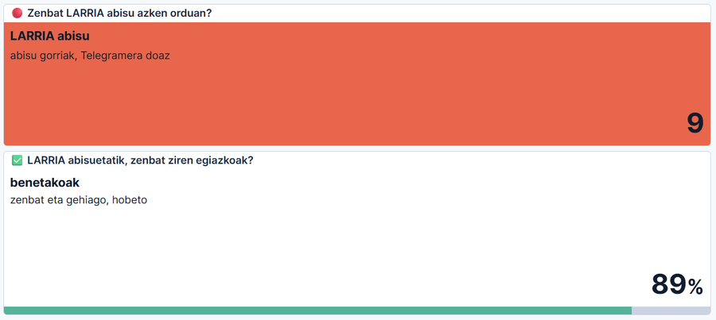
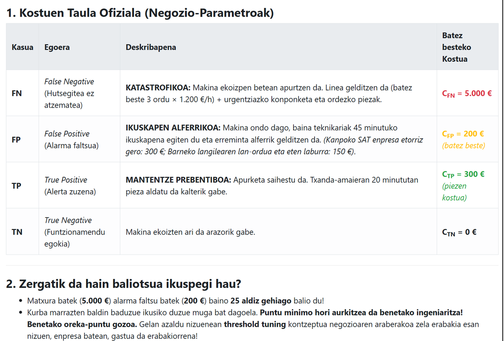
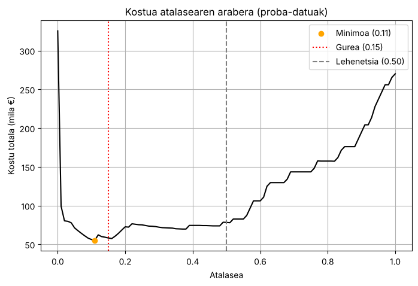
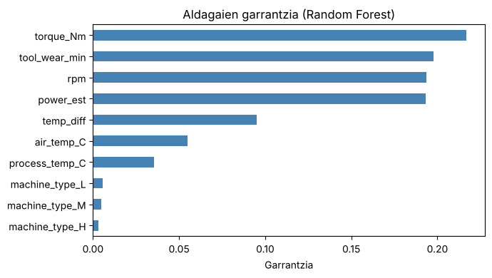
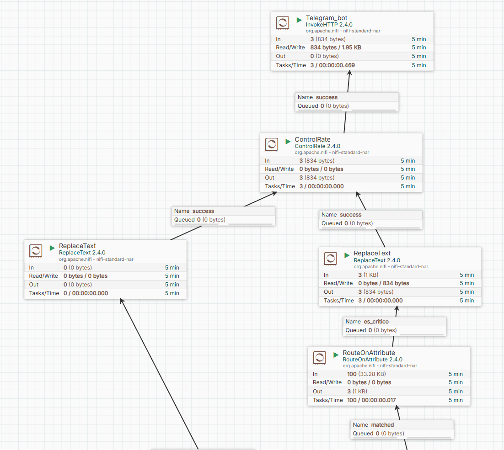
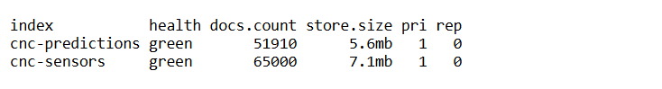
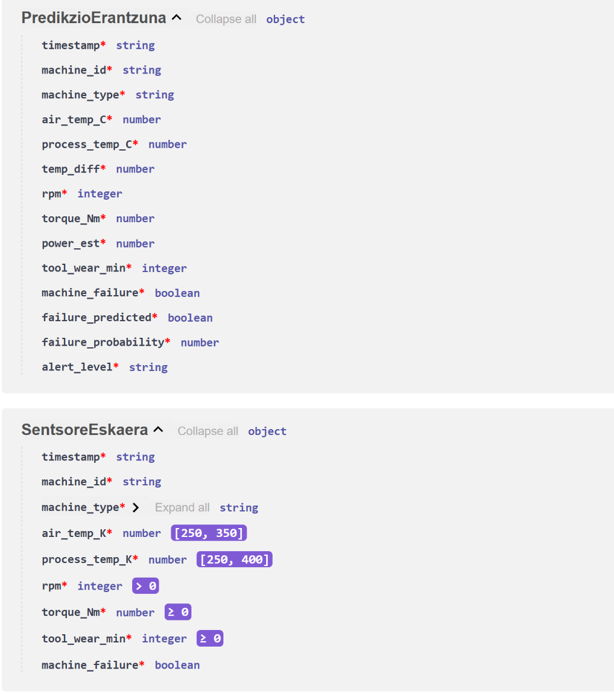

# CNC Guard: pentsatzeko galderen erantzunak

Erronkaren «pentsatzeko galderak» ez dira zuzenean puntuatzen, baina gure erabakiak azaltzen eta justifikatzen dituzte. Galdera bakoitzean, lehenik erantzun laburra dago; gero azalpena, gure sisteman ikusi duguna eta zergatik egin dugun horrela. Zenbakiak gure notebook-aren eta sistemaren benetako emaitzak dira.

Galderak `ENUNTZIATUA.md`-koak dira (G1-G12). Irakaslearen aurkezpenak beste sei galdera ditu, eta horien erantzunak [amaieran](#irakaslearen-aurkezpeneko-galderak) daude. Proiektuaren azalpen osoa [README-an](../README.md) dago.

---

## 1. fasea: datuak jaso eta gorde

### G1. Filebeat registry-rik gabe

> Filebeat-ek fitxategien jarraipena registry batean gordetzen du — badaki zer lerro irakurri duen jada. Zer gertatuko litzateke Filebeat berrabiaraziko bagenu registry gabe? Eta NiFi-k zuzenean irakurriko balu fitxategiak, nola kudeatuko luke "zer irakurri dudan jada" arazoa?

**Laburrean:** registry-rik gabe, Filebeat hasieratik hasiko litzateke, eta karpetako lerro guztiak berriz bidaliko lituzke: **datu bikoiztuak** Kafka-n eta Elasticsearch-en. NiFi-k ere gogora dezake zer irakurri duen, prozesadorearen egoeran (*state*), baina lan hori Filebeat-ek hobeto egiten du.

Registry-ak fitxategi bakoitza zein puntutaraino irakurri den gordetzen du. Ezabatzen bada, Filebeat-entzat fitxategi guztiak berriak dira. Karpetan ehunka fitxategi daudenez, milaka irakurketa bikoiztuko lirateke, eta Kibanako kopuruak eta batezbestekoak gaizki aterako lirateke.

NiFi-k fitxategiak zuzenean irakurriko balitu, prozesadorearen egoeran gordeko luke zer irakurri duen. `ListFile`-k azken fitxategiaren aldaketa-data gogoratzen du, eta fitxategi berriak bakarrik zerrendatzen ditu; gero `FetchFile`-k fitxategi osoa irakurtzen du. Hori nahikoa da fitxategiak behin idazten badira, baina ez du lerroen jarraipenik egiten. `TailFile`-k lerroen posizioa gogoratzen du, Filebeat-en antzera. Eta `GetFile`-k fitxategia ezabatu egiten du irakurri ondoren ([G2](#g2-karpeta-irakurtzeko-soilik)).

**Gure sisteman:** registry-a `filebeat-data` bolumenean dago, eta edukiontzia berriz sortzean ere mantentzen da. Probatu genuen: zerbitzariaren IPa aldatzean Filebeat berriz sortu genuen, eta 303 fitxategi aurkitu zituen, baina 93 berriak bakarrik bidali zituen (930 lerro).

**Zergatik horrela:** fitxategiak irakurtzeko lana Filebeat-i utzi diogu, horretarako egina dagoelako, eta datuak lantzekoa NiFi-ri. Lan bakoitza bere tresnari.

### G2. Karpeta irakurtzeko soilik

> NFS esportazioa `read-only` konfiguratuta dago. Zergatik? Zer gertatuko litzateke idazketa-baimena izango balu eta ikasle batek NiFi-n `GetFile` prozesadorea erabiliko balu (fitxategiak ezabatzen dituena)?

**Laburrean:** karpeta gelako talde guztiek partekatzen dute. Idazteko baimenarekin, `GetFile` erabiltzen duen lehen ikasleak fitxategiak ezabatuko lituzke, eta beste talde guztiak datu gabe geratuko lirateke.

`GetFile`-k, lehenetsita (`Keep Source File = false`), fitxategia ezabatzen du irakurri ondoren. Akats txiki batek (aukera hori ez aldatzeak) gelako datu-iturri bakarra hondatuko luke, eta ezin izango litzateke berreskuratu. Irakurtzeko soilik muntatuta, inork ezin ditu jatorrizko datuak ezabatu edo aldatu.

**Gure sisteman:** karpeta SMB bidez iristen zaigu (ez NFS bidez), eta bi aldiz babestu dugu: bolumena `ro` aukerarekin muntatzen da `docker-compose.yml`-en, eta Filebeat-en edukiontziak ere irakurtzeko soilik ikusten du (`/mnt/cnc-stream:ro`).

**Zergatik horrela:** **gutxieneko pribilegioa** da (*security by design*): zerbitzu batek behar duen baimena bakarrik izan behar du. Filebeat-ek irakurri besterik ez du egin behar.

### G3. Goiburua Elasticsearch-era iristea

> `exclude_lines` erregela bat idatzi duzu goiburu-lerroak iragazteko. Zer gertatuko litzateke iragazketa hori ez egongo balitz eta goiburua Elasticsearch-era iritsiko balitz? (Pentsatu: datu-motetan zer arazo sor liteke.)

**Laburrean:** goiburua irakurketa bat balitz bezala sartuko litzateke. «rpm» edo «timestamp» testua ezin da zenbaki edo data bihurtu: **mapaketa-errorea**, eta dokumentua baztertuta. Mapaketa finkorik gabe, okerrago: eremuak testu bihurtuko lirateke, eta grafikoak hondatu.

Gure mapaketan `rpm` integer da eta `timestamp` date. Goiburuaren lerroak `rpm = "rpm"` eta `timestamp = "timestamp"` ekarriko lituzke, eta Elasticsearch-ek baztertu egingo luke. Mapaketa finkorik gabe, Elasticsearch-ek eremu-motak lehen dokumentutik asmatzen ditu (*dynamic mapping*). Lehena goiburua bada, zenbakiak testu gisa gordeko lirateke, eta Kibanan ezin izango litzateke batezbestekorik edo maximorik kalkulatu. Gainera, 30 segundoan behin zabor-lerro bat iritsiko litzateke (fitxategi bakoitzeko bat): eguneko 2.880.

**Gure sisteman:** hiru babes ditugu, bata bestearen atzetik:

1. **Filebeat:** `exclude_lines: ['^timestamp']`. Goiburua ez da Kafka-ra ere iristen.
2. **NiFi:** CSVReader-ek eskema bat du; zenbaki ez den `rpm` batek errorea ematen du.
3. **Elasticsearch:** mapaketa finkoa, eta ingest pipeline-ak `machine_id = "machine_id"` duten lerroak baztertzen ditu.

**Zergatik horrela:** babes bakarra hautsi daiteke (adibidez, goiburuaren lehen zutabearen izena aldatzen bada). Geruza bakoitzean babes bat jarriz, zabor-datuak ez dira dashboard-etara iristen.

### G4. Zuzendaritzarentzako hiru KPI

> Kibana dashboard-a enpresako zuzendariei erakutsi behar diezu. Zer hiru KPI izango lirateke garrantzitsuenak? Zergatik?

**Laburrean:** (1) arriskuan dauden makinak orain, (2) abisuen fidagarritasuna, eta (3) sistemak saihestutako kostua.

1. **Arriskuan dauden makinak orain** (gorrian eta horian): gaur zer egin behar den. Alertak dashboard-ean dago: makina bakoitza karratu bat da, eta azken orduko LARRIA abisuak kontatzen dira.
2. **Abisuen fidagarritasuna:** LARRIA abisuetatik zenbat diren benetako matxurak. Hori gabe, zuzendaritzak ez du sisteman fidatzeko arrazoirik. Alertak dashboard-ean dago (2026-11-12an, % 89). Ekoizpenean, gainera, 100 hutsegitetik 91 garaiz harrapatzen dira.
3. **Saihestutako kostua:** sistemarik gabeko kostua ken sistemarekin izandakoa. Zuzendaritzak ulertzen duen hizkuntza dirua da. Ekoizpeneko bi egunetan, 1.285.000 € izango ziren sistemarik gabe, eta 251.900 € izan ziren: **1 milioi € inguru saihestu ziren**. Oraingoz README-n kalkulatuta dago; dashboard batean jartzea hurrengo urratsa litzateke.



**Gure sisteman:** erronkak eskatutako bi KPIak (makina aktiboak eta hutsegite-tasa orokorra, % 3,6 inguru) Makinen sentsoreak dashboard-ean daude. Langileentzat baliagarriak dira (sistemak funtzionatzen al du? zenbat hutsegite daude?), baina zuzendaritzak erabakiak hartzeko, goiko hirurak dira garrantzitsuenak.

**Zergatik horrela:** KPI on batek erabaki bat ekarri behar du: gaur nora joan (1), sisteman fidatu ala ez (2), eta inbertsioak merezi duen ala ez (3).

---

## 2. fasea: eredua

### G5. Accuracy-ren tranpa

> Datu-multzoaren %3,4 soilik dira hutsegiteak. Zer gertatzen da eredua **accuracy** bidez soilik ebaluatzen badugu? Zer puntuazio lortuko luke eredu batek beti "0" (ez da huts egingo) iragarriko balu? Zergatik da hau arazo larria?

**Laburrean:** beti «0» esaten duen eredu batek **% 96,6ko accuracy-a** lortuko luke, **hutsegite bakar bat ere harrapatu gabe**. Eredu bikaina dirudi, eta ez du ezertarako balio.

Kalkulua: 8.000 irakurketatik 7.729 onak dira, eta 7.729 / 8.000 = % 96,6. Gure balidazio-zatian berdin: 1.546 / 1.600 = % 96,6. Recall-a, berriz, 0 da: ez du hutsegite bakar bat ere abisatzen.

**Gure sisteman:** gure ereduak berak ere erakusten du tranpa. 0,50 atalasearekin accuracy-a **0,99** da, baina 54 hutsegitetik 13 galtzen ditu (laurdena). Accuracy-k ez du hori ikusten, irakurketa onak gehiengoa direlako. Horregatik beste metrika hauek erabiltzen ditugu: **recall**-a (zenbat hutsegite harrapatzen diren), **precision**-a (zenbat alerta diren egiazkoak), F1-a, ROC-AUC-a, nahasmen-matrizea eta, batez ere, **kostua**.

**Zergatik horrela:** klase-desoreka dagoenean, accuracy-k klase handiari begiratzen dio, eta guri klase txikia interesatzen zaigu: hutsegiteak.

### G6. Recall eta precision arteko oreka

> Recall eta precision arteko trade-off-a: recall maximizatuz gero, precision jaisten da. Zer esan nahi du honek praktikan ARAKAIN Makineriarentzat? Non dago oreka egokia?

**Laburrean:** recall-a igotzeko atalasea jaitsi behar da, eta horrek alerta faltsu gehiago dakartza. ARAKAIN-entzat, galdutako hutsegite batek alerta faltsu batek baino **25 aldiz** gehiago balio du. Beraz, oreka recall altuan dago. Guk **0,15** atalasea aukeratu dugu, kostu-kurbaren minimoaren ondoan.

**Kostuak nondik datoz.** Irakasleak Moodle-en argitaratutako **kostu-taula ofizialetik** hartu ditugu («Kostuen Taula Ofiziala (Negozio-Parametroak)» mezua):



| Kasua | Zer gertatzen da | Kostua |
|---|---|---|
| **FN** | Makina ekoizpenean apurtzen da: batez beste 3 ordu × 1.200 €/h, konponketa urgentea eta ordezko piezak | **5.000 €** |
| **FP** | Alferrikako ikuskapena (45 minutu): kanpoko teknikaria 300 €, barnekoa 150 € | **200 €** (batez beste) |
| **TP** | Pieza txanda-amaieran aldatzen da, kalterik gabe | **300 €** (piezak) |
| **TN** | Makina ondo dago | 0 € |

**Kalkulua.** Kodeak notebook-aren aldagaiak erabiltzen ditu (`y_test`, `y_prob` eta `ATALASEA`), eta kostua kalkulatzen du atalase bakoitzerako, 0,00tik 1,00era, 0,01eko pausoekin:

```python
# Analisi ekonomikoa: irakaslearen kostu-taula ofiziala
KOSTUAK = {"FN": 5000, "FP": 200, "TP": 300, "TN": 0}

errenkadak = []
for t in np.round(np.arange(0.0, 1.0001, 0.01), 2):
    tn, fp, fn, tp = confusion_matrix(y_test, (y_prob >= t).astype(int), labels=[False, True]).ravel()
    kostua = fn * KOSTUAK["FN"] + fp * KOSTUAK["FP"] + tp * KOSTUAK["TP"] + tn * KOSTUAK["TN"]
    errenkadak.append({"atalasea": t, "kostua": kostua, "FN": fn, "FP": fp, "TP": tp})
kostu_df = pd.DataFrame(errenkadak)

minimoa = kostu_df.loc[kostu_df["kostua"].idxmin()]
sistemarik_gabe = int(y_test.sum()) * KOSTUAK["FN"]
print(f"Sistemarik gabe: {sistemarik_gabe:,} €")
for t in (0.50, ATALASEA, minimoa["atalasea"]):
    r = kostu_df[np.isclose(kostu_df["atalasea"], t)].iloc[0]
    print(f"Atalasea {t:.2f}: {int(r.kostua):,} € (FN {int(r.FN)}, FP {int(r.FP)}, TP {int(r.TP)})")

plt.figure(figsize=(8, 5))
plt.plot(kostu_df["atalasea"], kostu_df["kostua"] / 1000, color="black")
plt.scatter([minimoa["atalasea"]], [minimoa["kostua"] / 1000], color="orange", zorder=3, label=f"Minimoa ({minimoa['atalasea']:.2f})")
plt.axvline(ATALASEA, color="red", ls=":", label=f"Gurea ({ATALASEA})")
plt.axvline(0.5, color="grey", ls="--", label="Lehenetsia (0.50)")
plt.xlabel("Atalasea")
plt.ylabel("Kostu totala (mila €)")
plt.title("Kostua atalasearen arabera (proba-datuak)")
plt.legend()
plt.grid(True)
plt.show()
```

Emaitza:

```
Sistemarik gabe: 270,000 €
Atalasea 0.50: 78,300 € (FN 13, FP 5, TP 41)
Atalasea 0.15: 58,200 € (FN 6, FP 69, TP 48)
Atalasea 0.11: 55,200 € (FN 4, FP 101, TP 50)
```



| Atalasea | Recall | Precision | FN | FP | TP | Kostua |
|---|---|---|---|---|---|---|
| Sistemarik gabe | 0 | – | 54 | 0 | 0 | 270.000 € |
| 0,50 (lehenetsia) | 0,76 | 0,89 | 13 | 5 | 41 | 78.300 € |
| **0,15 (gurea)** | **0,89** | **0,41** | **6** | **69** | **48** | **58.200 €** |
| 0,11 (minimoa) | 0,93 | 0,33 | 4 | 101 | 50 | 55.200 € |

Kurbak bi mutur garesti ditu: atalasea 0 bada, dena da alerta (325.400 €); 1 bada, ez da ezer abisatzen, sistemarik gabe bezala (270.000 €). Tartean minimo bat dago, eta hori bilatzea da irakasleak eskatzen zuena.

**Gure erabakia, 0,15.** 0,50ekin alderatuta, 13 hutsegite galdu beharrean 6 galtzen dira, eta kostua % 26 jaisten da (78.300 €-tik 58.200 €-ra). 0,11 da minimoa (55.200 €), baina 101 alarma faltsurekin, gure 69en aurrean. 3.000 € horiek (% 5) ordaintzea merezi du: alarma gehiegik teknikariak nekatzen ditu (**alarma-nekea**), eta alertei kasu egiteari uzten diete. Gainera, alarma faltsu bakoitza makina bat gelditzea da.

**Gure sisteman:** ekoizpenean oreka bera ikusten da: recall 0,91 eta precision 0,40.

### G7. Aldagai garrantzitsuenak

> `feature_importances_` atributua erabiliz jakin dezakezu zein ezaugarri den garrantzitsuena. Zer espero zenuke? Bat dator zure intuitzioarekin? (`model.feature_importances_`)

**Laburrean:** garrantzitsuenak torkea, higadura, abiadura eta guk sortutako `power_est` dira. Bai, intuizioarekin bat dator: indar handia egiten duen eta gastatuta dagoen tresna bat lehenago apurtzen da.

Kodea, notebook-eko `pipe_cw` ereduarekin:

```python
# Aldagaien garrantzia (feature_importances_)
rf = pipe_cw.named_steps["rf"]
izenak = pipe_cw.named_steps["preprocessing"].get_feature_names_out()
garrantzia = pd.Series(rf.feature_importances_, index=izenak)
garrantzia.index = garrantzia.index.str.replace("zenbak__", "").str.replace("kateg__", "")
print(garrantzia.sort_values(ascending=False).round(3))

garrantzia.sort_values().plot.barh(figsize=(7, 4), color="steelblue")
plt.xlabel("Garrantzia")
plt.title("Aldagaien garrantzia (Random Forest)")
plt.tight_layout()
plt.show()
```

Emaitza:

```
torque_Nm         0.217
tool_wear_min     0.198
rpm               0.193
power_est         0.193
temp_diff         0.095
air_temp_C        0.055
process_temp_C    0.035
machine_type_L    0.006
machine_type_M    0.005
machine_type_H    0.003
```



**Zer espero genuen.** AI4I datuetan, hutsegiteak arau hauen arabera gertatzen dira (UCI-ko deskribapena): tresna-higadura (TWF) 200-240 minutura iristean; gainkarga (OSF) higadura × torkea muga bat gainditzen duenean; potentzia (PWF) 3.500 W-tik behera edo 9.000 W-tik gora dagoenean; eta beroa (HDF) tenperatura-diferentzia txikia eta abiadura baxua batera daudenean. Beraz, torkea eta higadura goian egotea espero genuen, eta horrela da.

**Zergatik da garrantzitsua guretzat:** guk sortutako bi aldagaiak (`power_est` eta `temp_diff`) lehen bostetan daude: *feature engineering*-ak balio izan du. `power_est` abiadura bezain garrantzitsua da. Makina-motak ia ez du eraginik (guztira % 1,4), nahiz eta L motako makinek hutsegite gehiago izan (% 4,08, H motakoen % 2,03ren aurrean): ereduak sentsoreetan ikusten du arriskua, ez makina-motaren etiketan.

### G8. Data leakage

> Entrenamenduan erabili den datua (`ai4i2020_train.csv`) eta simuladoreak erabiltzen duena (`ai4i2020_test.csv`) jatorrizko dataset beretik etorri dira. Zergatik da garrantzitsua data leakage ekiditea, hau da, test datuak entrenamenduan ez erabiltzea?

**Laburrean:** eredua gero ebaluatuko den datu berberekin entrenatzen bada, datuak «buruz ikasten» ditu, eta metrikak puztuta ateratzen dira. Fabrikan, datu berriekin, huts egingo luke, eta guk ez genuke jakingo.

Simulagailuak `ai4i2020_test.csv` erabiltzen du justu horregatik: ereduak inoiz ikusi ez dituen datuekin nola funtzionatzen duen egiaztatzeko, benetako fabrika batean bezala.

**Gure sisteman,** lau neurri:

1. `ai4i2020_train.csv` bakarrik erabiltzen dugu entrenatzeko.
2. Horren barruan, 80/20 zatiketa `stratify=y`-rekin. Balidazio-zatia ez da inoiz entrenatzeko erabiltzen.
3. SMOTE entrenamendu-zatian bakarrik aplikatzen da (`ImbPipeline`-ren barruan), inoiz ez balidazioan.
4. `failure_*` zutabeak kendu ditugu: hutsegitea bera dira, eta fabrikan ez dira ezagutzen makinak huts egin aurretik. `machine_failure` API-ra iristen da eta Elasticsearch-en gordetzen da, baina **ez zaio ereduari pasatzen**: ekoizpenean zenbat asmatzen duen neurtzeko bakarrik da.

**Froga:** ekoizpenean, inoiz ikusi gabeko datuekin, recall-a 0,91 da (notebook-ean 0,89). Ereduak ez ditu datuak buruz ikasi.

---

## 3. fasea: iragarpenak denbora errealean

### G9. Eredua behin kargatzea

> Scoring-api-k modeloa **abieran behin** kargatzen du, ez eskaera bakoitzean. Zergatik da hau garrantzitsua? Zer gertatuko litzateke eskaera bakoitzean kargatuko balu? (Pentsatu 1.000 makina badaude eta segundoko datuak bidaltzen ari badira.)

**Laburrean:** eredua kargatzea lan garestia da: fitxategia diskotik irakurri eta 200 zuhaitz memorian sortu behar dira. Eskaera bakoitzean kargatuko balitz, lan hori milaka aldiz errepikatuko litzateke alferrik, eta 1.000 makinarekin API-a ito egingo litzateke.

Gure `.pkl` fitxategiak 4,2 MB ditu. Neurtu dugu: kargatzeak 0,05 segundo inguru behar ditu, iragarpen batek adina; beraz, eskaera bakoitzak bikoitza iraungo luke. 1.000 makinak segundoro datuak bidaltzen badituzte, segundoko 1.000 karga izango lirateke: 50 segundo kargatzen, segundo bakoitzeko. Ezinezkoa da: eskaerak NiFi-ko ilaretan pilatuko lirateke, eta alertak minutu batzuk berandu iritsiko lirateke.

**Gure sisteman:** `lifespan`-ean behin kargatzen da, API-a abiaraztean, eta memorian geratzen da. Erantzun bakoitzak `X-prozesatze-denbora` goiburua du, iragarpenaren denbora neurtzeko.

**Zergatik horrela:** entrenamendua (offline, behin) eta iragarpena (online, askotan) bereizi egin behar dira. Eredua aldatzeko, nahikoa da `.pkl` berria jarri eta API-a berrabiaraztea.

### G10. Alerta baten ondoren

> Sistema honek alerta bat sortzen duenean, zer egin beharko luke enpresak ondoren? Soilik Kibana alerta bat nahikoa da, ala beste zerbait behar da? Nola automatizatu liteke erantzuna?

**Laburrean:** Kibanako alerta bat ez da nahikoa, norbaitek pantailari begira egon behar duelako. Abisuak arduradunarengana joan behar du (guk Telegram-era bidaltzen dugu, NiFi-tik), eta pertsona batek erabakitzen du zer egin.

Enpresak hau egin beharko luke:

1. **Arduradunari abisatu** LARRIA pizten denean. Guk egina dugu: Telegram.
2. **Lan-agindu bat sortu** mantentze-lanen kudeaketa-sisteman, automatikoki.
3. **Emaitza erregistratu:** alerta benetakoa ala faltsua izan zen. Datu horiekin eredua hobetzen da ([feedback begizta](#g11-aurkezpena-feedback-begizta)).

**Gure sisteman:** NiFi-ko alerta-adarra: `EvaluateJsonPath` (maila eta probabilitatea atera) → `RouteOnAttribute` (LARRIA bada) → `ReplaceText` (mezua prestatu) → `ControlRate` (makina bakoitzeko mezu bat 2 minutuan) → `InvokeHTTP` (Telegram). API-ak irakurketa bat baztertzen badu, beste abisu bat bidaltzen da («DATO NO PROCESADO»).



**Zergatik horrela:** Telegram doakoa da, eta mugikorrera iristen da. Kibanatik bidaltzeko webhook konektorea behar da, eta ordainpeko lizentzia eskatzen du. `ControlRate`-k alarma-nekea saihesten du. Eta makina gelditzeko erabakia pertsona batek hartzen du (giza gainbegiraketa, AI Act-en 14. artikulua).

### G11. Bi indize ala bat

> Orain datuak bi indizetan gordetzen ditugu: `cnc-sensors` (1. fasea) eta `cnc-predictions` (3. fasea). Zer abantaila du bi indize izateak bakarra izatearen aldean? Eta zer desabantaila?

**Laburrean:** bi indizerekin, datu gordinak eta ereduaren emaitzak bereizita daude (garbiago). Baina datuak bikoiztu egiten dira, eta Elasticsearch-ek ez du JOIN-ik: irakurketa eta bere iragarpena batera ikustea zaila da.

Abantailak:

- Datu gordinak eta ereduaren emaitzak bereizita daude: eredua aldatzean iragarpenak ezabatu eta berriz sor daitezke, jatorrizko datuak ukitu gabe.
- Indize bakoitzak bere mapaketa eta bere politika izan ditzake (adibidez, iragarpenak denbora gutxiagoz gordetzea).

Desabantailak:

- Datuak bikoiztu egiten dira (`machine_id`, `timestamp`, neurketak), eta leku gehiago hartzen dute.
- Bi kontsumitzaile-talde eta bi NiFi fluxu mantendu behar dira.
- Irakurketa bat eta bere iragarpena batera ikusteko bi indizeak lotu behar dira, eta Elasticsearch-ek ez du JOIN-ik.



**Gure erabakia:** 1. fasean `cnc-sensors` bete genuen (65.000 irakurketa). 3. fasean `cnc-predictions` gehitu genuenean, **fluxu eta indize bakarrera** pasatu ginen: `cnc-predictions`-ek irakurketa, iragarpena eta benetako emaitza gordetzen ditu dokumentu berean, eta bi dashboard-ek indize bera erabiltzen dute. Horri esker, fluxu bakarra mantentzen dugu, eta ekoizpeneko asmatze-maila Kibanan bertan kalkulatzen da, JOIN-ik gabe. `cnc-sensors` 1. faseko emaitza gisa gorde dugu.

### G12. Model drift

> Eredua orain dela 6 hilabete entrenatu zen. Fabrika berria egin du makina-mota berri bat. Zer arazo ekar dezake honek eta nola konpon liteke? (Pentsatu: **model drift** kontzeptua.)

**Laburrean:** ereduak ez du inoiz makina-mota berria ikusi. Haren tenperaturak, abiadurak eta higadurak beste portaera bat izan dezakete, eta iragarpenak okertu egingo lirateke (**model drift**). Konponbidea: zaindu, datu berriak bildu, berriz entrenatu eta `.pkl` berria jarri.

Gure sisteman, gainera, API-ak `machine_type` L, M edo H bakarrik onartzen du: mota berriko irakurketak 422 errorearekin baztertuko lirateke, eta Telegram-era «DATO NO PROCESADO» abisua iritsiko litzateke. Gutxienez, arazoa ez litzateke isilik geratuko.

Urratsak:

1. **Zaindu:** Alertak dashboard-eko «LARRIA abisuetatik, zenbat ziren egiazkoak?» panela, eta ekoizpeneko recall-a (`machine_failure` gordetzen dugulako). Jaisten badira, eredua okertzen ari da.
2. **Datu berriak bildu:** mota berriaren irakurketak eta hutsegiteak, `cnc-predictions`-en gordetzen direnak.
3. **Berriz entrenatu** notebook-arekin, API-ari mota berria gehitu, eta eredu zaharrarekin alderatu zatiketa berean.
4. **Jarri:** `.pkl` berria `models/` karpetan, eta API-a berrabiarazi.

**Zergatik horrela:** entrenamendua eta iragarpena bereizita daudenez, eredua aldatzea ez da sistema osoa aldatzea: NiFi, Kafka eta Kibana ez dira ukitu behar.

---

## Irakaslearen aurkezpeneko galderak

Irakaslearen aurkezpenean (`Erronka1_Aurkezpena_Ikasleak.pptx`), G1-G6 galderek gai bera dute, baina G7-G12 desberdinak dira. Hemen daude haien erantzunak.

### G7 (aurkezpena). SMOTE

> Zer da SMOTE eta noiz da egokia erabiltzea?

**Laburrean:** SMOTE-k klase txikiko adibide sintetikoak sortzen ditu: hutsegite bat eta haren antzeko beste bat hartu, eta bien arteko puntu berri bat sortzen du (interpolazioa). Egokia da klase txikiak adibide gutxi dituenean eta ereduak pisuekin nahikoa ikasten ez duenean. Beti entrenamendu-zatian bakarrik.

**Gure sisteman:** probatu egin dugu. 0,15 atalasearekin `class_weight` baino okerragoa da: 7 hutsegite galdu eta 112 alarma faltsu, 6 eta 69ren aurrean (71.500 € eta 58.200 €). Random Forest-ekin pisuak nahikoak dira, eta ez dugu datu sintetikorik behar.

### G8 (aurkezpena). Random Forest eta XGBoost

> Nola konparatuko zenituzke Random Forest eta XGBoost?

**Laburrean:** baldintza berberetan: zatiketa bera (80/20, `stratify`), ezaugarri berak, desorekaren tratamendu bera (XGBoost-en, `scale_pos_weight`), atalasea doituta, eta metrika berak: recall, precision, ROC-AUC eta, batez ere, kostua. Gainera, entrenatzeko eta iragartzeko denbora.

**Gure sisteman:** Random Forest erregresio logistikoarekin eta SMOTE aldaerarekin alderatu dugu, baldintza horietan ([README-ko 4.4 atala](../README.md#44-ereduak-eta-haien-konparaketa)). Random Forest + `class_weight` izan da merkeena. XGBoost (*boosting*) hurrengo urratsa litzateke.

### G9 (aurkezpena). Sentsore-datu okerrak

> scoring-api-ra sentsore-datu okerrak iristen badira, zer gertatzen da?

**Laburrean:** API-ak baztertu egiten ditu (422 errorea), ez dira Elasticsearch-en gordetzen, eta Telegram-era abisu bat iristen da. Ez da iragarpen faltsurik sortzen.

Pydantic-ek egiaztatzen du: makina-mota L, M edo H; tenperaturak tarte batean (250-350 K eta 250-400 K); `rpm` > 0; torkea eta higadura ≥ 0. Datua okerra bada, NiFi-k «Ez saiatu» konexiotik bidaltzen du, eta «DATO NO PROCESADO» mezua prestatzen du, arrazoiarekin.



**Gure sisteman:** probatuta 2026-10-29an: `machine_type = "T"` duen irakurketa batek 422 errorea eta Telegram abisua eman zituen.

### G10 (aurkezpena). Hilabete barru berriz entrenatu

> Eredua hilabete barru berriz entrenatu beharko bagenu, nola egingo zenuke?

**Laburrean:** datu berriekin notebook bera exekutatu, eredu berria zaharrarekin alderatu, eta hobea bada bakarrik `.pkl` berria jarri.

1. Datu berriak `cnc-predictions`-etik atera (irakurketak eta `machine_failure`), eta entrenamendu-datuekin batu.
2. Notebook bera exekutatu, zatiketa estratifikatu berarekin.
3. Eredu berria eta zaharra alderatu balidazio-zati berean (recall, precision eta kostua).
4. Hobea bada, `.pkl` berria `models/` karpetan jarri eta API-a berrabiarazi. NiFi, Kafka eta Kibana ez dira ukitu behar. Eredu zaharra gorde, arazorik badago atzera egiteko.

### G11 (aurkezpena). Feedback begizta

> Zer da feedback begizta bat eta zergatik da garrantzitsua?

**Laburrean:** ereduaren iragarpenak benetan gertatu zenarekin alderatzea, eta informazio hori ereduari itzultzea (berriz entrenatzeko). Hori gabe, ez dakigu eredua okertzen ari den.

**Gure sisteman:** errazteko diseinatu dugu: dokumentu berean gordetzen dira iragarpena eta benetako emaitza (`machine_failure`), eta Kibanan asmatze-maila zuzenean ikusten da (LARRIA abisuetatik zenbat diren egiazkoak). Fabrika erreal batean, teknikariak alerta bakoitzaren emaitza erregistratu beharko luke.

### G12 (aurkezpena). Ekoizpenean ondo funtzionatzen duen

> Nola dakizu ereduak ondo funtzionatzen duela ekoizpenean?

**Laburrean:** iragarpenak benetako emaitzekin alderatuta. Ekoizpeneko metrikak notebook-ekoen berdinak dira; beraz, ereduak ondo funtzionatzen du datu berriekin.

| Noiz | Datuak | Emaitza |
|---|---|---|
| Notebook-a (balidazioa) | 1.600 irakurketa | Recall 0,89 eta precision 0,41 |
| 2026-10-29 eta 30 | 7.550 irakurketa | Recall 0,91 eta precision 0,40 |
| 2026-11-03 | 6.950 irakurketa | Recall % 91,7 eta precision % 41 |
| 2026-11-12 | Azken ordua | LARRIA abisuetatik % 89 egiazkoak |

Gainera, batez besteko probabilitatea 0,68 da benetako hutsegiteetan, eta 0,02 besteetan: ereduak ondo bereizten ditu bi taldeak.

---

## Iturriak

- **Kostu-taula ofiziala:** irakaslearen Moodle-eko mezua, «Kostuen Taula Ofiziala (Negozio-Parametroak)» ([argazkia](irudiak/moodle-kostu-taula.png)).
- **Datuak eta hutsegite-moten arauak:** AI4I 2020 Predictive Maintenance Dataset, UCI Machine Learning Repository: <https://archive.ics.uci.edu/dataset/601/ai4i+2020+predictive+maintenance+dataset>.
- **Erronka:** `ENUNTZIATUA.md` eta irakaslearen aurkezpena (`Erronka1_Aurkezpena_Ikasleak.pptx`).
- **Ikasgaien apunteak (Moodle):** Marko legala (5071: AI Act, giza gainbegiraketa eta *security by design*), Datua eta aurreprozesamendua (5072), Apache Kafka, Apache NiFi eta Elastic Stack.
